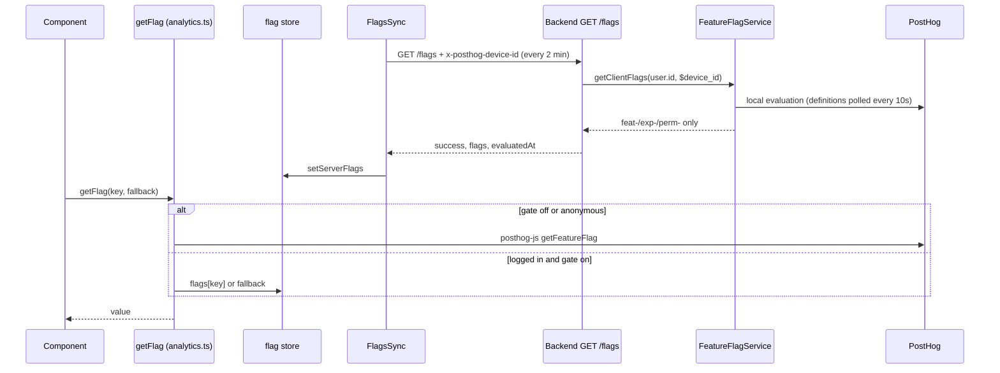

# Feature flags: how they work today

SpinQuest has three separate switching mechanisms. (1) PostHog flags read in the browser by the PostHog JS SDK, used for anonymous visitors and whenever the server-flag gate is off. (2) PostHog flags evaluated by the Backend with `posthog-node` and delivered to the logged-in web client through `GET /flags` or the login response. (3) Plain environment-variable switches (`ENABLE_*`, `VITE_APP_*`, `NEW_TERMS`, `PRODUCT`) read at boot or per call with no PostHog involved. PostHog flags are named by prefix (`feat-`, `exp-`, `perm-` go to the client; `ops-` stays on the server).

## At a glance

| Piece | Path |
|---|---|
| FE flag reader `getFlag` | `spinquest-frontend/src/lib/analytics.ts:109` |
| FE server-flag store (zustand, not persisted) | `spinquest-frontend/src/store/feature-flags.ts:34` |
| FE poller `FlagsSync` | `spinquest-frontend/src/features/feature-flags/flags-sync.tsx:32` |
| FE `GET /flags` client | `spinquest-frontend/src/lib/api/flags/index.ts:16` |
| FE query keys | `spinquest-frontend/src/lib/api/flags/keys.ts` |
| FE PostHog provider | `spinquest-frontend/src/lib/posthog.tsx:73` |
| FE identity + flag-clear owner | `spinquest-frontend/src/features/auth/auth-identity-sync.ts:54` |
| FE device-id header | `spinquest-frontend/src/lib/posthog-device.ts:16` |
| FE env schema | `spinquest-frontend/src/config/env.ts:67-83` |
| BE evaluator service | `Backend/src/services/FeatureFlagService.ts:66` |
| BE endpoint | `Backend/src/api/controllers/main/FlagsController.ts:24` (`GET /flags`) |
| BE login/signup embed | `Backend/src/api/controllers/main/AuthController.ts:79` (`resolveAuthFlags`) |
| BE kill-switch middleware | `Backend/src/api/middlewares/requireOpsFlag.ts:12` |
| BE controller boot gates | `Backend/src/api/express.ts:17-31, 82-86` |
| BE product gate | `Backend/src/api/decorators/ForProduct.ts`, `Backend/src/services/EnvironmentConfig.ts:98` |
| Runbook | `Backend/docs/feature-flags-runbook.md` |
| Vendor | PostHog (browser SDK `posthog-js`, server SDK `posthog-node`). No database tables. |

## The flow

### Mechanism 1: client-side PostHog (anonymous, or `ENABLE_SERVER_FLAGS` off)

1. `PostHogProviderWrapper` mounts `PostHogProvider` only when `env.ENABLE_POSTHOG` is true; otherwise it renders children unchanged (`spinquest-frontend/src/lib/posthog.tsx:74-80`).
2. A component or service calls `getFlag(key, fallback)` (`spinquest-frontend/src/lib/analytics.ts:109`). It is a plain function, not a hook.
3. `getFlag` goes to `readFromSdk`, which returns `posthog.getFeatureFlag(key)` or the fallback when the value is `undefined` or the SDK throws (`analytics.ts:34-45`).
4. The SDK auto-fires `$feature_flag_called`; `getFlag` does not (`analytics.ts:95`).

### Mechanism 2: server-evaluated, delivered to the client (`ENABLE_SERVER_FLAGS` on, logged in)

Path A, page load with a persisted session:

1. `AppProvider` runs `initAuthIdentitySync`, which calls `posthog.identify(user.id)` from the persisted user before anything else (`auth-identity-sync.ts:54-57`, `spinquest-frontend/src/app/providers/index.tsx:41-48`). `identify` is skipped if `ENABLE_POSTHOG` is false (`auth-identity-sync.ts:32`).
2. `FlagsSync` is mounted inside the provider tree (`app/providers/index.tsx:57`). Its React Query runs when `ENABLE_SERVER_FLAGS && userId && authToken` (`flags-sync.tsx:42`) and calls `GET /flags` with the `x-posthog-device-id` header when PostHog has a `$device_id` (`flags-sync.tsx:39`, `posthog-device.ts:16-25`).
3. Backend `FlagsController.getFlags` is `@Authorized({ api: 'user' })` (`FlagsController.ts:18`). It sanitizes the header (`/^[A-Za-z0-9_-]{1,200}$/`, `Backend/src/utils/analyticsDeviceId.ts:5-13`) into `personProperties: { $device_id }` and calls `getClientFlags(req.user.id, personProperties)` (`FlagsController.ts:31-35`).
4. `getClientFlags` calls `client.getAllFlags(userId, { onlyEvaluateLocally: true, personProperties })` and keeps only keys passing `isClientSafeFlag` (`FeatureFlagService.ts:198-205`): prefix in `feat-`, `exp-`, `perm-` and no `ops` segment (`FeatureFlagService.ts:16-28`). Returns `{ flags, evaluatedAt }`.
5. Response is `{ success: true, flags, evaluatedAt }` (`FlagsController.ts:36`). On success only, `FlagsSync` writes it into the store with `setServerFlags` (`flags-sync.tsx:47-51`).
6. It refetches every `TWO_MIN` (`flags-sync.tsx:43`), with `refetchOnWindowFocus: false`. The store keeps the last values on error (`flags-sync.tsx:17-21`).
7. A consumer calls `getFlag`. With the gate on and `hasAuthSession()` true, it reads only `useFeatureFlagsStore.getState().flags[key]`; a missing key returns the fallback. A present key fires one manual `$feature_flag_called` (deduped per distinct_id, key, value) (`analytics.ts:119-124`, `analytics.ts:64-81`). The SDK is never consulted while authenticated.

Path B, login or social signup:

1. `useLogin` and `useSocialRegister` send the device-id header only when `ENABLE_SERVER_FLAGS` is on (`features/auth/api/use-login.ts:46`, `use-social-register.ts:48`).
2. Backend `AuthController` login and `social-signup` call `resolveAuthFlags` (`AuthController.ts:148`, `AuthController.ts:261`). It returns `undefined` unless `GetBool('ENABLE_FLAGS_IN_AUTH_RESPONSE', false)`; otherwise it returns `getClientFlags` output. Everything is in a try/catch, so login never fails on flags (`AuthController.ts:79-98`). The field is spread in only when defined (`AuthController.ts:156`, `AuthController.ts:269`).
3. On success the client calls `setServerFlags(data.featureFlags)` if `ENABLE_SERVER_FLAGS && data.featureFlags` (`use-login.ts:60-62`, `use-social-register.ts:57-59`). The login branches for MFA or verification challenges return early with no flag write (`use-login.ts:50-53`).
4. Because the auth store changes `user.id` null to X, `initAuthIdentitySync` identifies the user in PostHog (`auth-identity-sync.ts:65-66`). `FlagsSync` then starts its query too (key `['flags', userId]`, `keys.ts`).

Path C, logout: `resetAuth()` sets `user.id` to null; `initAuthIdentitySync` calls `posthog.reset()` and `clearServerFlags()` (`auth-identity-sync.ts:41-52`). `useLogout` invalidates `flagKeys.all` and calls `window.location.reload()` (`features/auth/api/use-logout.ts:19-25`).

### Mechanism 2b: Backend-only reads (no client involvement)

1. Services call `featureFlagService.isEnabled(flag, userId, default)` or `getVariant`; both use `evaluateFlags(..., { onlyEvaluateLocally: true })` and return the caller's default on a null client or any error (`FeatureFlagService.ts:103-147`).
2. `ops-` kill-switches use either the shared id `OPS_DISTINCT_ID = 'ops-flag-evaluator'` (`FeatureFlagService.ts:12`) or a real user id (see Gaps).
3. Definitions are fetched at boot via `warmup()` before the HTTP listener starts (`Backend/src/index.ts:40-43`) and polled every 10s (`FeatureFlagService.ts:8`).

### Mechanism 3: env-var switches

1. Controller boot gates: each `ENABLE_*_API` key decides whether that controller directory is globbed at startup (`Backend/src/api/express.ts:82-86`). Note `admin` and `main` share `ENABLE_MAIN_API` (`express.ts:18, 26`); `status` is always loaded (`express.ts:31`).
2. Product gate: `@ForProduct('sweeps' | 'cards')` tags a controller class; untagged controllers serve every product (`Backend/src/api/decorators/ForProduct.ts`). `loadControllers` filters by `GetProduct()` for HTTP and cron controllers (`express.ts:46-52, 93, 109`). `PRODUCT` is `sweeps` (default) or `cards` (`EnvironmentConfig.ts:98-100`).
3. Per-call switches: `NEW_TERMS` (`Backend/src/services/TermsService.ts:218, 255`; `Backend/src/services/AuthService.ts:317`).
4. Frontend: `env.ENABLE_MFA`, `env.ENABLE_POSTHOG`, `env.ENABLE_SERVER_FLAGS`, `env.ENABLE_SENTRY` are parsed as `val === 'true'` booleans (`config/env.ts:62-83`). `env.PRODUCT` is `casino | cards` (`config/env.ts:48`).

### Which one to use

- Server-enforced behaviour that must not depend on the browser (kill-switches, payments, anything hitting a third party): PostHog `ops-` flag read in the Backend with default `false`. Runbook: ops flags 0% or 100% only (`Backend/docs/feature-flags-runbook.md:206-211`).
- Gradual rollout, experiment, or entitlement that changes UX: `feat-`, `exp-`, `perm-` PostHog flag, read on the client through `getFlag` and, if the server also enforces it, through `isEnabled` (the `feat-mfa` pattern).
- Per-deployment topology or a boot-time toggle that must not change at runtime (which controllers exist, product, terms enforcement): env var. The runbook lists `ENABLE_*_API` as boot gates, not runtime flags (`feature-flags-runbook.md:458`).
- Never flag legal gates: GeoComply, blocked states, KYC redemption, AMOE, break-in-play (`feature-flags-runbook.md:449-457`; `analytics.ts:100`).

### Adding a new flag end to end

1. Create the flag in PostHog Staging at 0%, name it with the right prefix (`feature-flags-runbook.md:12-17, 144`).
2. Backend, if it enforces: inject `FeatureFlagService` and call `isEnabled('feat-x', userId, false)`; use `evaluateAll` when reading several per request (`FeatureFlagService.ts:151`).
3. Frontend: call `getFlag('feat-x', false)` in a leaf component or service (not a layout that parents the game `<Outlet/>`, `store/feature-flags.ts:16-19`). Use a constant for the key, as `MFA_FEATURE_FLAG` does (`features/mfa/constants.ts:4`).
4. No allowlist edit is needed: any `feat-`/`exp-`/`perm-` key without an `ops` segment is serialized automatically (`FeatureFlagService.ts:25-28`).
5. If the flag targets on a person property, it will be silently omitted from the client payload; only `$device_id` is passed (`feature-flags-runbook.md:362-369`).
6. If it must bucket the same before and after login, set "Match by Device" in PostHog (`feature-flags-runbook.md:371-383`).
7. Remove the flag and both code paths at 100% (`feature-flags-runbook.md:193`).

## States and data

- No database tables. Flag state lives in PostHog and in two in-memory places: the `posthog-node` definition cache (per Backend pod) and the zustand store `{ flags: Record<string, boolean | string>, evaluatedAt: string | null }` (`store/feature-flags.ts:27-32`).
- Store writers: `FlagsSync` (`flags-sync.tsx:49`), `useLogin` and `useSocialRegister` (above), cleared by `initAuthIdentitySync` (`auth-identity-sync.ts:50`). It is deliberately not persisted, so every cold load starts empty (`store/feature-flags.ts:12-15`).
- Backend decoding: `decodeBool` treats only a literal `false` as off; a string variant counts as on; `undefined` gives the default (`FeatureFlagService.ts:43-49`). `decodeVariant` returns a string value or the default (`FeatureFlagService.ts:51-56`).
- `getClientFlags` omits a flag it cannot evaluate rather than defaulting it (`FeatureFlagService.ts:178-182`).

## Configuration

Frontend (`spinquest-frontend/src/config/env.ts`, `.env.example` uses the `VITE_APP_` prefix):

| Key | Read at | Effect |
|---|---|---|
| `ENABLE_POSTHOG` | `lib/posthog.tsx:74`, `auth-identity-sync.ts:32,42`, `components/common/error-boundary/index.tsx:10` | Mounts the SDK provider; gates identify/reset. Default false (`env.ts:70-73`). |
| `PUBLIC_POSTHOG_KEY`, `PUBLIC_POSTHOG_HOST` | `lib/posthog.tsx:36,77` | SDK key and host. Both required strings in the schema (`env.ts:68-69`). |
| `ENABLE_SERVER_FLAGS` | `analytics.ts:117`, `flags-sync.tsx:42`, `use-login.ts:46,60`, `use-social-register.ts:48,57`, `auth-identity-sync.ts:49` | Switches logged-in reads from SDK to server store. Default false (`env.ts:76-79`). |
| `ENABLE_MFA` | `features/mfa/constants.ts:7` | ANDed with `feat-mfa` for the client check (`env.ts:80-83`). |
| `PRODUCT` (`casino` or `cards`) | `config/env.ts:48` | Product selection. Where it is consumed was not traced. |
| `SOCIAL_CASINO` | `utils/domain/is-social-casino.ts:7` | Dev-only; in non-dev builds the function returns `true || host.endsWith('.com')`, i.e. always true (`is-social-casino.ts:13`). |

Backend:

| Key | Read at | Effect |
|---|---|---|
| `ENABLE_POSTHOG` | `FeatureFlagService.ts:70` | Off: no client created, every read returns the default. |
| `POSTHOG_API_KEY`, `POSTHOG_PERSONAL_API_KEY` | `FeatureFlagService.ts:78-79` | Required when enabled; the personal key enables local evaluation. `POSTHOG_HOST` defaults to `https://us.i.posthog.com` (`:80`). |
| `ENABLE_FLAGS_IN_AUTH_RESPONSE` | `AuthController.ts:88` | Embeds `featureFlags` in login and social-signup responses. Default false. |
| `ENABLE_MAIN_API`, `ENABLE_GAME_API`, `ENABLE_VERIFF_API`, `ENABLE_AEROPAY_API`, `ENABLE_ALEA_API`, `ENABLE_BGAMING_API`, `ENABLE_ICONIC21_API`, `ENABLE_LINKMONEY_API`, `ENABLE_PAYTECH_API`, `ENABLE_PETERSONS_API`, `ENABLE_SWEEPIUM_API`, `ENABLE_MOCKSERVICES_API` | `express.ts:18-30, 82-86` | Controller directory registration at boot. `.env.example:29-41` also lists `ENABLE_FUNDIST_API`, which does not appear in the `express.ts` table. |
| `PRODUCT` | `EnvironmentConfig.ts:98-100`, `express.ts:93,109`, `utils/geolocation.ts:20`, `AppsController.ts:114`, `StatusController.ts:134` | `sweeps` default or `cards`. |
| `NEW_TERMS` | `TermsService.ts:218,255`, `AuthService.ts:317` | Off: terms enforcement returns "current" and signup does not require acceptance. |

PostHog flag keys found in code:

| Key | Read where | Gates |
|---|---|---|
| `feat-mfa` | BE `MfaController.ts:116` (all MFA routes 403 when off), BE `MfaService.ts:226` (login and action-gate enforcement); FE `features/mfa/constants.ts:4,7` used by `mfa-account-row.tsx:109`, `use-mfa-prompt.ts:28`, `vault-modal/withdraw.tsx:9` | MFA availability and enforcement. Read on both sides. |
| `exp-geo-init-explainer` | FE `lib/api/geolocation/service.ts:29,34` | A/B: `'show'` opens an explainer before the browser location prompt; default `'control'`. |
| `ops-require-2fa` | BE `LoginCodeService.ts:27,163` | Email login code required at login, unless MFA is enforced (`:171`). Read with the user id. |
| `ops-singular-events` | BE `SingularService.ts:17`, `AsyncShopPackageService.ts:56`, `singularEmissionSweeperController.ts:114` | Enqueue and send of Singular events. Off holds rows in the sweeper (`:119-121`). |
| `ops-merch-redemption` | BE `Merch/constants.ts:8`, `MerchEnabledMiddleware.ts:18`, `MerchCatalogService.ts:58` | Merch cart and order controllers, and merch eligibility. |
| `ops-slack-<channel>` | BE `SlackService.ts:21,90-91` | Per-channel Slack notify, read with `OPS_DISTINCT_ID`. |

Frontend `getFlag` refuses any `ops-` key and returns the fallback (`analytics.ts:115`). The only direct FE `getFlag(` call sites outside tests are the MFA and geolocation ones above (grep of `src/`).

## Edge cases and failure handling

- PostHog disabled on Backend: `client` stays null; `isEnabled`, `getVariant` return the caller default; `evaluateAll` returns a default scope; `getClientFlags` returns `{ flags: {}, evaluatedAt }` (`FeatureFlagService.ts:70-75, 109, 132, 155, 195`).
- Client construction throws: logged, client stays null, same fail-closed behaviour (`FeatureFlagService.ts:91-100`).
- Evaluation throws: each method logs a warning and returns the default; `getClientFlags` logs only `userId` (`FeatureFlagService.ts:117-123, 207-213`).
- Cold pod: until `warmup()` resolves, local evaluation returns an empty batch (`FeatureFlagService.ts:222-236`). Warmup failure is logged and flags serve defaults until the next 10s poll.
- Missing `POSTHOG_API_KEY` while enabled: `GetString` is read outside the try so startup fails (`FeatureFlagService.ts:77-80`).
- Frontend with PostHog off or blocked: SDK path returns the fallback (`analytics.ts:38-44`); `deviceIdHeaders` returns `{}` (`posthog-device.ts:22`).
- Frontend authenticated with a cold store, or a 401 on refetch: `getFlag` returns the fallback and never re-buckets via the SDK (`analytics.ts:90-93, 119-121`). Failed refetches do not clear the store.
- Flag reaches an active session within about 10s (BE poll) plus up to 2 minutes (FE poll) (`flags-sync.tsx:22-24`).
- `requireOpsFlag` returns 503 with the standard error envelope when the flag is off or on error (`requireOpsFlag.ts:27-33`). The file header says never apply it to GeoComply, blocked states, KYC, AMOE or break-in-play (`requireOpsFlag.ts:1-3`).
- Shutdown drains the PostHog queue for 4.5s (`FeatureFlagService.ts:7, 216-220`, `shutdown.ts:75`).
- Bad device-id header: dropped to `undefined`, evaluation proceeds without device bucketing (`analyticsDeviceId.ts:10-11`).
- `MfaService.isEnforced` returns false when the flag read fails, so MFA goes dormant (`MfaService.ts:225-229`).

## What the team has already said

- MFA going dormant when `feat-mfa` cannot be read is "by design" and a decision to confirm, not a bug: `central-tech/drafts/legacy-parity-inventory.md:47-48`, `central-tech/drafts/backend-bugs.md:170`.
- Parity inventory: `/users/mfa` routes answer 403 unless `feat-mfa` is on (`central-tech/drafts/legacy-parity-inventory.md:239`, marked "drop"); MFA enforcement flag row at `:240`. Login `featureFlags` in the response is marked "change", with the open question "shared or per product" (`legacy-parity-inventory.md:170`).
- One PostHog project is shared by every sbx Backend, so `ops-require-2fa` read untargeted turns on for all nine previews at once: `central-tech/TODO.md:222`. Related: analytics-backend uses one PostHog key for every product (`central-tech/TODO.md:585`).
- Log levels are the only setting not yet on PostHog; moving them is deferred under "feature flags as a central concern": `central-tech/TODO.md:672-679`.
- `feat-mfa` off in prod would drop Backend's MFA gate on `/shop/redemption`: `central-tech/TODO.md:823`. Whether `feat-mfa` is on in production is an open question: `central-tech/drafts/legacy-rest-audit.md:124`.
- `ops-require-2fa` is on for pr-863: `central-tech/TODO.md:955`.
- Backend runbook covers taxonomy, canary steps, the `ENABLE_FLAGS_IN_AUTH_RESPONSE` rollout, and a pre-canary login-latency decision (up to the 10s SDK timeout if PostHog was unreachable at boot): `Backend/docs/feature-flags-runbook.md:411-447`. It also states there is no rate-limit middleware on `GET /flags` (`:393-398`).

## Gaps, oddities, and risks

- `requireOpsFlag` is defined and documented as the per-route kill-switch, but a grep of `Backend/src` finds no call site outside its definition. The runbook example shows it wired in `express.ts` (`feature-flags-runbook.md:214-224`); the code does not.
- `ops-merch-redemption` is read with the real user id in `MerchEnabledMiddleware.ts:18` and `MerchCatalogService.ts:58`, while the runbook says ops flags must use the synthetic id and be 0% or 100% (`feature-flags-runbook.md:206-211`). A percentage rollout would therefore bucket per user. The same applies to `ops-require-2fa` (`LoginCodeService.ts:163`) and `ops-singular-events` (`AsyncShopPackageService.ts:56`, `singularEmissionSweeperController.ts:114`).
- The `ops-` prefix is documented as the "never sent to the client" class, yet `ops-require-2fa` and `ops-merch-redemption` are used as per-user flags. Inferred: this blurs the taxonomy in `FeatureFlagService.ts:14-16`.
- Runbook names the validator `sanitizeDeviceId` in `src/utils/deviceId.ts` (`feature-flags-runbook.md:376`); the code has `sanitizeAnalyticsDeviceId` in `src/utils/analyticsDeviceId.ts`. The file lists no `deviceId.ts`.
- `feat-mfa` needs three switches on the client to show MFA: `ENABLE_MFA`, `ENABLE_SERVER_FLAGS` (otherwise SDK path), and the flag (`features/mfa/constants.ts:7`). The Backend needs only the flag.
- Client reads of `feat-mfa` when `ENABLE_SERVER_FLAGS` is off use the browser SDK, which may bucket on a different id than the Backend before identify; the Backend always uses `user.id` (`FlagsController.ts:33`). Inferred: this can disagree for a user between FE UI and BE 403.
- Three FE env keys (`ENABLE_POSTHOG`, `ENABLE_SERVER_FLAGS`, `ENABLE_MFA`) and two BE keys (`ENABLE_POSTHOG`, `ENABLE_FLAGS_IN_AUTH_RESPONSE`) must be set consistently across both repos for the server-flag path to work; nothing validates this.
- `getIsSocialCasino` returns `true || host.endsWith('.com')`, so the `.com` check is dead code (`utils/domain/is-social-casino.ts:13`).
- `ENABLE_FUNDIST_API` is in `Backend/.env.example:29` but absent from the controller table in `express.ts:17-31`. Inferred: stale or consumed elsewhere; not traced.
- `ENABLE_MAIN_API` gates both `admin` and `main` controllers (`express.ts:18, 26`); admin cannot be enabled separately.
- Backend `evaluateAll` has no non-test caller in `Backend/src` (grep). Unused so far.

## Not verified

- Actual PostHog flag definitions, rollout percentages, and which flags exist beyond those referenced in code.
- Deployed values of `ENABLE_POSTHOG`, `ENABLE_SERVER_FLAGS`, `ENABLE_FLAGS_IN_AUTH_RESPONSE`, `ENABLE_MFA`, `PRODUCT`, `NEW_TERMS` per environment.
- The native app: whether it reads flags, sends `x-posthog-device-id`, or uses the login `featureFlags` field. The Backend login path takes the header for any client (`AuthController.ts:261-269`); the app side could not be read.
- Frontend tests in `src/features/feature-flags/` (`embed-first-paint.test.tsx`, `compliance-isolation.test.ts`) were not opened; their coverage is not described here.
- Where frontend `env.PRODUCT` is consumed, and whether any `VITE_APP_*` flag beyond those in `.env.example` is used.
- `.claude/rules/frontend/feature-flags.md`, which the code comments cite as the taxonomy contract, was not located or read.
- Whether `Backend/tests/compliance/middleware-isolation.test.ts` (cited by the runbook) exists and passes.
