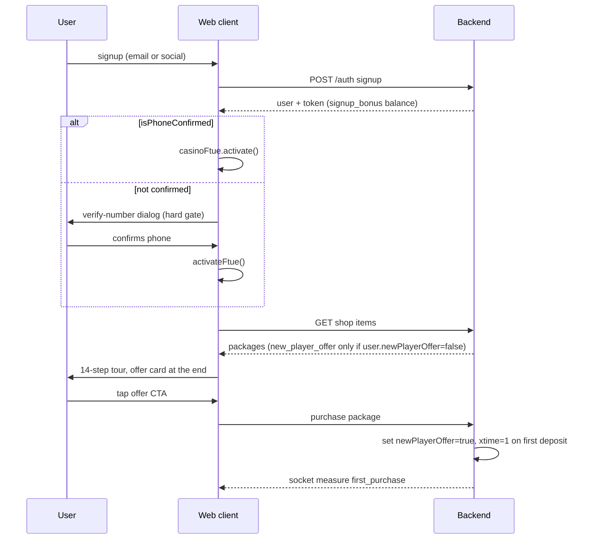

# First-time user experiences (FTUE): how they work today

SpinQuest has two real guided tours: a casino lobby tour that runs once right after signup and keeps its "seen" state only in memory, and a cards tour whose state lives in a front-end mock that persists to `localStorage`. First-time pricing is separate and server-driven: three one-time shop offers are tracked by boolean columns on `User`, and the first settled deposit is marked by `PaymentTransaction.xtime = 1`. There is no server field for "has completed the tour", no PostHog flag gating either tour, and no analytics event fired by either tour.

## At a glance

| Piece | Path |
|---|---|
| Casino tour mount | `spinquest-frontend/src/features/casino/components/casino-ftue/casino-ftue.tsx:24` (rendered at `spinquest-frontend/src/features/casino/components/lobby/index.tsx:225`) |
| Casino tour state (zustand, not persisted) | `spinquest-frontend/src/features/casino/components/casino-ftue/casino-ftue.store.ts:41` |
| Casino tour steps | `spinquest-frontend/src/features/casino/components/casino-ftue/casino-ftue.constants.ts:393` (`FULL_MODE_STEPS`), `:407` (`GOLD_COINS_ONLY_STEPS`) |
| Casino tour controller | `spinquest-frontend/src/features/casino/components/casino-ftue/components/casino-ftue-controller.tsx:48` |
| Tour activation on signup | `spinquest-frontend/src/features/auth/api/use-register.ts:20`, `spinquest-frontend/src/features/auth/api/use-social-register.ts:32`, `spinquest-frontend/src/features/auth/components/verify-number-otp/index.tsx:69` |
| Cards tour controller | `spinquest-frontend/src/features/spinquest-cards/components/cards-ftue/cards-ftue-controller.tsx:28` (mounted at `.../cards-hero-cta/index.tsx:106`) |
| Cards tour state and welcome pack (mock) | `spinquest-frontend/src/features/spinquest-cards/api/mock-service.ts:32`, `:336`, `:374` |
| Cards hooks over the mock | `spinquest-frontend/src/features/spinquest-cards/api/use-cards-ftue.ts:12`, `.../use-cards-shop.ts:21` |
| Welcome offer UI on the landing page | `spinquest-frontend/src/features/landing/primitives/sticky-offer-badge/index.tsx:150`, `spinquest-frontend/src/features/landing/sections/welcome-offer-bar/index.tsx:5` |
| One-time shop offers (eligibility) | `Backend/src/services/ShopPackageService.ts:95` (`checkShopPackage`) |
| One-time offer flags set on payment | `Backend/src/services/AsyncShopPackageService.ts:198-211`, `Backend/src/services/ShopPackageService.ts:228` |
| User columns | `Backend/src/db/entity/User.ts:343` (`oneTime50KGC`), `:346` (`newPlayerOffer`), `:349` (`first15minutes`), `:307` (`pushNotificationsBonus`) |
| First deposit marker | `Backend/src/db/entity/Payment/PaymentTransaction.ts:95` (`xtime`) |
| Signup bonus | `Backend/src/services/AuthService.ts:283`, `:375` (JsonConfig row `signup_bonus`) |
| MFA one-time offer | `spinquest-frontend/src/features/mfa/prompt-seen.ts:16`, `spinquest-frontend/src/features/mfa/hooks/use-mfa-prompt.ts:32` |
| Welcome card bundle (unused) | `Backend/src/services/Cards/CardAcquisitionService.ts:105` |
| Vendors | PostHog (only via the generic socket `measure` bridge), Singular (FTD event), Meta and Snapchat pixels (`InitiateCheckout` on first deposit) |

## The flow

### A. Casino lobby tour (product `casino`)

1. User signs up by email (`useRegister`) or social (`useSocialRegister`). On success, if `user.isPhoneConfirmed` is already true, the client calls `useCasinoFtueStore.getState().activate()` (`spinquest-frontend/src/features/auth/api/use-register.ts:20-23`, `spinquest-frontend/src/features/auth/api/use-social-register.ts:32-35`). The signup request itself is `postAuthSignup` / social-signup; the Backend creates the user and the balance with the `signup_bonus` gold coins and diamonds (`Backend/src/services/AuthService.ts:375-380`).
2. If the phone is not confirmed, the verify-number dialog is a hard gate. While the tour is not active and the user is unconfirmed, the dialog opens; when the user later confirms, `wasUnconfirmedRef` is true, the dialog closes and `activateFtue()` runs (`spinquest-frontend/src/features/auth/components/verify-number-otp/index.tsx:46-70`). The comment at `:40-43` states the intent: phone verification first, tour second.
3. `activate()` forces the selected coin to gold, then sets `active: true, completed: false, step: 0` (`casino-ftue.store.ts:47-55`).
4. `CasinoFtue` is rendered inside the casino lobby (`lobby/index.tsx:225`). It renders nothing unless `active && user` and the viewport is not short mobile landscape; in that landscape case it calls `skip()` (`casino-ftue.tsx:33-40`).
5. The lazy `CasinoFtueController` picks `GOLD_COINS_ONLY_STEPS` when `useIsGoldCoinsOnly()` is true, else `FULL_MODE_STEPS` (`casino-ftue-controller.tsx:67-70`). Steps, in order: `welcome`, `modes`, `goldMode`, `toggleCoin`, `sweepsInfo`, `redeemSC`, `visitShop`, `liveSupport`, `dailyBonus`, `tryTap`, `coinsBurst`, `rewardReceived`, `offerDrop`, `offerSquash` (`casino-ftue.constants.ts:50-373`). The gold-only list is a filter of the same array (`:407`).
6. The tour looks up the shop package whose `discount === 'new_player_offer'` from `useShopItems()` (`casino-ftue-controller.tsx:54-58`). If the shop has finished loading and there is no such package (the user already bought it, so `checkShopPackage` hides it), the tour calls `skip()` at the offer steps (`:110-115`). The offer CTA opens the shop package dialog for that package (`:188-198`).
7. The tour ends through `next()` past the last step (sets `completed: true, active: false, exitReason 'finished'`) or `skip()` (`exitReason 'skipped'`) (`casino-ftue.store.ts:57-95`). Nothing is written to the server or to storage.
8. Logout calls `useCasinoFtueStore.getState().reset()` and then reloads the page (`spinquest-frontend/src/features/auth/api/use-logout.ts:15`, `:25`).

### B. Cards tour (product `cards`)

1. `CardsFtueController` is mounted in the cards home hero (`.../cards-hero-cta/index.tsx:106`) and returns null without a user (`cards-ftue-controller.tsx:19-21`).
2. It reads `useCardsFtueStateQuery()`. After a 500 ms delay, if `tourCompleted` is false it opens the tour once per mount (`cards-ftue-controller.tsx:39-53`). A `manualLaunchToken` prop can open it on demand (`:55-64`).
3. When the tour opens, `useFtueFlow` claims the welcome pack unless `welcomePack.claimed` is already true (`use-ftue-flow.ts:48-72`, calling `claimCardsWelcomePack`).
4. On exit it calls `completeCardsFtue({ exitReason })`, then, if `welcomeOfferShown === false`, opens `WelcomeOfferDialog` (`use-ftue-flow.ts:76-81`, `cards-ftue-controller.tsx:66-71`).
5. Every one of these calls goes to `mock-service.ts`, not to the Backend (`use-cards-ftue.ts:5-10`, `use-cards-shop.ts:21-23`). `getCardsFtueState` returns an in-memory object; `completeCardsFtue` and `markCardsFtueWelcomeOfferShown` write it to `localStorage` key `cards.ftue.state.v1` (`mock-service.ts:32`, `:73`, `:374-407`). Inferred: the key is not scoped by user id, so it is shared by every account on the same browser.
6. The Backend has no welcome-pack route: the `Cards` controllers expose only `GET /collection`, `GET /definitions`, `GET /team`, `PUT /team` (`Backend/src/api/controllers/main/Cards/UserCardController.ts:19`, `.../CardDefinitionController.ts:15`, `:21`, `.../UserTeamController.ts:29`, `:40`). `CardAcquisitionService.welcomeBundle` exists, but nothing calls it (grep over `Backend/src` finds only its definition at `CardAcquisitionService.ts:105`).

### C. First-purchase and one-time shop offers (server-driven)

1. `ShopPackageService.checkShopPackage` rejects a package when: discount `new_player_offer` and `user.newPlayerOffer`; discount `first_15_minutes` and (`user.first15minutes` or the account is older than `FIFTEEN_MINUTE`); discount `one_time_offer_50k_gc` and `user.oneTime50KGC` (`Backend/src/services/ShopPackageService.ts:95-108`).
2. A zero-price package (the 50K gold coin offer) sets `oneTime50KGC = true` inside a SERIALIZABLE transaction at claim time (`ShopPackageService.ts:224-232`).
3. For paid packages, `addCoinsToBalance` sets `newPlayerOffer = true` or `first15minutes = true` on the user when the settled package carries that discount (`AsyncShopPackageService.ts:198-211`). It also swaps to a non-discount package of the same price if `newPlayerOffer` is already set (`:114-120`, partial read).
4. When a provider webhook marks a deposit COMPLETED and the row has no `xtime`, the provider service writes `xtime = (max xtime of this user's deposits) + 1`. Paytech: `Backend/src/services/Payments/paytech/PaytechService.ts:700-727`. Linkmoney: `Backend/src/services/Payments/linkmoney/LinkmoneyService.ts:595-620`. Aeropay sets it at `Backend/src/services/Payments/aeropay/AeropayService.ts:440`.
5. `xtime === 1` triggers: a Singular `FTD` emission deduped by `ftd:<userId>` (`AsyncShopPackageService.ts:86-93`), Meta `InitiateCheckout` (`:255`), and a socket `measure` event `first_purchase` in addition to `purchase` (`Backend/src/services/socketEmiter/ActionService.ts:41-52`, called at `AsyncShopPackageService.ts:301-304`).
6. The web client forwards every `measure` socket event to GTM and PostHog through `trackEvent` (`spinquest-frontend/src/lib/socket/index.tsx:78-80`, `:101`, `spinquest-frontend/src/lib/analytics.ts:24-32`).

### D. Other one-time prompts

- MFA offer: shown at most once per user per device after a deposit, withdraw, or redemption, if `mfaEnabled === false` and the MFA flag is on. Marked seen on show, stored in `localStorage` key `sq:mfa-prompt-seen:<userId>` with an in-memory fallback (`use-mfa-prompt.ts:28-37`, `prompt-seen.ts:1-34`, callers `vault-modal/deposit.tsx:97`, `vault-modal/withdraw.tsx:130`, `wallet/components/redeem/redemption-submitted-modal.tsx:118`).
- Push-notification bonus: a one-time reward guarded by `pushNotificationsBonus` (`Backend/src/services/UserService.ts:611-612`, `Backend/src/services/RewardsService.ts:542-555`, column at `User.ts:307`). The enabling UI is native-app side and was not read.
- Landing page "welcome offer" badge is static marketing art ("30 coin pack for just 10, one time offer") that opens signup (`sticky-offer-badge/index.tsx:147-152`). It reads no user state. The `WelcomeOfferBar` text is a generic tagline (`welcome-offer-bar/index.tsx:9-12`).
- Shop banner copy "on first purchase" is hard-coded text (`spinquest-frontend/src/features/shop/components/shop-banner.tsx:369`).

## Where a new first-time experience would fit

Everything below is a suggestion built from existing mechanisms, not something in the code.

1. **No post-login modal queue exists.** `src/features/smart-modal-navigation/` is a route-to-modal mapper for desktop deep links (`constants/modal-routes.ts`, `store/desktop-modal.store.ts`, `loaders/desktop-modal-deep-link-loader.ts`). Inferred: it decides how a URL opens as a modal, and does not sequence prompts after login. Existing first-time prompts are independent: the casino tour is gated by its own store, the MFA offer by `useMfaPrompt`, the phone dialog by an effect in `verify-number-otp/index.tsx:46-70`. A new experience that must not collide with these would have to read `useIsCasinoFtueActive()` (`casino-ftue.store.ts:105`) the way the hero does (`casino-lobby-hero/index.tsx:106-108`) or the phone gate does (`verify-number-otp/index.tsx:56-58`).
2. **Trigger.** The code's pattern is: flip a store flag from a signup success callback (`use-register.ts:20`, `use-social-register.ts:32`) or from the post-phone-verification effect (`verify-number-otp/index.tsx:69`). A "first login" or "first visit to screen X" trigger has no existing hook; a screen-level trigger would follow the `CardsFtueController` pattern of a controller mounted on the screen that checks a state query (`cards-ftue-controller.tsx:45-53`).
3. **"Already seen" storage, by durability** (the three patterns in code):
   - In-memory store: lost on refresh (casino tour, `casino-ftue.store.ts:7-12`).
   - `localStorage`, per device: survives logout and refresh, not a new device or browser (MFA prompt, `prompt-seen.ts:9-15`, which itself says the backend has no field for it).
   - Server column on `User`: survives everything, set transactionally (`newPlayerOffer`, `first15minutes`, `oneTime50KGC`, `pushNotificationsBonus`; `User.ts:307-349`). This is the only pattern that works across web and the native app. It needs a TypeORM migration (see `Backend/src/db/migration/`) and the field returned on `GET /users`.
4. **Gating a rollout.** Use a `feat-` or `exp-` PostHog flag read with `getFlag(key, fallback)` (`spinquest-frontend/src/lib/analytics.ts:109`). Flags reach the logged-in client through `GET /flags` and the login response; see `personal-docs/feature-flags.md`. The only first-time-related flag key in the repo is `exp-geo-init-explainer`, which appears only in tests (`spinquest-frontend/src/lib/analytics.test.ts:78`, `spinquest-frontend/src/features/feature-flags/embed-first-paint.test.tsx:69`); no production code reads it (grep of non-test files finds nothing).
5. **Measuring it.** Neither tour fires events (no `trackEvent`, `capture`, or `posthog` references under either `casino-ftue/` or `cards-ftue/`). The available channel is `trackEvent(data)` (`analytics.ts:24`), which pushes to GTM and PostHog, or a server-emitted socket `measure` event as `first_purchase` is (`ActionService.ts:41-52`). Funnel steps for step views, skip, and finish would need to be added.
6. **First-purchase-based experiences.** The cleanest existing signal is `PaymentTransaction.xtime === 1` and the `first_purchase` socket event, plus `User.newPlayerOffer`. Pricing eligibility belongs in `checkShopPackage` (`ShopPackageService.ts:95`) and the matching flag write in `AsyncShopPackageService.ts:198`, so both paths stay in sync (the second copy at `:114` is a separate branch to check).
7. **Replaying.** The casino store comment says a replay control only needs to call `activate()` (`casino-ftue.tsx:19-23`); the cards controller already accepts `manualLaunchToken` (`cards-ftue-controller.tsx:11`, `:55-64`).

## States and data

| State | Values | Written by | Lives in |
|---|---|---|---|
| `CasinoFtueState` | `active`, `completed`, `step`, `exitReason` (`'finished'`, `'skipped'`, `null`), `stepIds` | `activate`, `next`, `skip`, `skipToStep`, `reset` (`casino-ftue.store.ts:47-102`) | Memory only |
| `CardsFtueState` | `tourCompleted`, `welcomeOfferShown`, `completedAt`, `exitReason` (`finished`, `skipped`, `dismissed`) | `completeCardsFtue`, `markCardsFtueWelcomeOfferShown` (`mock-service.ts:377-407`) | Memory plus `localStorage` `cards.ftue.state.v1` |
| Cards welcome pack | `claimed`, `grantedAt` | `claimCardsWelcomePack` (`mock-service.ts:339-363`) | Memory only (reset on reload; the persisted object holds only the FTUE state at `:51-62`) |
| `User.newPlayerOffer` | boolean, default false | `AsyncShopPackageService.ts:198-203` | Postgres |
| `User.first15minutes` | boolean, default false | `AsyncShopPackageService.ts:206-211` | Postgres |
| `User.oneTime50KGC` | boolean, default false | `ShopPackageService.ts:228` | Postgres |
| `PaymentTransaction.xtime` | null, or Nth settled deposit of the user | Paytech, Linkmoney, Aeropay services (paths above) | Postgres |
| MFA seen | `'1'` under `sq:mfa-prompt-seen:<userId>` | `markMfaPromptSeen` | `localStorage` per device |

Survival of each "seen" marker: casino tour state does not survive refresh, logout (explicit `reset()`), or a new device. Cards tour state survives refresh and logout in the same browser but not a new device, and is not user-scoped (Inferred, key has no user id). Server columns survive all of it. The native app cannot be assessed (see Not verified).

## Configuration

| Item | Where read | Effect |
|---|---|---|
| `PRODUCT` (`casino` or `cards`) | `spinquest-frontend/src/config/env.ts:48`, `:37-38` | Selects which product's routes and therefore which tour mounts. Inferred: the casino lobby only exists in the casino product and the cards hero only in the cards product. |
| `signup_bonus` JsonConfig row | `Backend/src/services/AuthService.ts:283-288` | Gold coins and diamonds given at signup; the row name is also in the enum at `Backend/src/db/entity/JsonConfig.ts:10`. |
| `FIFTEEN_MINUTE` | `Backend/src/services/ShopPackageService.ts:26` (import), `:102` | Window for the `first_15_minutes` discount. |
| `ENABLE_MFA` and `MFA_FEATURE_FLAG` | `spinquest-frontend/src/features/mfa/constants.ts:6-7` | Gates the one-time MFA offer. |
| `FTUE_LOCALSTORAGE_PERSISTENCE_DISABLED` | `spinquest-frontend/src/features/spinquest-cards/api/mock-service.ts:37` | Currently `false`. A TODO says it is a testing switch to turn off persistence. |
| Landscape media query | `casino-ftue.tsx:7-8` | Tour auto-skips on short mobile landscape. |

No PostHog flag or env key gates either tour.

## Edge cases and failure handling

- Shop still loading when the tour reaches the offer steps: the tour waits (`isShopPending`) and only skips once loading ends with no offer package (`casino-ftue-controller.tsx:110-115`).
- User already bought the new-player offer: `checkShopPackage` hides it (`ShopPackageService.ts:96-98`), so the tour drops the offer steps.
- Signup with phone unconfirmed while off the casino route: user is redirected to `ROUTES.CASINO_LOBBY` and the verify dialog opens; dismiss attempts are swallowed (`verify-number-otp/index.tsx:49-52`, `:84-86`).
- Tour is not keyed on `isOpen`, so closing the dialog does not retrigger it (`verify-number-otp/index.tsx:40-43`).
- `localStorage` failure for the cards tour is swallowed silently (`mock-service.ts:74-76`); for MFA it falls back to a per-page in-memory set (`prompt-seen.ts:31-33`).
- A tour interrupted by refresh is not resumed (`casino-ftue.store.ts:10-12`).
- `completeCardsFtue` and the welcome-offer mark are idempotent in the mock (`mock-service.ts:380-382`, `:397-399`).
- `isFirstPurchase` socket emission is wrapped in try/catch in the purchase path (`AsyncShopPackageService.ts:300` onward, partial read).
- Geo, KYC, and terms gates were not traced against the tours.

## What the team has already said

- `central-tech/drafts/rips-qa-plan-gaps.md:71` lists "Tutorial (A7)" under "No answer yet" for the Rips product (a different product from the two tours above; Inferred from the "Repackz" and "Grail" context at `:60-70`).
- `central-tech/drafts/spinquest-on-central.md:69`, `central-tech/drafts/cutover-copy.md:90-91`, and `central-tech/building/new-core-stack/account-columns.md:47` list `oneTime50KGC`, `newPlayerOffer`, `first15minutes` among the user columns carried into the migration. No document discusses the FTUE tours or `xtime`.
- Nothing found on the casino tour, cards tour, welcome bundle, or first-purchase experience in `Backend/docs/`.

## Gaps, oddities, and risks

- The cards tour and welcome pack run against a mock. A real account's `localStorage` decides whether the tour shows, and the welcome-pack "claim" grants cards only in browser memory. The Backend `welcomeBundle` is not wired to any route (`CardAcquisitionService.ts:105`; its doc comment says eligibility is "the caller's to check").
- The cards tour key `cards.ftue.state.v1` has no user id, so a second account on the same browser inherits the first account's "completed" state (Inferred from `mock-service.ts:32`, `:45`).
- The casino tour store comment calls itself a "web port" of a mobile store at `spinquest-mobile-app/src/features/onboarding/store/lobby-tour.store.ts` (`casino-ftue.store.ts:5-7`). That repo is not in the workspace.
- The casino tour fires only after signup in the same session. A user who signs up and closes the tab before the phone gate completes could still activate the tour on confirming in a later session only if the verify dialog is still mounted with `wasUnconfirmedRef` true; on a fresh page load that ref starts false (`verify-number-otp/index.tsx:46-67`). Inferred: such a user never sees the tour.
- `exp-geo-init-explainer` is referenced only in tests, not in production code.
- "First claim" wording in `RewardsService.ts:127` and `User.ts:312` means the first claim of each 24-hour cycle, not the first ever claim; it is not an FTUE marker.
- Two near-duplicate first-purchase offer writes exist (`ShopPackageService.ts:228` for the free package, `AsyncShopPackageService.ts:198-211` for paid), plus a package swap at `AsyncShopPackageService.ts:114`; a new one-time offer must update all three places.
- `xtime` is computed per provider with copy-pasted queries (Paytech, Linkmoney, Aeropay), so a new payment provider can miss it.
- The landing "one time offer" badge copy is static and unconnected to `newPlayerOffer` (`sticky-offer-badge/index.tsx:150`).

## Not verified

- The native iOS and Android apps: any app-side tour, push-permission bonus UI, or lobby tour (the store comment suggests the mobile app has one).
- Which route actually hosts `CardsFtueController` at runtime, and whether the cards product routes use the mock or a real API in deployed builds (only the mock was found).
- The `signup_bonus` and shop package values in the production database, and which packages carry `new_player_offer`, `first_15_minutes`, or `one_time_offer_50k_gc`.
- Where `first15minutes` is surfaced in the web client (no `first_15_minutes` reference was found in non-test frontend code).
- PostHog dashboards, funnels, or person properties for first-time users.
- How `welcome` steps look at runtime and whether the step list differs between desktop and mobile.
- Whether `isPhoneConfirmed` is true at signup in production (depends on the phone-first signup flow).
- Full read of `AsyncShopPackageService.ts` lines 100-130 and 296-320; only the cited portions were read.
