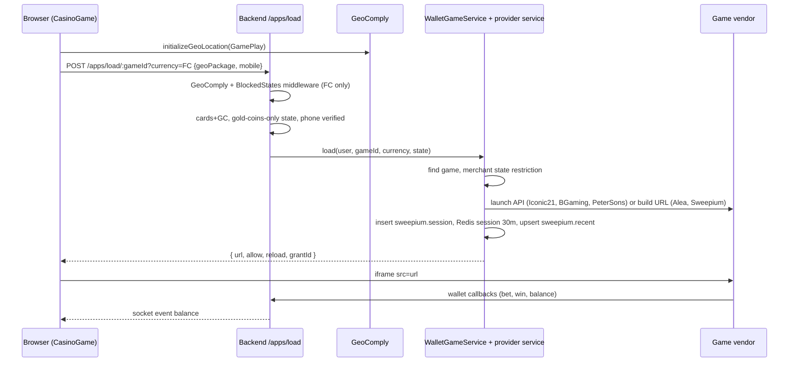

# The lobby: how it works today

The lobby is the `/casino/lobby` screen. It loads the game catalogue from `GET /apps/groups`, `GET /apps/merchants` and `GET /apps/games` (all Postgres reads, cached in Redis and React Query), and tapping a game calls `POST /apps/load/:gameId?currency=GC|FC`. The Backend runs geo and phone-verification gates, builds a vendor-specific launch URL (Alea, Iconic21, BGaming, PeterSons or Sweepium), writes a session row and a Redis session, and returns `{ url, allow, reload, grantId }`. The frontend puts that URL in an iframe. Balance changes during play reach the client over Socket.IO event `balance`, fired by the Backend when the vendor's wallet callback debits or credits.

The cards product reuses the same `/casino/*` routes and game flow. It swaps the lobby hero and refuses Gold Coin launches on the Backend.

The native app (`spinquest-mobile-app`, React Native + Expo) calls the same `/apps/*` endpoints and renders the game in a `react-native-webview` instead of an iframe. Its lobby adds routed tabs, lobby widgets, a periodic `POST /rewards/checkPromo` ping, and is the place where mobile's post-login prompts (rating, pending notification, push permission) are drained. See "Native app" below.

Backend references are to branch `PeterSons`, which is effectively the Backend main branch. Mobile references are to `master` at `fce425f0` (2026-11-10).

## At a glance

| Piece | Path |
|---|---|
| Casino routes (`/casino/lobby`, `/casino/games/:gameId`, search, groups, recently played, recent wins) | `spinquest-frontend/src/features/casino/route.factory.tsx:5-84` |
| Route loader that prefetches groups | `spinquest-frontend/src/features/casino/components/page.tsx:12-26` |
| Lobby route component | `spinquest-frontend/src/features/casino/components/lobby/index.tsx:40` |
| Lobby view | `spinquest-frontend/src/features/casino/components/lobby-view/casino-lobby-view/index.tsx:24` |
| Search page | `spinquest-frontend/src/features/casino/components/search-game/index.tsx:109` |
| Game page with iframe | `spinquest-frontend/src/features/casino/components/game/index.tsx:29` |
| Catalogue API client | `spinquest-frontend/src/lib/api/fundist/index.ts:19-139` |
| Catalogue hooks | `spinquest-frontend/src/features/casino/api/use-casino-groups.ts`, `use-casino-games.ts`, `use-recently-played.ts`, `use-merchants.ts`, `use-casino-game.ts` |
| Game-launch error handler | `spinquest-frontend/src/hooks/use-handle-fundist-errors.ts:28` |
| Product hero switch | `spinquest-frontend/vite.config.ts:20-34` |
| Cards hero | `spinquest-frontend/src/features/casino/components/lobby-view/product-lobby-hero-cards.tsx:4` |
| Socket client (balance, wins) | `spinquest-frontend/src/lib/socket/index.tsx`, `spinquest-frontend/src/features/casino/components/leaderboard/recentwins-socket-provider.tsx:37` |
| Catalogue and launch controller | `Backend/src/api/controllers/apps/AppsController.ts:90` (`/apps/*`) |
| Catalogue and launch services | `Backend/src/services/Providers/wallet/GameService.ts`, `GroupService.ts`, `MerchantService.ts`, `CategoryService.ts`, `RecentService.ts`, `MerchantIds.ts` |
| Generic list engine and Redis cache | `Backend/src/services/CommonService.ts:84-319` |
| Provider services | `Backend/src/services/Providers/{alea,iconic21,bgaming,petersons,sweepium}/*Service.ts` |
| Wallet callbacks (provider to Backend) | `Backend/src/api/controllers/{alea,iconic21,bgaming,petersons,sweepium}/*` and `Backend/src/services/Providers/wallet/CommonWalletService.ts` |
| Geo and state gates | `Backend/src/api/middlewares/custom/GeoComplyMiddleware.ts`, `BlockedStatesMiddleware.ts`, `GuessStateMiddleware.ts`, `Backend/src/utils/geolocation.ts` |
| Tables (all schema `sweepium`) | entities in `Backend/src/db/entity/Wallet/`: `Game.ts`, `Merchant.ts`, `Category.ts`, `CategoryToGame.ts`, `Group.ts`, `GroupToCategory.ts`, `Recent.ts`, `Session.ts`, `FreeSpinGrant.ts`, `WalletTransaction.ts` |
| Vendors | Alea, Iconic21, BGaming, PeterSons, Sweepium (game launch and wallet), GeoComply (location) |
| Mobile lobby screen | `spinquest-mobile-app/src/app/(tabs)/index.tsx` (409 lines; `HomeScreen`, `PromoChecker`) |
| Mobile catalogue API client | `spinquest-mobile-app/src/lib/api/fundist/index.ts:15-117` |
| Mobile catalogue hooks | `spinquest-mobile-app/src/features/casino/api/*` (`use-casino-groups`, `use-merchants`, `use-recently-played`, `use-trending-games`, `use-check-promo`, `use-daily-bonus-status`, `use-recent-wins-query`) |
| Mobile game WebView | `spinquest-mobile-app/src/features/casino/components/game/casino-game.tsx` (449 lines) |
| Mobile hero and widgets | `spinquest-mobile-app/src/components/lobby/lobby-hero.tsx`, `src/components/lobby/lobby-widgets/*` |
| Mobile recent-wins socket | `spinquest-mobile-app/src/lib/socket/recent-wins-subscription.ts:19` |

## The flow

### Casino product: landing on the lobby

1. The router mounts `CasinoPage` for `/casino`, and `/casino` redirects to `/casino/lobby` (`spinquest-frontend/src/features/casino/route.factory.tsx:30-51`). The route loader starts `casinoGroupsQuery()` without awaiting it, so navigation is not blocked (`spinquest-frontend/src/features/casino/components/page.tsx:15-21`).
2. The lobby calls `GET /apps/groups` with `order=ASC, sort=ORDER, page=1, perPage=20` (`spinquest-frontend/src/features/casino/api/use-casino-groups.ts:9-19`). Groups with no games are dropped client-side (`use-casino-groups.ts:27`).
3. Backend `groups()` runs `GuessStateMiddleware` first (`Backend/src/api/controllers/apps/AppsController.ts:217-224`). That middleware sets `res.locals.approxState` from the `geoToken` cookie, else the `cf-region-code` header, else a MaxMind lookup on `cf-connecting-ip` (`Backend/src/api/middlewares/custom/GuessStateMiddleware.ts:16-44`).
4. `WalletGroupService.search` checks Redis key `group.<md5 of query>.<state>`; on a miss it reads groups, loads each group's first 10 games through `WalletGameService.search` with `{"groupId":N}`, and caches the result for 60 seconds with `setex` (`Backend/src/services/Providers/wallet/GroupService.ts:26-53`).
5. `WalletGameService.search` selects from the games table joined to enabled merchants, requires `enabled = true` and `providerEnabled = true`, and excludes merchants restricted for the guessed state (`Backend/src/services/Providers/wallet/GameService.ts:42-54`). The `groupId` filter joins `categoriesToGame` and `groupToCategories` and orders by `ctg_g.order` (`Backend/src/services/CommonService.ts:200-217`).
6. The lobby also calls `GET /apps/merchants` (`spinquest-frontend/src/features/casino/api/use-merchants.ts:8-13`). Backend returns enabled merchants that have at least one enabled game, cached 5 minutes in TypeORM cache, ordered by the `merchant_order` JSON config row, minus merchants restricted for the state (`Backend/src/services/Providers/wallet/MerchantService.ts:16-50`).
7. When the user is logged in, "Recently played" calls `GET /apps/games?recent=true&page=1&perPage=30` (`spinquest-frontend/src/features/casino/api/use-recently-played.ts:24-28,36`). Backend joins `t.recent` for that user with `reopen = false`, orders by `recent.startedAt DESC`, and forces a 5-second cache time (`Backend/src/services/Providers/wallet/GameService.ts:56-69`).
8. Recent wins on the lobby: the REST seed `GET /apps/wins` (`spinquest-frontend/src/lib/api/wins/index.ts:10-19`) returns an empty list because the Backend handler has an early `return` with a `TODO: fix this endpoint` (`Backend/src/api/controllers/apps/AppsController.ts:245-248`). Live rows come from the socket: the client emits `subRecentWins`, joins room `recentWins`, and receives `wins` events (`spinquest-frontend/src/features/casino/components/leaderboard/recentwins-socket-provider.tsx:37-38`, `Backend/src/sockets/controllers/CommonController.ts:132-146`, `Backend/src/services/socketEmiter/ActionService.ts:86-87`).

### Casino product: categories, search, filters

1. The `/casino/search` route debounces the text box by 300 ms and builds a JSON `filter`: `name_like` only when text was typed, `merchantId` for provider filters, `groupIds` for type filters (`spinquest-frontend/src/features/casino/components/search-game/index.tsx:109,177-199`). It calls `GET /apps/games` through `useCasinoGames` with `sort=ID, order=ASC, perPage=30` (`spinquest-frontend/src/features/casino/api/use-casino-games.ts:21-28`).
2. `CommonService.commonAliasSearch` parses the filter. For alias `game`, only `id`, `merchantId`, `name` are filterable columns (`Backend/src/services/CommonService.ts:54`); `name_like` becomes `ILIKE %text%` (`CommonService.ts:263-264`); `categoryId`, `categoryIds`, `groupId`, `groupIds` add joins (`CommonService.ts:172-176`).
3. Pagination is `take = perPage || 10`, `skip = perPage * (page - 1)` (`Backend/src/services/CommonService.ts:286-287`). The response is `{ status, data, totalResults, hasMore }`, where `totalResults` comes from the `Content-Range` header (`Backend/src/api/controllers/apps/AppsController.ts:188-200`).
4. Cache: if env `POSTGRES_CACHE` is true and the request has a `cacheTime` (default 10 minutes), the full result list is stored in Redis under `cache.<alias>.<sha1 of SQL>` and sliced per page (`Backend/src/services/CommonService.ts:67,92-94,99,139-153`; default in `Backend/src/api/validators/CommonValidator.ts:86`).
5. `GET /apps/categories` exists (`Backend/src/api/controllers/apps/AppsController.ts:209-215`) and the frontend defines `getCategories` (`spinquest-frontend/src/lib/api/fundist/index.ts:55`). Inferred: lobby tabs are driven by groups, not categories, because the lobby calls only `useCasinoGroups` and `useMerchantsQuery` (`spinquest-frontend/src/features/casino/components/lobby/index.tsx:29-30`).
6. No favourites feature exists in the frontend casino code or the `/apps/*` controller (grep for "favourite" found only two unrelated promotion components).

### Casino product: launching a game

1. The user taps a game. The route `/casino/games/:gameId` mounts `CasinoGame` (`spinquest-frontend/src/features/casino/route.factory.tsx:7-12`).
2. `useCasinoGame` runs `getGameById(gameId, 'GC'|'FC', isMobileView)`; coin comes from `useEffectiveSelectedCoin` (`spinquest-frontend/src/features/casino/api/use-casino-game.ts:18-25`). `isGoldCoinsOnly` forces Gold Coin whatever is stored (`spinquest-frontend/src/hooks/use-effective-selected-coin.ts:17-24`). The stored default is Gold Coin (`spinquest-frontend/src/store/balance.ts:45`).
3. `getGameById` first calls `initializeGeoLocation(null, 'GamePlay')` to get a GeoComply package, then sends `POST /apps/load/:gameId/?currency=GC|FC` with body `{ geoPackage, mobile? }` (`spinquest-frontend/src/lib/api/fundist/index.ts:73-93`).
4. Backend gates, in order (`Backend/src/api/controllers/apps/AppsController.ts:104-144`):
   - `@Authorized({ api: 'user' })`, so a logged-in user is required (line 104).
   - `GeoComplyMiddleware`, then `BlockedStatesMiddleware` (line 106). Both skip when `?currency` is anything other than `FC` (`GeoComplyMiddleware.ts:41-46`, `BlockedStatesMiddleware.ts:18-23`). For FC, GeoComply validates the `geoPackage` and sets `res.locals.state` from the primary source `region_code` (`GeoComplyMiddleware.ts:103-115`); a valid `geoToken` cookie short-circuits this (`GeoComplyMiddleware.ts:48-67`). `BlockedStatesMiddleware` throws `BlockedStateError` unless `isStateAllowed(state)` or the user is a geo-bypass user (`BlockedStatesMiddleware.ts:26-32`).
   - Cards product with `currency === 'GC'` throws `ForbiddenError('CurrencyNotAvailable')` (line 114).
   - FC with no state, or a state in `geoCheckService.goldCoinsOnly`, throws `UnauthorizedError('GeoLocation')` (lines 121-129).
   - `req.user.isVerified()` (phone confirmed, `Backend/src/db/entity/User.ts:407-409`) or `UnauthorizedError('Phone not Verified!')` (lines 131-132).
5. `WalletGameService.load` reloads the game with `enabled` (skipped for role `superAdmin`), `providerEnabled`, and an enabled merchant; absent gives `InternalError('Game not found')` (`Backend/src/services/Providers/wallet/GameService.ts:87-101`). Then `isMerchantRestrictedForState(state, merchant.externalId)` throws `BlockedProviderError` (`GameService.ts:103-105`). The `switch (game.provider)` picks the vendor service (`GameService.ts:107-143`).
6. Every provider service does the same four things: create a session token, insert a `sweepium.session` row, write a Redis hash `sessionKey(provider, token)` with a 30-minute TTL, and call `recentRepository.insertIf` (upsert into `sweepium.recent`, `startedAt = now()`, `reopen = false`, per-user trim after a new insert) (`Backend/src/db/repository/Wallet/recentRepository.ts:20-40`). Examples: Sweepium `SweepiumService.ts:95-119`, Alea `AleaService.ts:206-234`.
7. Launch URL per provider (the exit/lobby values come from `APP_URL`):
   - Alea: `${ALEAPLAY_GAME_SERVER}/v1/games/<externalId>?casinoSessionId&environmentId&locale=en-US&device&gameMode=REAL&lobbyUrl=<APP_URL>/casino/lobby&depositUrl=<APP_URL>`; BetSoft games on FC use the second environment id; returns `allow` for Evolution, NoLimit, Red Tiger, NetEnt merchants, and `reload` plus `grantId` when free-spin grants are pending (`Backend/src/services/Providers/alea/AleaService.ts:79-80,153-162,237-258`).
   - Sweepium: `${SWEEPIUM_SERVER}?idGame&idLanguage=en&token&exitUrl=<APP_URL>&idPlayer=<user.uid>&idCurrency=<GC|FC>&forReal=1&mobile`, then one `fetch` with `redirect: 'manual'` to resolve a `Location` header (`Backend/src/services/Providers/sweepium/SweepiumService.ts:42-43,47-65,80-91`).
   - BGaming: calls the vendor API, `return_url = <APP_URL>/casino/lobby`, returns `launch_options.game_url` (`Backend/src/services/Providers/bgaming/BGamingService.ts:110,158`).
   - Iconic21: signed POST to `${ICONIC21_API_SERVER}/sw/v3/launch` with `playerId = <user.id>_<currency>`; returns `launchUrl` (`Backend/src/services/Providers/iconic21/Iconic21Service.ts:151-167`).
   - PeterSons: builds a launch query with `lobbyUrl = <APP_URL>/casino/lobby`, `exitTarget: 'self'`, resolved with the same redirect helper (`Backend/src/services/Providers/petersons/PeterSonsService.ts:69,197-207`).
8. The frontend renders `<iframe src={gameData.url} allow={gameData.allow} scrolling="no">` with no `sandbox` attribute (`spinquest-frontend/src/features/casino/components/game/index.tsx:145-163`). When `reload` is true the iframe is hidden, and after load it refetches the launch call 3 seconds later (`game/index.tsx:142,149-153`). A changed `allow` value forces an iframe reload by reassigning `src` (`game/index.tsx:112-118`).
9. While playing with Sweep Coins, the page checks every 30 seconds whether the geo token is valid and requests a new GeoComply package when it is not; failure sets `geoLocked` (`spinquest-frontend/src/features/casino/components/game/index.tsx:78-110`).
10. Errors from the launch call go to `handleError(error, ROUTES.CASINO_LOBBY)` (`game/index.tsx:92-100`). `BlockedProviderError` opens a "game unavailable" dialog; codes such as `GeoLocation`, `Proxy`, `ExclusionBoundary` open the regional error dialog (`spinquest-frontend/src/hooks/use-handle-fundist-errors.ts:67-90`).

### Cards product: where it differs

1. Frontend product is set by `PRODUCT` (`'casino' | 'cards'`) (`spinquest-frontend/src/config/env.ts:48`). At build time Vite aliases `lobby-view/product-lobby-hero` to either the casino or the cards file, chosen from `VITE_APP_PRODUCT` (`spinquest-frontend/vite.config.ts:20-34`).
2. The cards hero is `CardsHeroCta` (`spinquest-frontend/src/features/casino/components/lobby-view/product-lobby-hero-cards.tsx:4-12`); its buttons navigate to cards routes and open the login-required modal when logged out (`spinquest-frontend/src/features/spinquest-cards/components/home/cards-hero-cta/index.tsx:30-46`).
3. Cards-only routes (`/cards/card-info/:cardId`, `/my-cards`, `/tournaments`) register only when `env.isCardsProduct` (`spinquest-frontend/src/features/spinquest-cards/route.factory.tsx:5-33`). The catalogue and launch flow above is shared; no separate cards game list exists in the frontend.
4. Backend `PRODUCT` is `'sweeps' | 'cards'`, default `sweeps` (`Backend/src/services/EnvironmentConfig.ts:96-100`). Cards requires a non-empty `ALLOWED_STATES` or the process throws at boot (`Backend/src/utils/geolocation.ts:20-21`), and refuses `currency=GC` on `/apps/load` (`AppsController.ts:114-116`).

### Currency toggle

1. `_selectedCoin` is persisted in the balance store (`spinquest-frontend/src/store/balance.ts:45,107`). The launch call sends `GC` for Gold Coin and `FC` for Sweep Coin (`use-casino-game.ts:21`).
2. In a gold-coins-only jurisdiction (`useGeolocationStore.isGoldCoinsOnly`, from `/IPCheck` per its comment) the toggle is hidden and the effective coin is Gold Coin (`spinquest-frontend/src/hooks/use-is-gold-coins-only.ts:3-9`).

### Wallet callback and balance, summary

1. The vendor calls the Backend wallet routes with a session token: Alea `/alea/wallet/sessions/:id`, `/players/:id/balance`, `/transactions` (`Backend/src/api/controllers/alea/AleaController.ts:37-62`); Iconic21 `/iconic21/wallet/sw/v3/{sessionInfo,balance,bet,win,cancel,promoWin}` (`Backend/src/api/controllers/iconic21/Iconic21v3Controller.ts:23-124`); Sweepium `/wallet/{GetPlayerInfo,WithdrawAndDeposit,Withdraw,Deposit,RollbackTransaction}` (`Backend/src/api/controllers/sweepium/SweepiumController.ts:19-79`). BGaming and PeterSons controllers were not read.
2. Each controller mounts only if its env gate is on (`ENABLE_ALEA_API`, `ENABLE_ICONIC21_API`, `ENABLE_SWEEPIUM_API`, and so on) (`Backend/src/api/express.ts:17-31`).
3. `CommonWalletService.makeBalance` runs `UPDATE ... SET <field> = <field> +/- :value RETURNING *`; a debit adds `AND <field> >= :value`, and a miss throws `InsufficientFunds` (`Backend/src/services/Providers/wallet/CommonWalletService.ts:190-216`). It then calls `sendUserBalance`, which emits `balance` `{ diamonds, goldCoins }` to room `usr<userId>` (`CommonWalletService.ts:218`, `Backend/src/services/socketEmiter/ActionService.ts:34-38`).
4. The client socket connects with `io(SOCKET_URL || API_URL, { transports: ['websocket'] })`, emits `auth` with the auth token on connect, and on `balance` calls `setBalance(data, { fromSocket: true })` (`spinquest-frontend/src/lib/socket/index.tsx:43,56,72-73,98`). Inferred: the `auth` handler puts the socket in `usr<userId>`; the handler was not read. The store keeps the local optimistic value if an older lower socket value arrives within the optimistic window (`spinquest-frontend/src/store/balance.ts:55-63`).

### Native app (`spinquest-mobile-app`): where it differs

Same Backend endpoints and the same groups, merchants, games and load contract. The structure was copied across (web `casino-ftue`, `use-lobby-hero-bob.ts`, daily bonus and giveaway hero pieces are ports of mobile code). Differences that matter:

1. **Screen and tabs.** The lobby is the Expo Router tab `src/app/(tabs)/index.tsx`. It renders `OtaUpdateBanner`, `LobbyHero`, then `RoutedTabs` with `All` (`group:0`), `Recent`, and one tab per group (`(tabs)/index.tsx:333-400`). `All` renders `CasinoLobby`; `Recent` renders `RecentlyPlayedScreen`; a group tab renders `CasinoGroupScreen`. `LobbyCoachmarks` (the onboarding tour) mounts at the bottom (`:406`). The active tab lives in `useNavStore.activeLobbyTab`.
2. **Data calls.** `useCasinoGroups`, `useMerchantsQuery`, and `useRecentlyPlayed({ page: 1, perPage: 20 })` on the screen (`(tabs)/index.tsx:103-109`). Recently played uses `getGames({ recent: true })`, the same path as web, not `/apps/recent` (`use-recently-played.ts:28-29`). Search uses `GET /apps/trending` via `useTrendingGames` (`features/casino/components/search-game.tsx:74`). The client also defines `/apps/topWins` and `/apps/categories`.
3. **Lobby widgets.** `src/components/lobby/lobby-widgets/` has coin offer, daily bonus, giveaway and shop-now bubbles in widget slots. Web has the daily-bonus bubble and giveaway modal inside the hero but no widget-slot system (`spinquest-frontend/src/features/casino/components/lobby-view/casino-lobby-hero/*`).
4. **Promo ping.** `PromoChecker` calls `POST /rewards/checkPromo` when a user is logged in and the socket is connected, and again on screen focus if the last attempt is older than `PROMO_RECHECK_MS` = 5 minutes (`(tabs)/index.tsx:66-91`). `useCheckPromo` sets `retry: false` because "every attempt runs a GeoComply check" (`features/casino/api/use-check-promo.ts:7-13`). Added in `87f69468` (Sawyer Charles, 2026-10-27, "ping check promo, sale ribbon"). See Gaps: the route does not exist on Backend `PeterSons`.
5. **Post-login prompt drain.** On focus, the lobby calls `consumePendingAppRatingPrompt()`, `maybeShowPendingNotification()` and `consumeQueuedNotificationPermissionPrompt()` (`(tabs)/index.tsx:126-143`). This is the only place in either client that sequences post-login prompts; web has no equivalent.
6. **Launch call.** `getGameById` is the same as web: GeoComply package (`'GamePlay'`), then `POST /apps/load/:gameId/?currency=<coin>` with `{ geoPackage, mobile? }` (`src/lib/api/fundist/index.ts:60-80`).
7. **Game WebView** (`casino-game.tsx`):
   - `source={{ uri: gameUrl, headers: GAME_WEBVIEW_HEADERS }}` where the headers are hard-coded `Origin: https://spinquest.com` and `Referer: https://spinquest.com/` (`:62-65`, `:375`). Inferred: this makes the WebView look like the production web origin to vendors that check the embedding domain.
   - `originWhitelist={['*']}` (`:376`).
   - `onShouldStartLoadWithRequest` intercepts top-frame navigation to our own web host (the vendor's lobby/exit URL, built from `APP_URL`) and calls `handleBrowse()` instead of loading our website inside the WebView (`:383-395`).
   - `onError` and `onHttpError` handlers write to `useWebViewErrorLogStore`, viewable in developer settings.
   - Sweeps-coin geo re-check every 30 seconds, as on web, with an in-flight guard so ticks don't stack GeoComply transactions, and permission errors treated as recoverable (`:155-191`, `:67-70`). Failure sets `geoBlocked`; the game is replaced by an error view (`:319-336`).
   - Does not read `reload`, `grantId` or `allow` from the launch response (no references in `src`). Inferred: the Alea free-spin reload handled on web (`game/index.tsx:149-153`) does not happen on mobile.
8. **Recent wins.** Same pattern as web: REST seed via `getRecentWins` (the stubbed `/apps/wins`) plus socket `subRecentWins` (`src/lib/socket/recent-wins-subscription.ts:19`).

## States and data

| Entity | Notes |
|---|---|
| `sweepium.game` | `enabled` (our flag), `providerEnabled` (vendor flag), `firstEnabledAt`, `externalId`, `merchantId`, `provider` (`Backend/src/db/entity/Wallet/Game.ts:97-111`). Lists need both flags true. |
| `sweepium.merchant` | `enabled`, `externalId`; hardcoded Alea ids in `MerchantIds.ts:3-22`. |
| `sweepium.category`, `category_to_game` | Category membership with `order`; the "new games" category id is env `RECENT_CATEGORY_ID` and is rebuilt as the 50 newest enabled games by `firstEnabledAt` (`Backend/src/services/Providers/wallet/CategoryService.ts:16,34-60`). |
| `sweepium.group`, `group_to_category` | What the lobby tabs and rows read (`GroupService.ts`). |
| `sweepium.recent` | One row per (`userId`, `gameId`); `startedAt` bumped on each launch (`recentRepository.ts:25-28`). |
| `sweepium.session` | One row per launch: `userId`, `provider`, `token`, `currency`, `state`, `gameId` (`SweepiumService.ts:95-105`). |
| Redis | `group.<md5>.<state>` (60 s), `cache.<alias>.<sha1>` (when `POSTGRES_CACHE`), session hash (30 min), list `recentWins` (last 10). |
| Currency | `WalletCurrency` is `GC` or `FC`; request default is `FC` (`AppsController.ts:83-87`). |

Who writes them: provider sync jobs write games and merchants; admin game edits trigger `refreshNewGames` (`Backend/src/services/admin/gaming/AdminGamesService.ts:90`); the cron `game_refresh` runs daily at 11:00:00 (`Backend/src/api/cron/cronController.ts:82-86`); the launch path writes session and recent.

## Configuration

| Key | Effect | Read at |
|---|---|---|
| `PRODUCT` (BE `sweeps`/`cards`; FE `casino`/`cards`) | Cards: GC launch refused, allow-list required, cards routes | `Backend/src/services/EnvironmentConfig.ts:98`, `spinquest-frontend/src/config/env.ts:48` |
| `VITE_APP_PRODUCT` | Chooses hero file at build time | `spinquest-frontend/vite.config.ts:19` |
| `APP_URL` | Exit, lobby and deposit URLs sent to vendors | `SweepiumService.ts:43`, `AleaService.ts:79-80`, `BGamingService.ts:54`, `PeterSonsService.ts:69` |
| `ALLOWED_STATES`, `BLOCKED_STATES` (default `["NY","LA","NJ"]`) | Non-empty allow-list wins and ignores block list | `Backend/src/utils/geolocation.ts:11-16,59-62` |
| `GEO_WHITELIST`, `LOCAL_ENV`, `@spinquest.com` emails | Geo bypass; bypass sets state `CO` | `geolocation.ts:23-55`, `GeoComplyMiddleware.ts:66,81-85` |
| `RECENT_CATEGORY_ID` | "New games" category rebuilt daily | `CategoryService.ts:16` |
| `POSTGRES_CACHE` | Turns on Redis list cache in `CommonService` | `CommonService.ts:67` |
| `SWEEPIUM_SERVER` | Sweepium launch base URL (`.env.example` points to `stage.sweepium.com/SocialGaming`) | `SweepiumService.ts:42`, `Backend/.env.example:175` |
| `ALEAPLAY_*`, `ICONIC21_*`, `BGAMING_*`, `PETERSONS_*` | Vendor endpoints and credentials (names only) | provider services |
| `ENABLE_GAME_API`, `ENABLE_<PROVIDER>_API` | Mount `/apps` and wallet controllers | `Backend/src/api/express.ts:17-31` |
| `SOCKET_URL`, `API_URL` | Socket origin | `spinquest-frontend/src/lib/socket/index.tsx:43` |

Hardcoded: `MERCHANT_STATE_RESTRICTIONS` per Alea merchant (`MerchantIds.ts:24-118`); `CASINO_GAME_PAGE_SIZE = 30` (`spinquest-frontend/src/features/casino/constants.ts:1`); Sweepium merchant include list `[10,11,19,22,27,36,47,51,57]` (`SweepiumService.ts:136`).

## Edge cases and failure handling

- Anonymous visitors can read `/apps/games`, `/trending` (optional auth) and `/merchants`, `/groups`, `/categories` (no `@Authorized`); only `/apps/recent`, `/history` and `/apps/load` need a user (`AppsController.ts:104,146,163,176,203-224,226`).
- Provider restrictions are applied in lists and merchants with the guessed state, and again at launch with the verified state (`GameService.ts:48,103`, `MerchantService.ts:49`). A direct game link to a hidden game gets the "game unavailable" dialog (`use-handle-fundist-errors.ts:67-74`).
- `getFinalUrl` in Sweepium and PeterSons swallows any fetch error and returns the unresolved URL (`SweepiumService.ts:61-64`). A DNS or TLS failure upstream is therefore invisible at launch time.
- Free-spin grants: if grants are pending and the user has not loaded that merchant before, the response sets `reload: true` and the client refetches 3 seconds after iframe load (`AleaService.ts:171-203`, `game/index.tsx:149-153`). Grant issue errors are logged as warnings and not thrown (`AleaService.ts:189-193`).
- Redis failure on `sismember` is swallowed to 0 (`AleaService.ts:173-175`); group cache read failure is swallowed (`GroupService.ts:28`).
- GeoComply: no `geoPackage` or the placeholder `GeoComplyCookieTokenValid` throws `ForbiddenError('IPChanged|<type>')`; a response with no `region_code` throws `UnauthorizedError('GeoLocation')` (`GeoComplyMiddleware.ts:90-113`).
- There is no KYC (Veriff) check on `/apps/load`; the only player gate is phone verification (`AppsController.ts:131-132`).
- React Query on the game page has no custom retry or `staleTime` in `use-casino-game.ts`, so library defaults apply (Inferred).

## What the team has already said

- `central-tech/drafts/legacy-rest-audit.md:55,174-175`: `POST /apps/load/:id?currency=FC` in CA, TN, IN, ME currently returns 500 `UnauthorizedError GeoLocation`; the central compliance port returns 401 `BlockedStateError NYRegion`.
- `central-tech/drafts/legacy-rest-audit.md:117` and `central-tech/drafts/backend-central-readiness.md:133`: `/apps/load` with no currency is flagged as a parity question.
- `central-tech/drafts/compliance-checks-rips-vs-spinquest.md:58`: records the current gates on `/apps/load` (FC: geo and blocked states; GC: none) against the planned central checks.
- `central-tech/drafts/backend-bugs.md:73`: any `@spinquest.com` email skips geo; the bypass places the user in Colorado and applies on every geo route, which includes `/apps/load`.
- `central-tech/drafts/legacy-parity-compliance.md:63`: the geo middlewares are route-level only (`geo.scope-routes`).
- Nothing found in `central-tech` or `Backend/docs` about the lobby catalogue cache, `RECENT_CATEGORY_ID`, the Sweepium hosts, or localhost launches.

## Gaps, oddities, and risks

- Mobile calls `POST /rewards/checkPromo` on every lobby focus (at most every 5 minutes), but no such route exists on Backend `PeterSons`: `RewardsController` exposes `/`, `/wheel`, `/wheel/spin`, `/dailyBonus`, `/dailyBonus/claim`, `/loginStreak`, `/loginStreak/claim`, and `git log --all -S checkPromo` in Backend finds nothing. Either it 404s in production or another service answers it. Same pattern as the purchase-session and redemption-rate drift recorded in `claude/codebase-facts.md`.
- Mobile ignores `reload`, `grantId` and `allow` from `/apps/load` (Inferred from no references), so Alea free-spin grants that need the reload dance may not appear on first launch in the app.
- Mobile spoofs `Origin`/`Referer` as `https://spinquest.com` on the game WebView. This works around vendor domain allowlists but ties every environment (including staging builds) to the production origin from the vendor's point of view.

- `GET /apps/wins` returns `{ status: 'success', data: [] }` before reaching `winsService.wins('wins')`, which is unreachable code (`AppsController.ts:245-254`). The frontend still calls it as the initial seed (`spinquest-frontend/src/lib/api/wins/index.ts:13`). Only the socket supplies live wins.
- Gold Coin launches skip both geo middlewares (`GeoComplyMiddleware.ts:41-46`), so `res.locals.state` is empty and `state` is `''` (`AppsController.ts:119`). `getRestrictedMerchantIds('')` returns `[]` (`MerchantIds.ts:136`), so the per-merchant state restrictions never apply to GC launches, and sessions are stored with an empty `state`. Lists still filter by the guessed state.
- The middleware skip tests `req.query.currency !== 'FC'`, while the controller defaults a missing currency to `'FC'` (`BlockedStatesMiddleware.ts:20`, `AppsController.ts:86`). A request with no `currency` therefore skips the middlewares and then fails at the `!state` check with `GeoLocation` (`AppsController.ts:121-129`). Not a bypass, but a 401 with a misleading error.
- The Sweepium sync URL is hardcoded to `https://backofficestage.sweepium.com:4500/GetGameListC?idCasino=36&hash=...` and ignores `SWEEPIUM_SERVER` (`SweepiumService.ts:131`). The URL embeds a credential-like hash in source (value not reproduced here). `syncGames` has no caller: the cron calls only `aleaService.syncGames()` (`cronController.ts:85`), and `grep` for `.syncGames(` in `Backend/src` found only that call. So the Sweepium catalogue is not refreshed by code in this repo, and the DNS failure of `backofficestage.sweepium.com` (2026-11-10, per the brief) would only matter if something calls it. Inferred: the other providers' `syncGames` (iconic21, bgaming, petersons) are also uncalled from `Backend/src`; not checked for admin or CLI callers.
- Sweepium launches use `SWEEPIUM_SERVER` (`SweepiumService.ts:42,91`). If `stage.sweepium.com` does not resolve, `getFinalUrl` swallows the error (`SweepiumService.ts:61-64`) and the API still returns `{ url }` with the dead host, after having written the session and recent rows (`SweepiumService.ts:105-124`). The iframe then fails with no Backend error. The DNS fact itself is not verifiable from the repo.
- Sweepium thumbnails: `image` is stored as the vendor's `urlButton` (`SweepiumService.ts:177`). No string `www.sweepium.com` exists in `Backend/src` (outside migrations) or `spinquest-frontend/src`, so the host comes from vendor data in the database. The dependency on that host is implicit.
- Localhost launches: nothing in the frontend or Backend checks the origin before launch, and the iframe has no `sandbox` (`game/index.tsx:145-163`). `APP_URL` defaults to `https://dev.spinquest.com` in `.env.example` and `http://localhost:3000` in the frontend schema (`Backend/.env.example:15`, `spinquest-frontend/src/config/env.ts:56`). A vendor-side domain allowlist rejection is therefore a vendor response the code does not handle.
- The cards product reuses the casino catalogue; there is no cards-specific game list, and the cards hero is chosen at build time by `VITE_APP_PRODUCT` while runtime behaviour reads `PRODUCT`. Two separate keys that must agree (`vite.config.ts:19` vs `env.ts:48`).
- Product value names differ across tiers: frontend `casino`, Backend `sweeps`.
- `RECENT_CATEGORY_ID` is named "recent" but holds the newest 50 enabled games, not per-user recents (`CategoryService.ts:34-60`). It silently does nothing if the env value is empty (`CategoryService.ts:36`).
- `getRecentlyPlayed` and `GET /apps/recent` are defined (`fundist/index.ts:97`, `AppsController.ts:147`) but the lobby uses `GET /apps/games?recent=true` instead (`use-recently-played.ts:24`). Two code paths for the same data.
- `LOBBY_MERCHANT_IDS` is exported (`MerchantIds.ts:154`); its use was not traced.
- Group results are cached by `(query, state)` for 60 seconds but also pass through `CommonService` caching disabled per game (`GroupService.ts:45`); each cold group request issues one games query per group.

## Not verified

- Whether `stage.sweepium.com` or `backofficestage.sweepium.com` resolve, and the Sweepium thumbnail host: DNS is outside the repos.
- The localhost domain-allowlist rejection by vendors: no code or doc in the repos shows it.
- Deployed env values: `PRODUCT`, `POSTGRES_CACHE`, `RECENT_CATEGORY_ID`, `ALLOWED_STATES`, `ENABLE_*_API`, `SWEEPIUM_SERVER`.
- The socket `auth` handler that joins `usr<userId>`, the BGaming and PeterSons wallet controllers, `Backend/src/services/geo/geoCheck` `goldCoinsOnly` contents, and the sports and cards product game pages.
- Whether `MerchantIds.ts` `LOBBY_MERCHANT_IDS` is used anywhere.
- Native app: read for lobby, launch and WebView only. Not read: mobile `CasinoLobby` / `CasinoGroupScreen` internals, `lobby-widgets` data sources, `handleBrowse`, `useCurrencyToggleEnabled`, and how `checkPromo` responses are used by `shop-card.tsx` (the "sale ribbon").
- Whether something other than Backend serves `/rewards/checkPromo` in production.
- Visual behaviour of tabs, rows and hero (components under `lobby-view/*` were only skimmed).
