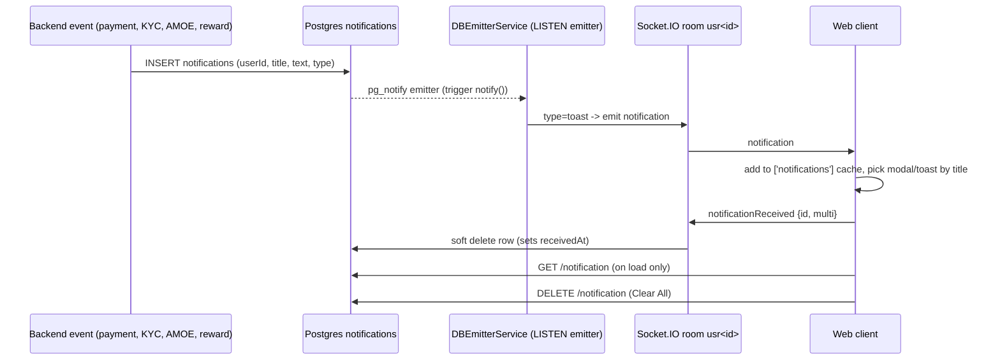

# Notifications: how they work today

**Update 2026-11-11 (native app read):** push is sent by **Optimove (Optimobile SDK)** from the mobile app's side, not by the Backend. The mobile app registers its push token with Optimove and identifies the user to it; it does **not** successfully register tokens with the Backend (field-name mismatch), and it never sets `users.pushNotifications`. So `firebase_messaging` is effectively unused by the current app and the push-notification bonus is never paid. Details in "C. Native app" below. Backend references are to branch `PeterSons` (effectively Backend main); mobile references are to `spinquest-mobile-app` `master` at `fce425f0`.

The Backend contains no code that sends a push notification. It only stores native-app FCM device tokens in `firebase_messaging` and a per-user `pushNotifications` boolean; whatever actually sends push (a Firebase console, Optimove, or another service) is outside these repos. The only notification delivery the code performs itself is "in-app": a row in the `notifications` table, pushed to the web client over Socket.IO and listed in a bell popover. That in-app path is live and reachable on web for every logged-in user (no flag), and it is what carries redemption, purchase, KYC and AMOE messages. "Legacy" here means the design is old and partly stale (several FE title matchers no longer match Backend titles), not that it is disabled.

## At a glance

| Piece | Path |
|---|---|
| Notification entity (`notifications` table) | `Backend/src/db/entity/Notification.ts:23` |
| Read-state entity (`notifications_received`) | `Backend/src/db/entity/NotificationReceived.ts:20` |
| Device token entity (`firebase_messaging`) | `Backend/src/db/entity/FirebaseMessage.ts:20` |
| User push fields (`pushNotifications`, `pushNotificationsBonus`) | `Backend/src/db/entity/User.ts:303-307` |
| REST list and clear (`GET /notification`, `DELETE /notification`) | `Backend/src/api/controllers/main/NotificationController.ts:22-41` |
| REST list service | `Backend/src/services/NotificationService.ts:14` |
| Admin create, list, delete (`/admin/notification`) | `Backend/src/api/controllers/admin/NotificationController.ts:58` |
| Token upsert and revoke | `Backend/src/services/FirebaseMessageService.ts:12-59` |
| Postgres trigger and listener | `Backend/src/db/migration/0000000000003-notifications.ts:29`, `Backend/src/services/socketEmiter/DBEmitterService.ts:43-47` |
| DB row to socket router | `Backend/src/services/socketEmiter/DBEmitterService.ts:82-95` |
| Socket emit helpers | `Backend/src/services/socketEmiter/ActionService.ts:54-74` |
| Socket rooms and read ack | `Backend/src/sockets/controllers/CommonController.ts:43-128` |
| Redis socket emitter | `Backend/src/sockets/emitter.ts:5` |
| FE socket provider (receives `notification`) | `spinquest-frontend/src/features/notifications/components/notifications-socket-provider.tsx:25` |
| FE bell, list, item | `spinquest-frontend/src/features/notifications/components/notifications-popover/index.tsx:17` |
| FE REST client | `spinquest-frontend/src/lib/api/notification/index.ts:10-31` |
| FE modals (purchase result, free spins) | `spinquest-frontend/src/features/notifications/components/notification-modal/index.tsx`, `.../free-spin-modal/index.tsx` |
| Vendors | Firebase Cloud Messaging (token storage only on our side), Redis (socket fan-out), Postgres `LISTEN emitter` |
| Mobile push SDK (Optimove) | `spinquest-mobile-app/src/lib/optimove/index.ts`, `@optimove-inc/react-native` 3.2.0 (patched, `patches/@optimove-inc__react-native.patch`), config plugin `plugins/with-optimove.ts` |
| Mobile push received/opened handlers | `spinquest-mobile-app/src/hooks/use-optimove-push-handlers.ts:63`, `:96` (mounted from `src/app/_layout.tsx:47`) |
| Mobile priority filter and pending queue | `spinquest-mobile-app/src/lib/notifications/notification-priority.ts` |
| Mobile push deep links | `spinquest-mobile-app/src/lib/firebase/notification-navigation.ts` (reads `url` from the payload, `parseAppUrl`) |
| Mobile permission prompt | `spinquest-mobile-app/src/features/notifications/utils/maybe-show-permission-prompt.ts`, `src/components/common/app-guards/guards/notification-permission-guard.tsx` |
| Mobile token params sent to Backend | `spinquest-mobile-app/src/utils/push-notification-params.ts`, `src/features/auth/api/use-login.ts:255-290`, `use-register.ts:26-28` |
| Mobile in-app socket handler | `spinquest-mobile-app/src/features/notifications/components/notifications-socket-provider.tsx:40-78` |

## The flow

### A. In-app notification (the only channel the code delivers itself)

1. A Backend event inserts a row into `notifications`. Most inserts are `notificationRepository.insert({ userId, title, text })` and rely on the column default `type = 'toast'` (`Backend/src/db/entity/Notification.ts:39-45`). The full trigger list is in the table below.
2. An `AFTER INSERT` trigger on `public.notifications` calls `public.notify()` (`Backend/src/db/migration/0000000000003-notifications.ts:29-32`), which does `pg_notify('emitter', ...)` with table name, operation and row (`Backend/src/db/migration/0000000000001-init.ts:69`).
3. `DBEmitterService` runs `LISTEN emitter` only when `API_TYPE === 'Fundist'` and `FORK_ZERO` is true (one process, "main") (`DBEmitterService.ts:43-50`). `router` sends `public.notifications` payloads to `notifications()` (`DBEmitterService.ts:76-77`).
4. `notifications()` acts on INSERT only (`DBEmitterService.ts:84`). If `row.type === 'toast'` it calls `sendNotification(row)`; otherwise, if `row.command` is set, it calls `openModal({ userId, command })` (`DBEmitterService.ts:86-93`). A `popup` row with no command is ignored here.
5. `sendNotification` emits Socket.IO event `notification` with the row to room `usr<userId>` (`ActionService.ts:66-68`). `openModal` emits event `command` with `{ userId, command }` to the same room (`ActionService.ts:72-74`). Emission goes through the Redis emitter (`sockets/emitter.ts:5`).
6. Some code paths skip the DB-listener route and emit directly after commit: `UserService.updateUser` (`UserService.ts:626-628`) and `FreeSpinService` via `commitHooks` (`FreeSpinService.ts:132-134`). Both insert `type: 'popup'` rows, which the listener would not emit (step 4), so the direct emit is the only live delivery for them.
7. Room membership: the web client opens a websocket (`spinquest-frontend/src/lib/socket/index.tsx:40-45`), emits `auth` with the JWT on connect (`index.tsx:56`); the Backend verifies it and `socket.join('usr<id>')` (`CommonController.ts:51-56`, `CommonController.ts:94`). A logged-out client sends `noAuth` and joins `noAuth` (`CommonController.ts:45-49`).
8. `NotificationsSocketProvider` subscribes to `notification` (`notifications-socket-provider.tsx:121`). On each event it (a) prepends the row to the React Query cache `['notifications']` if the id is new (`use-notifications.ts:16-29`), (b) emits `notificationReceived { notificationId, multi, userId }` back (`notifications-socket-provider.tsx:43-47`), then (c) picks a presentation by matching the title string (step 9).
9. Presentation, all keyed on `notification.title` or `notification.command` (`notifications-socket-provider.tsx:49-110`):
   - title contains `Purchase Approved`: success modal (`:51-64`).
   - title equals `❌ Failed`: error modal (`:65-78`).
   - title contains `Purchase Pending`: info modal (`:79-92`).
   - `command === 'freeSpins'` with `data`: `FreeSpinDialog` (`:93-101`).
   - title `Purchase Confirmed` or `Redemption Confirmed`: `toast.success(title)` (`:104-106`); `Deposit Failed`: `toast.error` (`:108-110`).
   - Anything else (all redemption, KYC, AMOE, admin messages): no modal and no toast, only the list entry.
10. The list: `NotificationsPopover` is mounted in the header when `!hideProfile` (`spinquest-frontend/src/components/layouts/top-bar/header/components/sub-components.tsx:533-541`). It renders `useNotifications()` data; the badge count is `list.length` (`notifications-popover/index.tsx:26`). Each row shows an icon, title, text (with `GC`/`SC` swapped for coin icons) and timestamp (`utils/notification-content.tsx:48-92`, `notification-item.tsx:78-116`). Clicking a `freeSpins` row switches to Sweep Coin and navigates to the game (`notification-item.tsx:42-54`).
11. Initial load and reload: `useNotificationsQuery` calls `GET /notification` once `useCurrentUser` has data (`use-notifications-query.ts:8-16`). There is no polling and no `refetchInterval`. The Backend query returns rows where `userId = me or userId is null`, left-joined to `notifications_received`, newest first, `withDeleted()` (`NotificationService.ts:19-23`), with a 30 s cache (`NotificationService.ts:25`).
12. Mark read: there is no "mark read" REST route. The socket ack `notificationReceived` is handled at `CommonController.ts:115-128`: if `multi` is falsy it soft-deletes the notification row (sets `receivedAt`, since `receivedAt` is the `@DeleteDateColumn`, `Notification.ts:35-37`); if `multi` is true it inserts into `notifications_received (notificationId, userId)`. `@AfterLoad` copies `notificationsReceived[0].receivedAt` onto `receivedAt` for global rows (`Notification.ts:85-91`).
13. Clear: the "Clear All" link calls `DELETE /notification` (`notifications-header.tsx:43`, `lib/api/notification/index.ts:23-31`), which hard-deletes all rows with `userId = me` (`NotificationService.ts:35-39`). The cache is set to `[]` on success (`use-notifications-delete-mutation.ts:15-17`). Global rows (`userId` null) are not touched.



### B. Push notification (what the Backend does)

1. Opt-in at settings: the app calls `PUT /users` (`Backend/src/api/controllers/main/UserController.ts:32`, `:69-73`) with `pushNotifications: true`, `source` (`ios` or `android`), `appDeviceId`, `fcmToken`, `appVersion`. These are required only when `pushNotifications === true` (`Backend/src/api/validators/PlayerValidator.ts:55-77`).
2. `UserService.updateUser` writes `users.pushNotifications`. If it flips false to true, it upserts the token (`UserService.ts:600-610`). If the user has never received it, `RewardsService.pushNotificationsBonus` credits the `push_notification_bonus` config amount and inserts a `popup` notification titled "Push Notifications Enabled" (`RewardsService.ts:542-594`). After commit the notification is emitted on the socket (`UserService.ts:626-628`) and the balance too.
3. Opt-out: true to false calls `revokeAll(userId)`, a soft delete (sets `revokedAt`) of all that user's token rows (`UserService.ts:619-621`, `FirebaseMessageService.ts:53-59`).
4. Login: `POST /auth/login` with `source !== 'web'` and an `fcmToken` upserts the token; if `user.pushNotifications` is false the row is written with `revokedAt = now` (`AuthController.ts:238-246`). Web logins never register a token. The upsert key is `(userId, appDeviceId)` and updates `token, platform, appVersion, revokedAt` (`FirebaseMessageService.ts:28-31`). Failures are logged and swallowed unless a transaction runner was passed (`FirebaseMessageService.ts:34-42`).
5. Logout: `POST /auth/logout` with `appDeviceId` hard-deletes that one row (`AuthController.ts:423-430`, `FirebaseMessageService.ts:45-51`). Without `appDeviceId` it does nothing.
6. Sending: no file in `Backend/src` imports `firebase-admin` or any FCM client (grep for `firebase`, `fcm`, `messaging` finds only the token store; `Backend/package.json` has no firebase dependency). No code reads `firebase_messaging` to send, and there is no topic subscription code. Which events cause a push, with what text, to which platforms, is not determinable from these repos.
7. The web client has no push code at all: no service worker, no FCM SDK, no `pushNotifications` or `fcmToken` usage under `spinquest-frontend/src` (grep). Web `source` is excluded from token registration (step 4).

### C. Native app (`spinquest-mobile-app`)

**Who sends push.** Optimove's mobile SDK ("Optimobile"). `isOptimoveEnabled()` returns `Config.ENABLE_OPTIMOBILE` (env `EXPO_PUBLIC_ENABLE_OPTIMOBILE`, default `'false'`, `env.ts:87`, `:146`); every Optimove call is a no-op when it is off (`src/lib/optimove/index.ts:8`). Campaign content, targeting and sending live in the Optimove console, outside all repos. The Backend's Optimove ETL export (`OptimoveETLService`) feeds that targeting.

1. **Identify.** On auth-store login the app calls `setOptimoveUserId(user.id)` and `requestOptimovePushTokenIfPermitted()` (`src/features/auth/auth.store.ts:99-100`). On logout: `unregisterOptimovePush()` and `signOutOptimoveUser()` (`auth.store.ts:158-159`).
2. **Permission.** The OS prompt is never shown at launch. `maybeShowNotificationPermissionPrompt` opens the app guard `NOTIFICATION_PERMISSION` only when no other guard is open, the lobby tour is complete, permission is not granted and can be asked again, and the re-prompt window has passed (10 days after the first prompt, then 60 days; TODO to move to PostHog remote config) (`maybe-show-permission-prompt.ts:9-38`). Triggers: tour finish/skip (`features/onboarding/store/lobby-tour.store.ts`), and the first-ever login queues it for the lobby to consume (`use-login.ts:228-233`, `src/app/(tabs)/index.tsx:126-143`). The guard calls `Notifications.requestPermissionsAsync()` then `requestOptimovePushToken()`, or opens OS settings if permission was denied (`notification-permission-guard.tsx:57-75`, `:103-114`).
3. **Received.** `Optimove.setPushReceivedHandler` reports the receipt to Optimove, reads a `priority` from the payload, and decides whether to display it (`use-optimove-push-handlers.ts:63-90`). Priorities: `critical`, `gameplay` (the default when missing), `engagement`, `promotional` (`notification-priority.ts:12-24`, `:99-120`).
   - App in foreground: `critical` shows; `gameplay` is conditional (suppressed while a game route is visible, saved as the one pending notification for 60 minutes, then shown when the user is back on the lobby via `maybeShowPendingNotification()`); `engagement` and `promotional` are suppressed.
   - App in background: everything except `promotional` shows. App inactive: everything shows (`notification-priority.ts:126-154`, `:223-242`).
4. **Opened.** `setPushOpenedHandler` navigates using the payload's custom `url` (deliberately not Optimove's own `notification.url`, which Optimove would hijack when the app is closed) through `parseAppUrl` (`use-optimove-push-handlers.ts:40-41`, `:96`; `src/lib/firebase/notification-navigation.ts:158-246`).
5. **Backend token registration is broken.** Login and register add `deviceId`, `appVersion` and `token` (from `expo-notifications` `getDevicePushTokenAsync`) to the body (`push-notification-params.ts:7-33`, `use-login.ts:255-290`). The Backend `LoginRequest` reads `appDeviceId` and `fcmToken` (`Backend/src/api/validators/AuthValidator.ts:68`, `:74`) and only upserts when `body.fcmToken` is set (`AuthController.ts:238-246`). So no row is written to `firebase_messaging` from the current app. Also, password login hard-codes `source: AuthSource.IOS` (`src/features/auth/components/login-form.tsx:80`), so Android would be stored as `ios` even if the names matched. Matches `central-tech/drafts/cleanup-pass-2026-11-10.md:77`.
6. **`pushNotifications` is never set.** No `pushNotifications` reference exists in mobile `src` (grep), and there is no push toggle in account settings. `PUT /users` is therefore never called with it, `users.pushNotifications` stays false, and `RewardsService.pushNotificationsBonus` never runs. The `push_notification_bonus` reward is configured but unreachable.
7. **In-app (socket) on mobile.** The app listens to the same `notification` socket event (`notifications-socket-provider.tsx:78`). It first runs the same priority filter and caches the decision (`:40-48`), then: free-spin payloads open `FreeSpinDialog` (`toFreeSpinData`, `:51-55`); titles `Purchase Confirmed` / `Redemption Confirmed` show a success toast and `Deposit Failed` an error toast (`:57-70`). Those three titles have no live Backend source (see Gaps), so in practice only free spins produce a visible reaction. No purchase result modals are keyed off titles on mobile. The list is shown from the header via `useNotifications` (`src/components/layouts/header.tsx`).
8. **Developer settings** (`src/app/developer-settings/notifications.tsx`, `in-app-messaging.tsx`) can read the device token, re-request the Optimove token, unregister, and fire a fake free-spin message. Useful for QA.

```mermaid
sequenceDiagram
  participant App as Mobile app
  participant OS as iOS / Android
  participant OPT as Optimove
  participant BE as Backend
  App->>OPT: setUserId(user.id) on login
  App->>OS: requestPermissionsAsync (after tour, via guard)
  App->>OPT: pushRequestDeviceToken()
  App->>BE: POST /auth/login {deviceId, token}  (BE expects appDeviceId, fcmToken: ignored)
  OPT-->>OS: campaign push (content, targeting in Optimove console)
  OS-->>App: setPushReceivedHandler -> priority filter
  App->>App: show / suppress / pending until lobby
  OS-->>App: setPushOpenedHandler -> deep link via custom url
```

## Notification types and triggers

Channel columns: in-app = row in `notifications` delivered by socket and shown in the bell list. "Push" is `none in code` for every row because no Backend code sends push.

| Trigger event | Created where | Channels in code | Title and text source |
|---|---|---|---|
| Redemption (WITHDRAWAL) row inserted | `Backend/src/services/socketEmiter/payment/PaymentEmitterService.ts:35-40` | in-app (list only) | Hardcoded: "Redemption Pending" |
| Redemption state COMPLETED | `PaymentEmitterService.ts:46-52` | in-app (list only) | Hardcoded: "Redemption Submitted", amount in text |
| Redemption state FAILED | `PaymentEmitterService.ts:53-59` | in-app (list only) | Hardcoded: "Redemption Failed" |
| Redemption state DECLINED or CANCELLED | `PaymentEmitterService.ts:60-67` | in-app (list only) | Hardcoded: "Redemption Declined" |
| Redemption claim rolled back (rejected) | `Backend/src/services/AsyncShopPackageService.ts:321`, email at `:356-358` (callers `Backend/src/services/Payments/paytech/PaytechService.ts:481`, `:674`) | email only | Email template env key `EMAIL_REDEMPTION_REQUEST_REJECT_TEMPLATE_NAME` |
| Purchase (Aeropay) INSERT, COMPLETED, DECLINED | `Backend/src/services/socketEmiter/aeropay/AeropayEmitterService.ts:59-85` | in-app (modal for Pending and Approved) plus email on approve (`:75`) | Hardcoded "Purchase Pending/Approved/Failed" |
| Purchase (Linkmoney) PENDING, COMPLETED, DECLINED | `Backend/src/services/socketEmiter/linkmoney/LinkmoneyEmitterService.ts:66-104` | in-app plus email on approve | Hardcoded, emoji-prefixed titles (`:68`, `:89`, `:100`) |
| Purchase (Paytech) | `Backend/src/services/socketEmiter/paytech/PaytechEmitterService.ts:56-109` | none today: `purchaseTransaction` call is commented out (`:21-23`, "we show result in paytech iframe modal") | n/a |
| Purchase generic (`PaymentEmitterService`) "Purchase Confirmed" | `PaymentEmitterService.ts:102` | none: call is commented out (`:19-21`) | n/a |
| KYC verification inserted | `Backend/src/services/socketEmiter/kyc/KYCEmitterService.ts:14-19` | in-app (list only) | "ID Verification - Pending" |
| KYC VERIFIED | `KYCEmitterService.ts:25-30` | in-app (list only) | "ID Verification - Success" |
| KYC FAILED | `KYCEmitterService.ts:32-37` | in-app (list only) | "ID Verification - Failed" |
| Admin accepts or declines AMOE (mail-in) | `Backend/src/services/admin/AmoeService.ts:148-165` | in-app (list only) plus email (`:170`, `:181`) | "Postal Request Code Approved" (reward text) or "AMOE Request Declined" |
| Enable push (first time) | `Backend/src/services/RewardsService.ts:588-598` | in-app, `type: 'popup'`, emitted directly (`UserService.ts:626-628`); list entry only on web | "Push Notifications Enabled" plus reward text |
| Free spins granted | `Backend/src/services/Providers/wallet/FreeSpinService.ts:114-134` | in-app, `type: 'popup'`, `command: 'freeSpins'`, emitted directly; opens `FreeSpinDialog` | "You Have Been Granted N Free Spins" |
| Daily GC bonus under threshold | `Backend/src/services/Providers/wallet/CommonWalletService.ts:866-872` | in-app (list only) | "5,000 GC Bonus Added!" |
| Support sends a message | `Backend/src/api/controllers/admin/NotificationController.ts:78-92` (`POST /admin/notification`, role `support`) | in-app, `type` from request (`tray`, `toast`, `popup`); `userId` omitted means global | Free text from the request body |
| Login code, password reset, email verify, MFA, KYC-required | `Backend/src/services/LoginCodeService.ts:205`, `AuthService.ts:174`, `:499`, `MfaService.ts:474`, `admin/UserService.ts:719` | email only (separate channel) | Email templates by env key |

### Other channels (not notifications, listed to bound the scope)

| Channel | Path | Used for |
|---|---|---|
| Email | `Backend/src/services/EmailService.ts:50` (`sendEmail`) | Transactional templates (purchase approved, redemption rejected, AMOE, OTP, KYC required) |
| SMS | `Backend/src/services/sinch/SinchService.ts:88` (`startSmsVerification`) | Phone verification codes only; no notification SMS found |
| Slack | `Backend/src/services/slack/SlackService.ts:97`, `:160` | Internal alerts (used from `ContactService.ts`, `PaytechService.ts`), not player-facing |
| Optimove | `Backend/src/services/optimove/OptimoveETLService.ts` | Data export ETL; no push or message sending found in it |

## States and data

- `notifications` (`Notification.ts:23-92`): `id` (bigint, `flake_id()`), `createdAt`, `receivedAt` (soft-delete column, index), `type` enum `tray | toast | popup` default `toast` (`:17`, `:39-45`), `userId` (nullable, null means global, `:52-54`), `sentById` (admin author, `:61-62`), `title` (255), `text` (16384), `command` enum `5kCappedWin | freeSpins` nullable (`:20`, `:70-71`), `data` jsonb (`:74-75`), `multi` (transient, not a column, `:77`).
- `notifications_received` (`NotificationReceived.ts:20-51`): per-user read marker for global rows, unique on `(userId, notificationId)`.
- "Unread" has no stored boolean. For per-user rows it is `receivedAt is null` (row not soft-deleted); for global rows it is no matching `notifications_received` row. The REST list returns read and unread together (`withDeleted()`), and the FE badge counts everything in the list (`notifications-popover/index.tsx:26`), so "read" rows stay visible until Clear All or a rebuilt cache.
- `firebase_messaging` (`FirebaseMessage.ts:20-60`): `userId`, `platform` enum `ios | android` (`:17`), `token`, `appDeviceId`, `appVersion`, `revokedAt` (soft delete), unique `(userId, appDeviceId)`.
- `users.pushNotifications` and `users.pushNotificationsBonus`, both default false (`User.ts:303-307`). `pushNotifications` is written by `PUT /users` only (`UserService.ts:590-592`).
- FE type `Notification` (`spinquest-frontend/src/lib/api/notification/types.ts:1-13`): mirrors the entity; `type` is a plain string and `multi` is typed `false`.

## Configuration

- `API_TYPE` and `FORK_ZERO`: both must match (`Fundist`, true) for the one process that runs the Postgres listener (`DBEmitterService.ts:43`). Other processes insert rows but never emit them.
- `EMAIL_REDEMPTION_REQUEST_REJECT_TEMPLATE_NAME`, `EMAIL_PURCHASE_APPROVED_TEMPLATE_NAME`, `EMAIL_AMOE_APPROVED_TEMPLATE_NAME` (email templates; read at `AsyncShopPackageService.ts:357`, `:404`, `AmoeService.ts:171`).
- `json_config` row `push_notification_bonus` (diamonds, goldCoins) sets the opt-in reward (`RewardsService.ts:543-546`, seeded by `Backend/src/db/migration/1773069280001-push-notification-bonus-seed.ts`).
- FE: `env.SOCKET_URL` falling back to `env.API_URL` (`spinquest-frontend/src/lib/socket/index.tsx:42`). No feature flag gates the bell, the socket provider or the REST routes.
- Cache: list query cache time 30 s (`NotificationService.ts:25`).

## Edge cases and failure handling

- Insert-then-emit ordering: purchase and KYC inserts happen in the listener after the source row commits, so a listener crash or a non-main process means no notification at all. Not retried.
- AMOE insert runs inside the admin transaction (`AmoeService.ts:147-165`); the comment there says a dropped notification is non-critical (`:147`).
- Free-spin and push-bonus notifications are inserted inside the business transaction and emitted only after commit (`FreeSpinService.ts:129-134`, `UserService.ts:624-628`).
- Token upsert failure on login is logged and ignored (`FirebaseMessageService.ts:34-42`); login still succeeds.
- Token registration needs `source !== 'web'` and a non-empty `fcmToken` on login (`AuthController.ts:238`). `GET /notification` and `DELETE /notification` require `api: 'user'` auth (`NotificationController.ts:21`).
- On reconnect the FE re-emits `auth` (`socket/index.tsx:56`). The server no longer replays missed notifications on `auth`: the call that did is commented out ("FE does not show toast", `UserService.ts:804-808`). A notification created while the socket is down appears only after the next `GET /notification`, which happens on page load.
- Global notifications (`userId` null): see the first item under "Gaps".

## What the team has already said

- Push is undecided for the platform rewrite: "Global or per product? One mobile app means one device token..." (`central-tech/initiatives/decisions-needed.md:111`).
- Parity inventory marks login FCM upsert and logout FCM revoke as `change` with owner undecided (`central-tech/drafts/legacy-parity-inventory.md:168`, `:183`); the auth porting note says FCM and other vendor calls are cut at the controller seam (`central-tech/services/porting/auth.md:316`).
- KYC in-app notification driven by the DB trigger is marked `drop` with a stated legacy bug: expired or abandoned sessions set FAILED, so a player who closed the tab is told verification failed (`central-tech/drafts/legacy-parity-compliance.md:160`).
- Known mobile field mismatch: the app sends `deviceId` and `token`, Backend reads `appDeviceId` and `fcmToken`; Android reports `source: 'ios'` (`central-tech/drafts/cleanup-pass-2026-11-10.md:77`).
- Logout behind the terms gate did not drop the FCM token; recorded as fixed (`central-tech/drafts/backend-bugs.md:114`). `POST /auth/logout` does not end the session, it only revokes the FCM row (`central-tech/drafts/the-legacy-session.md:77`).
- `/admin/notifications` is "a shared capability, in flight in Core" (`central-tech/drafts/admin-actions.md:133`); `/admin/notification/*` is listed in the back-office move (`central-tech/drafts/back-office-to-control-plane.md:124`).
- Mobile push registration is called out as missing shared client plumbing (`central-tech/reference/client-libraries.md:80`).

## Gaps, oddities, and risks

- No push sender in the Backend. Resolved by the native app read: push is Optimove (Optimobile) campaigns, registered from the app. The Backend's `firebase_messaging` table and FCM upsert/revoke code are effectively dead for the current app (field-name mismatch, see C.5), and Backend code never reads tokens anyway.
- Transactional events (purchase, redemption, KYC, AMOE) produce only in-app rows and emails. Unless Optimove builds triggered campaigns from the ETL export, nothing pushes "your redemption was approved" to the phone. Worth confirming with whoever owns the Optimove console.
- `push_notification_bonus` can never be paid: mobile never sends `pushNotifications`.
- Both clients' toast matchers (`Purchase Confirmed`, `Redemption Confirmed`, `Deposit Failed`) target titles no live Backend path produces; the mobile copy of the matcher was carried over from web.
- Dead and stale FE title matchers: the error modal matches `❌ Failed` (`notifications-socket-provider.tsx:65`) but Backend titles are `❌ Purchase Failed` (`LinkmoneyEmitterService.ts:100`, `PaytechEmitterService.ts:102`) and `Purchase Failed` (`AeropayEmitterService.ts:82`), so the error modal never opens. `Redemption Confirmed` and `Deposit Failed` toasts (`:104`, `:108`) have no Backend source (`PaymentEmitterService.ts:112` is commented out); `Purchase Confirmed` is created only by the disabled generic purchase path. `ID Verification - Fail` icon match (`notification-content.tsx:78`) is shadowed by the earlier `includes('Failed')` case (`:66`) and the real title is `... - Failed`.
- Redemption in-app presentation is list-only. The commented-out toast (`notifications-socket-provider.tsx:112-114`) and the separate wallet modal `spinquest-frontend/src/features/wallet/components/redeem/redemption-submitted-modal.tsx:109-110` (driven by the redeem API response, not by notifications) are the "legacy" redemption surfaces; the Backend `Redemption *` rows only reach the bell list.
- `command` event shape mismatch: Backend emits an object `{ userId, command }` (`ActionService.ts:73`), but the FE handler treats the argument as a string `command === '5kCappedWin'` (`socket/index.tsx:76-78`). That branch can never be true. Also no code inserts a row with `command = '5kCappedWin'` (grep finds only the enum values), so the congrats modal path is dead on both sides. For `freeSpins` the listener's `command` emit is ignored by the FE; the modal is opened by the direct `notification` emit.
- Global notifications are likely undeliverable live. Inferred: for `userId` null, `DBEmitterService` emits to room `usrnull` (`ActionService.ts:67`) which no client joins, and the `auth` replay is disabled (`UserService.ts:804-808`). Global rows reach users only via `GET /notification`.
- Read-ack hazards: `notificationReceived` does no auth or ownership check and soft-deletes by id for any connected socket (`CommonController.ts:115-122`). The FE sends `multi: notification.multi` (`notifications-socket-provider.tsx:45`), but DB-listener rows carry no `multi` field (it is a transient property, `Notification.ts:77`), so it is undefined, and a global row acked this way would be soft-deleted for everyone instead of recorded per user. The `notifications_received` insert is not awaited (`CommonController.ts:123`).
- The badge shows total list length, not unread (`notifications-popover/index.tsx:26`); read rows remain until Clear All. Clear All is a hard delete (`NotificationService.ts:36`), so there is no history.
- Admin create does not await `validate(...)` (`Backend/src/api/controllers/admin/NotificationController.ts:84`); the `title` limit is 64 there but 255 in the entity.
- The `tray` type has no handler: `DBEmitterService` only emits `toast` or rows with a `command` (`DBEmitterService.ts:86-93`), so an admin-created `tray` row is never pushed live (it appears on next `GET /notification`). `popup` rows without a command are likewise never pushed except via the two direct-emit call sites.
- Three payment-provider emitters have empty `redemptionTransaction` switches (`AeropayEmitterService.ts:32-53`, `PaytechEmitterService.ts:34-55`, `LinkmoneyEmitterService.ts:33-54`); redemption notifications come only from the shared `PaymentEmitterService` for all providers (`DBEmitterService.ts:60`).
- The `source` an Android client reports is `ios`: confirmed in mobile `login-form.tsx:80` (password login hard-codes `AuthSource.IOS`; social login uses `Platform.OS`).

## Not verified

- Native app: read for push registration, permission, received/opened handlers, priority filter and socket handler. Not read: the header bell list UI in detail, `parseAppUrl` route coverage, and what `priority` values Optimove campaigns actually send.
- Optimove console configuration: which campaigns exist, whether any are triggered by transactional events, what `priority` and `url` they set, and whether `EXPO_PUBLIC_ENABLE_OPTIMOBILE` is true in production builds.
- Which payment providers (Aeropay, Linkmoney, Paytech) are live in each deployed environment, which affects which purchase notifications fire.
- Deployed values of `API_TYPE` and `FORK_ZERO` (whether the listener is running in each environment), and the `push_notification_bonus` amount.
- Email template contents and whether any marketing push or SMS is sent through Optimove.
- Whether `central-tech/drafts/legacy-parity-inventory.md` and the porting notes reflect decisions already executed; they were read as team notes, not behaviour.
