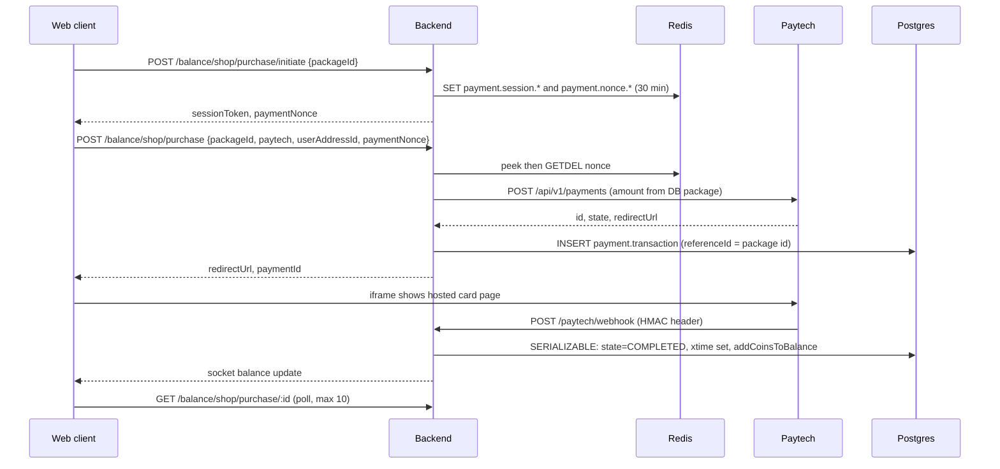

# Payments: how they work today

SpinQuest takes money in by selling coin packages (Gold Coins plus Sweeps Coins, stored as `goldCoins` and `diamonds`) and sends money out by redeeming Sweeps Coins. Purchases go through Paytech (card and Apple Pay) or LinkMoney (ACH bank); Aeropay is wired but dead. Redemptions are only ever paid through Paytech: card payouts are fired immediately, bank (ACH) payouts wait in `CHECKOUT` until an admin approves them. The LinkMoney webhook has no signature check at all, and coin credit on purchases is the only place where the ledger gains value.

The merch store (Shopify, `Merch*` controllers) exists and is a separate system. It is not covered here.

**Update 2026-11-11 (native app read):** the mobile app does not have its own payment UI in practice. It initiates the session natively, then loads the **web** checkout page (`/shop/checkout/payment`) in a WebView, so card, Apple Pay and LinkMoney purchases on mobile run through the web code above. Redemption on mobile is native and calls the same `POST /balance/shop/redemption`. The mobile routes that have no Backend handler (`/balance/shop/purchase/session/:token/...`, `/balance/shop/redemptionRate`, `GET /balance/shop/redemption`, `/aeropay/*`, `/redeem`) are in dead or crypto-only code paths; see "Sub-flow 4: native app". Backend references are to branch `PeterSons` (effectively Backend main); mobile references are to `spinquest-mobile-app` `master` at `fce425f0`.

## At a glance

| Piece | Path |
|---|---|
| FE shop API client | `spinquest-frontend/src/lib/api/shop/index.ts:31` (initiate), `:57` (purchase), `:124` (status) |
| FE package confirm step (creates session) | `spinquest-frontend/src/features/shop/components/shop-package-page/index.tsx:122` |
| FE payment method rows (Apple Pay, LinkMoney, Cards) | `spinquest-frontend/src/features/shop/components/checkout-payment-page/index.tsx:361-420` |
| FE purchase call + iframe URL capture | `spinquest-frontend/src/features/shop/hooks/use-shop-util.ts:52` |
| FE hosted page iframe and outcome check | `spinquest-frontend/src/features/shop/components/shop-iframe-dialog.tsx:91`, `spinquest-frontend/src/features/shop/lib/purchase-outcome.ts:49` |
| FE LinkMoney flow | `spinquest-frontend/src/features/shop/components/shop-package-modal/link-money/index.tsx:204`, `spinquest-frontend/src/lib/api/link-money/index.ts:14` |
| FE Apple Pay | `spinquest-frontend/src/features/shop/components/shop-package-modal/apple-pay/index.tsx`, SDK script `spinquest-frontend/index.html:83` |
| FE redemption UI | `spinquest-frontend/src/features/wallet/components/redeem/redeem-page.tsx`, `.../redemptions/redeem-bank-transfer-dialog/components/{bank-page,card-page,default-page}/` |
| FE transaction history | `spinquest-frontend/src/features/transactions/components/page.tsx:38`, `spinquest-frontend/src/lib/api/transaction-history/index.ts:14,29` |
| BE purchase and redemption controller | `Backend/src/api/controllers/main/ShopPackageController.ts:136` (`/balance/...`) |
| BE Paytech webhook controller | `Backend/src/api/controllers/paytech/PaytechController.ts:11` (`/(paytech\|payment)/webhook`) |
| BE LinkMoney controller | `Backend/src/api/controllers/linkmoney/LinkmoneyController.ts:35` |
| BE Aeropay controller | `Backend/src/api/controllers/aeropay/AeropayController.ts:25` |
| BE balance and history controllers | `Backend/src/api/controllers/main/BalanceController.ts:16`, `Backend/src/api/controllers/main/HistoryController.ts:19` |
| BE admin approval | `Backend/src/api/controllers/admin/PaymentsController.ts:46,106`, `Backend/src/services/admin/PaymentService.ts:89` |
| Services | `Backend/src/services/ShopPackageService.ts`, `Backend/src/services/AsyncShopPackageService.ts`, `Backend/src/services/PaymentSessionService.ts`, `Backend/src/services/Payments/{paytech,linkmoney,aeropay}/` |
| Tables | `payment.transaction` (`Backend/src/db/entity/Payment/PaymentTransaction.ts:30`), `payment.log` (`PaymentLog.ts`), admin actions (`AdminAction.ts`), `public.balance` (`Backend/src/db/entity/Balance.ts:22`), `public.transactions` ledger (`Backend/src/db/entity/Transaction.ts`), `ActionLog` |
| Redis | `payment.session.*`, `payment.nonce.*` (`Backend/src/services/PaymentSessionService.ts:19-21`), `pixelObj.<userId>` (`ShopPackageService.ts:242`) |
| Vendors | Paytech (fyntek engine, `PAYTECH_*`), Finix (Apple Pay merchant session, `FINIX_*`), LinkMoney (`LINKMONEY_*`), Aeropay (dead), Slack (redemption alert), Singular and Meta/Snapchat pixels (post-credit analytics) |
| Mobile purchase screen (native initiate + web checkout WebView) | `spinquest-mobile-app/src/features/shop/components/confirm-purchase-page.tsx` (route `src/app/(protected)/confirm-purchase.tsx`, also `features/casino/components/game-shop-overlay.tsx`) |
| Mobile shop API client | `spinquest-mobile-app/src/lib/api/shop/index.ts:11-119` |
| Mobile redemption | `spinquest-mobile-app/src/features/wallet/components/redeem/new-redemption-modal.tsx`, `payment-method-selection.tsx`, `src/features/wallet/api/use-redemption.ts`, `src/lib/api/users/index.ts:53-140` |

## The flow

### Which providers are on

Controller directories load only when their flag is true (`Backend/src/api/express.ts:17-31`, `:82-86`). Defaults in `Backend/.env.example`: `ENABLE_PAYTECH_API=Y` (line 36), `ENABLE_LINKMONEY_API=Y` (line 40), `ENABLE_AEROPAY_API=N` (line 39). The main purchase and redemption routes sit under the `main` directory, gated by `ENABLE_MAIN_API`.

The accepted `paymentMethod` values are `paytech`, `aeropay`, `aeropaySDK`, `crypto`, `linkmoney`, `linkmoney2`, `applepay` (`Backend/src/services/ShopPackageService.ts:40-48`). `createPurchaseShopPackage` handles `paytech`, `applepay` and `linkmoney`; `aeropay` throws `InternalError` (`:259-260`) and anything else, including `crypto`, `aeropaySDK`, `linkmoney2`, throws `Unsupported Payment Method` (`:283-284`).

### Sub-flow 1: purchase (money in)

#### 1a. Common start: package list and checkout session

1. The shop calls `POST /balance/shop` with a `geoPackage` (`spinquest-frontend/src/lib/api/shop/index.ts:17-28`). The Backend runs `GeoComplyMiddleware` (`ShopPackageController.ts:175`), loads all `ShopPackage` rows ordered by price (`ShopPackageService.ts:114`), and in gold-coin-only states sets `diamonds = 0` on each (`:118-131`).
2. `checkShopPackage` drops offers the user already used (`new_player_offer`, `first_15_minutes`, `one_time_offer_50k_gc`) and every package above 500_00 unless `user.liftedLimit` (`ShopPackageService.ts:95-113`). The controller keeps only the best package per price tier (`ShopPackageController.ts:188-222`).
3. The user picks a package and a billing address (`shop-package-page/index.tsx:122`). Free package (`price === 0`, the one-time 50K GC offer): the client calls `POST /balance/shop/purchase` with `paymentMethod: 'paytech'` and skips checkout (`shop-package-page/index.tsx:127-151`); the Backend claims it in a SERIALIZABLE transaction, sets `oneTime50KGC = true` and calls `userService.addUserGC` (`ShopPackageService.ts:223-239`).
4. Paid package: the client calls `POST /balance/shop/purchase/initiate` with `{ packageId }` (`lib/api/shop/index.ts:38`). Required: user auth with KYC relation loaded, `GeoComplyMiddleware`, `BlockedStatesMiddleware`, `PixelMiddleware`, and a verified phone (`ShopPackageController.ts:145-155`). The Backend stores `{ userId, packageId, state, pixel }` in Redis for 1800 s and returns `sessionToken` and `paymentNonce` (`PaymentSessionService.ts:25-50`, `ShopPackageController.ts:157-170`).
5. The client navigates to `ROUTES.SHOP_CHECKOUT_PAYMENT` with package fields, `sessionToken` and `paymentNonce` in the query string (`shop-package-page/index.tsx:160-176`). The same page is what the native app loads in a WebView (inferred from `payment-success.tsx:6-20` posting to `ReactNativeWebView`).
6. The checkout page shows Apple Pay (only when `window.ApplePaySession.canMakePayments()` is true), LinkMoney and Cards (`checkout-payment-page/index.tsx:361-420`). The crypto row is commented out (`:29`).
7. Every `POST /balance/shop/purchase` is authorised as `paymentSession`: a Bearer JWT if present, otherwise the `x-spinquest-payment-session` header (`UserAuthService.ts:89-122`, `ShopPackageController.ts:299-300`). On the session path, the controller requires `paymentNonce`, requires `body.packageId` to equal the session's package, and peeks the nonce (`ShopPackageController.ts:247-262`). The nonce is deleted atomically (`GETDEL`) just before the service call, so one session can start one charge (`:275-283`, `PaymentSessionService.ts:64-74`).
8. `createPurchaseShopPackage` re-reads the package from the DB by id, so the price and coin amounts come from the server (`ShopPackageService.ts:192-198`). It enforces the daily purchase cap: `maxPurchasePerDay = 9500_00`, `liftedMaxPurchasePerDay = 50000_00` (`:70-71`, `:200-221`). It stores the pixel object in Redis for an hour (`:242-243`), formats `amount` as dollars, and switches on `paymentMethod` (`:244-285`).

#### 1b. Paytech card (enabled by default)

1. Client: `CardsPayment` calls `handleShopPurchase` with method `paytech` (`use-shop-util.ts:52-74`). Body includes `userAddressId` (required by validation for `paytech` and `applepay`, `ShopPackageController.ts:69-73`).
2. `PaytechService.createPayment` loads the user's US address (`PaytechService.ts:278-284`), then `POST {PAYTECH_URL}/api/v1/payments` with `paymentType: DEPOSIT`, `paymentMethod: BASIC_CARD`, `amount`, `referenceId = shopPackage.id`, `returnUrl = APP_URL/payment-success`, `webhookUrl = API_URL/paytech/webhook` (`:286-320`). Every vendor call is logged to `payment.log` with the card redacted (`:166-208`).
3. A non-200 response throws (`:322-329`). On 200 it inserts a `payment.transaction` row: `payment: 'Paytech'`, `paymentId = result.id`, `state = result.state`, `referenceId = package id`, `sweepsIneligible` true when the state is gold-coins-only (`:332-345`). It returns the row plus `redirectUrl` (`:347-349`).
4. The client opens `redirectUrl` in `ShopIframeDialog` and stores `paymentId` (`use-shop-util.ts:76-85`). The hosted card page belongs to the vendor.
5. When the iframe lands on `/payment-success` or posts a `payment-success` message, the dialog does not trust it: it polls `GET /balance/shop/purchase/:id` up to 10 times at 1 s intervals, treating `AUTHORIZED` or `COMPLETED` as success and `FAILED`, `DECLINED`, `CANCELLED` as failure (`shop-iframe-dialog.tsx:96-118`, `lib/purchase-outcome.ts:4-11`, `:49-69`). Only messages from the dialog's own iframe `contentWindow` are accepted (`shop-iframe-dialog.tsx:173-176`).
6. Webhook: Paytech calls `POST /paytech/webhook` (the controller path regex is `/(paytech|payment)`, `PaytechController.ts:11`). The controller calls the service without `await` and always answers `{ status: 'success' }` (`:20-26`).
7. `PaytechService.webhook` computes `HMAC-SHA256(PAYTECH_WEBHOOK_KEY, rawBody)` hex and compares to the `signature` header with `!==`; on mismatch it returns silently (`PaytechService.ts:612-622`). It then logs the webhook (PII redacted) and dispatches on `paymentType`: `DEPOSIT` to `completePaymentPurchaseShopPackage` (`:638-642`).
8. `completePaymentPurchaseShopPackage` runs in a SERIALIZABLE transaction. It finds the row by `payment: 'Paytech'` and `paymentId` (`:691-698`). `shouldProcessTx = body.state === 'COMPLETED' && !transaction.xtime` (`:700-701`). It writes `state` and `status` from the webhook, and when processing it sets `xtime` to the user's highest prior deposit `xtime` plus one (`:703-729`). If `shouldProcessTx`, it calls `addCoinsToBalance` in the same transaction and queues a post-commit Singular enqueue (`:734-752`). Errors are caught and logged, and the webhook is not retried by the Backend (`:757-762`).
9. Idempotency: the credit path is guarded by `xtime` being null plus the SERIALIZABLE transaction, so a repeated `COMPLETED` webhook does not credit twice (`PaytechService.ts:700-701`).

#### 1c. Paytech Apple Pay (enabled with Paytech)

1. The Apple Pay SDK is loaded globally in `spinquest-frontend/index.html:83`. The `ApplePay` component runs the same purchase call with method `applepay` (`apple-pay/index.tsx`); the Backend creates the payment with `paymentMethod: APPLEPAY` (`PaytechService.ts:288-290`).
2. For validation the client calls `POST /balance/shop/purchase/:id/session` with `{ validationUrl }` (`lib/api/shop/index.ts:97-108`). The Backend checks the payment belongs to the user, is Paytech `APPLEPAY`, then calls Finix `POST https://finix.live-payments-api.com/apple_pay_sessions` with `FINIX_MID` and `WEB_DOMAIN` (`ShopPackageService.ts:146-160`, `PaytechService.ts:222-243`).
3. After the sheet, the client calls `POST /balance/shop/purchase/:id/continue` with `{ result, data }`; the Backend forwards it as form data to `https://engine-external.fyntek.ai/checkouts/:id/continue` (or `/cancel` for `CANCEL`) and returns `{ success: true }` regardless of vendor errors (`ShopPackageService.ts:162-181`, `PaytechService.ts:245-261`).
4. Status: `GET /balance/shop/purchase/:id` for Apple Pay rows asks the vendor engine directly (`PaytechService.ts:210-220`, `ShopPackageService.ts:140-142`); for every other row it returns the local `payment.state` (`:143`). Credit still happens only through the same webhook (1b step 7 to 8).

#### 1d. LinkMoney ACH (enabled by default)

1. The row component first calls `GET /balance/shop/purchase/linkmoney/bank-accounts` for saved accounts (`lib/api/shop/index.ts:44-50`, `ShopPackageController.ts:299-308`). Accounts come from LinkMoney via `listPreferredActiveBankAccounts` (`ShopPackageService.ts:90-93`).
2. New bank: client sends `POST /balance/shop/purchase` with `paymentMethod: 'linkmoney'` and `bankAccountId: 'linkNewAccount'` (`link-money/index.tsx:201-208`). `linkAndPay` creates a LinkMoney session (`POST /v2/sessions`, `experienceId: LINK_MANAGED_PAYMENT`), inserts a `payment.transaction` row in state `CHECKOUT` with a random UUID as `paymentId`, and returns `session.sessionUrl` (`LinkmoneyService.ts:354-416`). The client does `window.location.href = sessionUrl` (`link-money/index.tsx:213-216`).
3. Return from LinkMoney: the shop page carries `customerId`, `paymentId`, `paymentStatusCode` in the URL; if the user has no `linkmoneyUserId` yet, the client calls `POST /linkmoney/redirect` (`use-link-money-customer.ts:84-90`, `lib/api/link-money/index.ts:14`). The Backend stores the supplied `customerId` as `user.linkmoneyUserId` and writes an `ActionLog` row (`LinkmoneyService.ts:308-331`).
4. Saved bank (or user with `linkmoneyUserId` and a chosen account): `createPayment` posts `POST /v1/payments` from `source: { id: user.linkmoneyUserId, type: 'CUSTOMER' }` to the merchant, ignoring `bankAccountId` (`LinkmoneyService.ts:446-476`). It inserts the row with `state = LinkmoneyStatesEnum[paymentStatus]` (`PENDING`, `FAILED`, `AUTHORIZED`) (`:486-500`, `Backend/src/db/entity/Linkmoney/LinkmoneyTypes.ts:14-18`). If the immediate status is `AUTHORIZED`, it calls `completeLinkmoneyPurchaseShopPackage` itself (`:501-508`).
5. Webhook: `POST /linkmoney/webhook` is unauthenticated and the service does not verify any signature (`LinkmoneyController.ts:53-58`, `LinkmoneyService.ts:561-571`). Mapping `payment.*` event to state: `WebhookTypesEnum` (`LinkmoneyTypes.ts:33-43`), for example `payment.authorized` to `AUTHORIZED`, `payment.succeeded` to `COMPLETED`, `payment.failed` to `DECLINED`.
6. `completeLinkmoneyPurchaseShopPackage` handles every `payment.*` event except `payment.created`. It looks up by `payment: 'Linkmoney'` and `paymentId = body.metadata.clientReferenceId` (`:577-593`). `shouldProcessTx = status === 'AUTHORIZED' && !transaction.xtime` (`:595`); the same `xtime` guard and `addCoinsToBalance` follow (`:598-648`). The comment says the user must not wait for ACH settlement, so credit happens on `AUTHORIZED`, not on `COMPLETED` (`:631`).

#### 1e. Aeropay (disabled and dead)

`ENABLE_AEROPAY_API=N` by default (`Backend/.env.example:39`). The purchase branch throws before any vendor call (`ShopPackageService.ts:259-266`). The webhook handler still exists: it verifies `HMAC-SHA256` over `rawBody` with its last character replaced by `, "url": "<webhookUrl>"}` (`AeropayService.ts:397-415`), updates state, and for `processed` throws `Not Supported` instead of crediting (`:417-458`). The redemption branch for Aeropay in admin approval is commented out (`PaymentService.ts:155-158`). Bank linking routes `GET /aeropay/addBankAccount` and `POST /aeropay/linkBankAccount` exist behind the flag (`AeropayController.ts:29-43`).

### Credit step shared by all providers: `addCoinsToBalance`

`Backend/src/services/AsyncShopPackageService.ts:96` is the only place purchase value is credited. It must run inside a SERIALIZABLE transaction (`:98`).

1. Re-reads the package by `payment.referenceId` (`:101-104`). For `new_player_offer`, if the user already used the offer, it swaps to a non-discounted package and rewrites `referenceId` (`:106-130`).
2. Refuses if the package is missing or `payment.amount !== (price / 100).toFixed(2)` (`:132-140`). This compares the stored amount to the package price, not to anything the vendor reports in the webhook.
3. If `payment.sweepsIneligible`, sets `diamonds = 0` for this credit (`:144-146`).
4. Single `UPDATE balance SET diamonds = diamonds + D, goldCoins = goldCoins + G, playThrough = playThrough + D RETURNING *` (`:148-159`); throws if it did not affect exactly one row (`:161`).
5. Updates `user.lastPurchase` and `user.currentPurchase += price` (`:163-172`).
6. Writes two `Transaction` ledger rows, type `purchase`: one for `diamonds` (credit D, debit 0) and one for `goldCoins` (debit = price in cents, credit G) (`:174-191`).
7. Pushes the new balance over the socket (`:193-195`), flips `newPlayerOffer` or `first15minutes` flags (`:197-211`), then fires Meta and Snapchat pixels and a GA purchase event (`:213-318`). Post-commit, `enqueueSingularEmissions` queues Singular events behind the `ops-singular-events` flag (`:55-94`).

### Sub-flow 2: redemption (money out)

Methods come from `REDEEM_METHODS` (default `["bank","card"]`, `Backend/.env.example:22`), read in `ShopPackageService.ts:289`. The request validator only accepts `type` `card` or `bank` (`ShopPackageController.ts:86-88`). `REDEEM_METHODS` only filters what `GET /balance/shop/redemptionMethods` offers; `POST /balance/shop/redemption` does not read it (`ShopPackageService.ts:325-477`).

#### 2a. Eligibility the user sees

1. The redeem page uses `GET /balance/redeemable` for `redeemableDiamonds` and `playThroughRequired` (`lib/api/users/index.ts:114`, `BalanceController.ts:31-41`). Redeemable SC is `max(0, floor(diamonds - playThrough))` (`Backend/src/services/BalanceService.ts:8-10`).
2. The page enables redemption only when identity is verified (`user.kycVerification.sessionStatus === 'approved'`), email is confirmed, and redeemable SC is at least `MIN_REDEEM_AMOUNT = 50` (`redeem-page.tsx:22-33`, `verification-checks.tsx:10`).
3. The method picker calls `GET /balance/shop/redemptionMethods?amount=` (`lib/api/users/index.ts:143`, `default-page/index.tsx:66`). The Backend returns for each enabled method `min`, `max`, `command`, `enabled` (`ShopPackageService.ts:288-323`). Limits are hard-coded: bank 50_00 to 5000_00, card 50_00 to 500_00 (`:66-69`). The card is disabled with `availableAfterFirstRedemption` until the user has one `COMPLETED` withdrawal (`:303`, `:498-507`).

#### 2b. The request (both methods)

1. The form collects bank (`routingNumber`, `accountNumber`) or card (`cardNumber`, `expiryMonth`, `expiryYear`, `cardSecurityCode`) plus `amount` (SC converted by `toCentsFromCoin`), `userAddressId` and a fresh `geoPackage` (`bank-form.tsx:111-121`, `card-form.tsx:146-157`). The request class is `RedemptionRequest` (`ShopPackageController.ts:81-134`).
2. `POST /balance/shop/redemption` requires user auth with balance and KYC relations, `GeoComplyMiddleware` then `MfaGateMiddleware` (`ShopPackageController.ts:348-353`). The MFA gate requires `mfaCode` in the body when MFA is enforced and the device is not trusted (`Backend/src/api/middlewares/custom/MfaGateMiddleware.ts:36-55`). There is no `BlockedStatesMiddleware` on this route.
3. The handler rejects unless `kycVerification.status === 'VERIFIED'` and `isVerifiedFully()` (email) (`:358-362`).
4. `createRedemption` runs in a SERIALIZABLE transaction (`ShopPackageService.ts:325-327`):
   - Reads the user's latest non-`FAILED`/`CANCELLED`/`DECLINED` withdrawal (`:332-342`).
   - Enforces min and max per type (`:344-361`); a card amount above 500 SC but within the bank max says "Use ACH transaction".
   - Rate limit: no new request on the same calendar day (zone `TIMEZONE`) as the last one, and not within 6 hours (`:363-379`).
   - Card needs a prior `COMPLETED` withdrawal (`:381-392`).
   - Playthrough: `UPDATE balance SET diamonds = diamonds - amount WHERE userId AND FLOOR(diamonds - playThrough) >= amount`; zero rows affected means `Playthrough Requirement not yet met.` (`:394-406`). This is the atomic check; `amount` comes from the client but is bounded by the balance in this statement.
   - Writes the ledger row: `Transaction` type `claim`, `affectedCurrency: 'diamonds'`, `debitAmount: amount` (`:408-415`). Its id becomes the redemption's `referenceId`.
   - Pushes the new balance to the socket (`:417-419`).
   - Converts to dollars as `amount / 100` (1 SC = 1 USD, `:421`).

#### 2c. Bank (ACH): manual admin review

1. `redemptionBank` inserts `payment.transaction`: `payment: 'Paytech'`, `type: WITHDRAWAL`, `state: 'CHECKOUT'`, `paymentId: 'bank'`, `parentPaymentId: '<routing>:<account>:<addressId>'` (`PaytechService.ts:579-592`). Bank numbers are therefore stored in a `varchar(64)` column (`PaymentTransaction.ts:78-79`).
2. A post-commit hook posts to Slack channel `SLACK_REDEMPTION_CHANNEL_ID`: "New Redeem ACH Transaction for $X requested!" (`:594-602`).
3. The user sees the row in redemption history in `CHECKOUT` (`ShopPackageService.ts:479-496`).
4. An admin with role `support` calls `PUT /admin/payment/:id` with `{ accept, reason }` (`PaymentsController.ts:45-46`, `:106-119`). `AdminPaymentService.action` requires `type === 'WITHDRAWAL'` and `state === 'CHECKOUT'` (`PaymentService.ts:101-112`), inserts a `PaymentAdminAction` and an `ActionLog` row (`REDEMPTION_APPROVE` or `REDEMPTION_REJECT`) (`:114-131`).
5. Approve: flips the ledger row `claim` to `withdraw` (`:133-143`), then for `Paytech` calls `withdrawal()`, which re-reads the row, blocks banned users, parses bank data back out of `parentPaymentId` and queues a post-commit `POST /api/v1/payments` with `paymentType: WITHDRAWAL` (`PaytechService.ts:355-460`). On response, state becomes the vendor state, or the claim is rolled back on a 400 or on `CANCELLED`/`DECLINED` (`:460-518`). Non-Paytech payments throw `No Payment Solution` (`PaymentService.ts:159-160`).
6. Reject: payment state set to `CANCELLED` and `rollbackClaim` credits the SC back (`:162-176`).

#### 2d. Card: instant request, no admin step

1. `redemptionCard` inserts the row (`paymentId: 'card'`, `state: 'CHECKOUT'`) and immediately calls `withdrawal()` with the card data (`PaytechService.ts:537-562`). Card data is passed in memory to the post-commit hook; it is not written to the DB, and the request log replaces `card` with `REDACTED` (`:193-195`).
2. After the DB commit the hook posts the payout to Paytech. If the call throws, the row stays `CHECKOUT` "for manual review" (`:467-470`). A 400 gives `FAILED` plus rollback; a vendor `DECLINED`/`CANCELLED` gives the same rollback (`:475-515`).

#### 2e. Payout webhook, completion, reversal

`POST /paytech/webhook` with `paymentType: WITHDRAWAL` calls `completeRedemption` (`PaytechService.ts:640-641`, `:645-683`). It sets `state` and `status` from the webhook (`:655-662`). On `COMPLETED` it flips the ledger row to `type: 'withdraw'` (`:664-669`). On `DECLINED`, `CANCELLED` or `FAILED`, if the stored state was not already one of those, it calls `rollbackClaim` (`:670-678`). `rollbackClaim` adds the original debit back to `diamonds`, writes a `claim` ledger row with `creditAmount`, pushes the balance, and sends the `EMAIL_REDEMPTION_REQUEST_REJECT_TEMPLATE_NAME` email (`AsyncShopPackageService.ts:321-372`).

### Sub-flow 3: how history is shown

1. The Transactions page has Deposits and Withdrawals tabs (`spinquest-frontend/src/features/transactions/components/page.tsx`, `common/transaction-tabs.tsx`). They call `GET /users/history/deposits` and `GET /users/history/withdraws` (`lib/api/transaction-history/index.ts:14,29`).
2. `HistoryController` returns `{ status, data, totalResults, hasMore }` using the `Content-Range` header (`HistoryController.ts:22-62`).
3. Deposits: `payment.transaction` rows of `type DEPOSIT` for the user with `state != 'CHECKOUT'` (`Backend/src/services/HistoryService.ts:20-26`). Withdrawals: `WITHDRAWAL` rows with `state != 'CANCELLED'` (`:41-47`). The client relabels `CHECKOUT` deposits as `ABANDONED_CART` (`page.tsx:38-44`, `deposits-table.tsx:10-14`), which the Backend already filters out.
4. The redeem page has its own list from `GET /balance/shop/redemptionHistory`, which also hides `CANCELLED` (`ShopPackageController.ts:376-400`, `ShopPackageService.ts:479-496`, `lib/api/users/index.ts:99`).
5. `src/features/user-history/` is game history (`/apps/history`, `lib/api/history/index.ts:14`), not payments.
6. Wallet balances: `GET /balance` returns `goldCoins` and `diamonds` (`BalanceController.ts:20-29`); balance changes also arrive by socket (`socketActionService.sendUserBalance`, `AsyncShopPackageService.ts:193`).

### Sub-flow 4: native app (`spinquest-mobile-app`)

#### 4a. Purchase: native session, web checkout in a WebView

1. `ConfirmPurchasePage` (route `(protected)/confirm-purchase`, and the in-game `game-shop-overlay`) handles the free package natively with `postClaimFreeShopPackage` (`POST /balance/shop/purchase`, `confirm-purchase-page.tsx:128`).
2. For a paid package it calls `postInitiatePurchase` (`POST /balance/shop/purchase/initiate`, exists on Backend) and stores `sessionToken` and `paymentNonce` (`:151-166`).
3. It builds `${webUrl}/shop/checkout/payment?...sessionToken&paymentNonce...` where `webUrl` defaults to `https://spinquest.com` and can be overridden in developer settings (`:83-84`, `:103-119`), and renders it in a `WebView` (`:488-493`).
4. Inside the WebView the **web** checkout runs: it calls `POST /balance/shop/purchase` with the `x-spinquest-payment-session` header (Sub-flow 1a step 7), then Paytech card, Apple Pay or LinkMoney as on web. The web `payment-success` page posts to `window.ReactNativeWebView`.
5. The app listens with `onMessage={handleCheckoutMessage}`: a `payment-success` event opens the native purchase-success screen (`:228`). It also watches navigation: URLs containing `/payment-success` or `/payment-failed` end the flow, and any URL not under `webUrl` is treated as the payment provider (`:330-341`). Credit still happens only through the Backend webhook (Sub-flow 1b step 8).

Consequence: the mobile app has no payment SDK of its own and depends on the production web checkout page, matching `central-tech/TODO.md:430-439`. A web checkout regression breaks mobile purchases too, and a mobile build always buys through whatever `webUrl` points to.

#### 4b. Dead native purchase code (explains the missing routes)

- `src/lib/api/shop/index.ts:61-119` calls `POST /balance/shop/purchase/session/:sessionToken`, `.../:paymentId/session`, `.../:paymentId/continue` and `GET .../:paymentId`. None exist on Backend `PeterSons`. They match an unmerged Backend branch: commits `f978e089` ("adding session token for the payment flow", 2026-03-20), `780bb6f8`, `28661110` ("payment session auth, guarded purchase commit, initiate", 2026-03-25) are not ancestors of `PeterSons`. `PeterSons` instead uses the `x-spinquest-payment-session` header on `POST /balance/shop/purchase`.
- Callers: `usePurchaseShopItem` and `useLinkMoneyBankAccounts` are used only by `features/shop/components/link-money/*`, reached via `InstantBankTransfer` → `PaymentMethodForm` → `BillingDetailsModal`, and nothing renders `BillingDetailsModal` (grep). `usePurchaseStatus`, `useCreateApplePaySession`, `useSubmitApplePayResult` have no component callers. So the whole native payment-method path (including native LinkMoney) is unreachable; the WebView path in 4a is the live one.
- `src/lib/api/aeropay/index.ts` (`/aeropay`, `/aeropay/addBankAccount`, `/aeropay/linkBankAccount/`, `/aeropay/payment`) and `src/lib/api/redemption/index.ts` (`POST /redeem`) have no callers.

#### 4c. Redemption: native

1. `NewRedemptionModal` and `PaymentMethodSelection` (`src/features/wallet/components/redeem/`) use `GET /balance/redeemable`, `GET /balance/shop/redemptionMethods?amount=`, `GET /balance/shop/redemptionHistory` and `POST /balance/shop/redemption`, all present on Backend (`src/lib/api/users/index.ts:53-115`). Same rules and gates as Sub-flow 2 (KYC, email, MFA gate, GeoComply, limits, playthrough).
2. Methods default to `['bank', 'card']` when the methods call returns nothing (`payment-method-selection.tsx:94-101`).
3. Crypto is a leftover: `useGetShopRedemption` calls `GET /balance/shop/redemption` (no Backend route) to decide `hasCryptoOptions`; when it fails or is empty, `crypto` is filtered out (`:91-118`). `useRedemptionRate` (`GET /balance/shop/redemptionRate`, no Backend route; web uses `/redemption/rate`, also missing) is only used by `crypto-form.tsx`. Inferred: both clients carry crypto-redemption UI that the Backend removed (migration `1742372561871-remove-redeem.ts`), and it stays hidden because the options call fails. Each redeem screen open still fires one failing request.

## States and data

### Balance representation

| Field | Meaning | Where |
|---|---|---|
| `goldCoins` | Gold Coins (play, not redeemable) | `Backend/src/db/entity/Balance.ts:49-54` |
| `diamonds` | Sweeps Coins (SC), integer in cents-of-SC (50_00 = 50 SC) | `Balance.ts:56-61`, `ShopPackageService.ts:66-69` |
| `playThrough` | Numeric(20,4) wagering requirement; purchase adds the SC amount to it | `Balance.ts:63-70`, `AsyncShopPackageService.ts:155` |
| redeemable | `floor(diamonds - playThrough)`, not stored | `BalanceService.ts:8-10`, `ShopPackageService.ts:401` |

The code does not separate redeemable from non-redeemable SC into two columns; it uses the `playThrough` subtraction. Purchased SC raises `playThrough` by the same amount (1x), and gameplay logic that lowers it is outside this document.

### Ledger writes

| Event | Table and type | Written by |
|---|---|---|
| Purchase credited | `Transaction` `purchase`, one row per currency (diamonds, goldCoins) | `AsyncShopPackageService.ts:174-191` |
| Free 50K GC claim | via `userService.addUserGC` | `ShopPackageService.ts:233-237` |
| Redemption requested | `Transaction` `claim`, debit | `ShopPackageService.ts:408-415` |
| Redemption approved or completed | same row updated to `withdraw` | `PaymentService.ts:134-143`, `PaytechService.ts:664-669` |
| Redemption rolled back | new `Transaction` `claim`, credit | `AsyncShopPackageService.ts:340-348` |

The `payment.transaction` table is the vendor-facing record. Its `referenceId` is the package id for a deposit and the `Transaction.id` for a withdrawal (`PaytechService.ts:579`). `xtime` is the per-user deposit sequence and doubles as the "already credited" marker (`:700-729`).

### Purchase states (`payment.transaction.state`, enum `PaymentStatesValues`: `CHECKOUT`, `PENDING`, `FAILED`, `AUTHORIZED`, `SCHEDULED`, `INITIATED`, `COMPLETED`, `DISBURSED`, `CANCELLED`, `DECLINED`, `Backend/src/db/entity/Payment/PaymentTypes.ts:4-15`)

| State | Set by | Component | What moves it on |
|---|---|---|---|
| (row created) vendor `result.state`, typically `CHECKOUT` | `createPayment` (`PaytechService.ts:332-345`) | Backend, on `POST /balance/shop/purchase` | Paytech webhook |
| `CHECKOUT` (LinkMoney) | `linkAndPay` insert (`LinkmoneyService.ts:404`) | Backend | LinkMoney `payment.*` webhook |
| `PENDING` / `FAILED` / `AUTHORIZED` (LinkMoney saved account) | `createPayment` insert (`:489`) | Backend, synchronous vendor reply | `AUTHORIZED` triggers credit immediately (`:501-508`); later webhooks |
| any vendor state | Paytech webhook writes `body.state` (`PaytechService.ts:703-710`) | Webhook | next webhook (no guard on order) |
| `COMPLETED` (Paytech) | same | Webhook | credit happens here, once (`:700-701`) |
| `AUTHORIZED` (LinkMoney) | `WebhookTypesEnum` (`LinkmoneyTypes.ts:33-43`) | Webhook | credit happens here, once (`LinkmoneyService.ts:595`) |
| `SCHEDULED`, `INITIATED`, `COMPLETED`, `DISBURSED`, `CANCELLED`, `DECLINED` (LinkMoney) | webhook mapping | Webhook | state overwritten; no further coin effect |
| History hides `CHECKOUT` | `HistoryService.ts:26` | Backend query | n/a |

No cron moves a purchase state. The only scheduled code touching payments is a commented-out `sendRedemptionRequests` call (`Backend/src/api/cron/cronController.ts:37`).

### Redemption states

| State | Set by | Component | Next |
|---|---|---|---|
| `CHECKOUT` | `redemptionBank` / `redemptionCard` insert (`PaytechService.ts:524-592`) | Backend on `POST /balance/shop/redemption` | Bank: admin; card: immediate post-commit payout call |
| `CANCELLED` | `AdminPaymentService.action` with `accept: false` (`PaymentService.ts:165`) | Admin | terminal; SC refunded |
| vendor state (`PENDING`, `COMPLETED`, `CANCELLED`, `DECLINED`) | post-commit hook after Paytech reply (`PaytechService.ts:496-514`) | Backend | webhook |
| `FAILED` | HTTP 400 from Paytech (`:508`) | Backend | terminal; SC refunded (`:481-484`) |
| `PENDING` | non-200, non-400 reply (`:508`) | Backend | webhook |
| `COMPLETED` | webhook (`PaytechService.ts:655-662`) | Webhook | ledger row becomes `withdraw` |
| `DECLINED`, `CANCELLED`, `FAILED` | webhook | Webhook | SC refunded once if prior state was not already one of these (`:670-678`) |

## Configuration

| Key or constant | Effect | Read at |
|---|---|---|
| `ENABLE_PAYTECH_API` (Y), `ENABLE_LINKMONEY_API` (Y), `ENABLE_AEROPAY_API` (N), `ENABLE_MAIN_API` | Load controller directories | `Backend/src/api/express.ts:17-31`, `:82-86` |
| `REDEEM_METHODS` | Methods listed by `redemptionMethods` | `ShopPackageService.ts:289` |
| `PAYTECH_URL`, `PAYTECH_API_KEY`, `PAYTECH_WEBHOOK_KEY`, `PAYTECH_WEB_DOMAIN` | Vendor API, webhook HMAC key, Apple Pay domain | `PaytechService.ts:147-150` |
| `FINIX_AUTH`, `FINIX_MID` | Apple Pay merchant session | `PaytechService.ts:153-154` |
| `LINKMONEY_API_KEY`, `LINKMONEY_API_SECRET`, `LINKMONEY_MERCHANT_ID`, `LINKMONEY_URL` | LinkMoney API | `LinkmoneyService.ts:151-154` |
| `LINKMONEY_WEBHOOK_KEY` | Present in `Backend/.env.example:285`; no code reads it | none |
| `AEROPAY_*` | Aeropay (dead) | `AeropayService.ts:141` |
| `APP_URL`, `API_URL` | Return and webhook URLs | `PaytechService.ts:151-152` |
| `SLACK_REDEMPTION_CHANNEL_ID` | ACH redemption alert | `PaytechService.ts:596` |
| `EMAIL_REDEMPTION_REQUEST_REJECT_TEMPLATE_NAME`, `EMAIL_PURCHASE_APPROVED_TEMPLATE_NAME` | Email templates | `AsyncShopPackageService.ts:357`, `:404` |
| `TIMEZONE` | Day boundary for purchase cap and once-per-day redemption | `ShopPackageService.ts:74` |
| Hard-coded limits | Redemption bank 50 to 5000 SC, card 50 to 500 SC; purchase cap 9500 (50000 lifted) dollars per day; session TTL 1800 s | `ShopPackageService.ts:66-71`, `PaymentSessionService.ts:21` |
| Flag `ops-singular-events` | Gate for Singular revenue events | `AsyncShopPackageService.ts:56-61` |
| FE `AEROPAY_LOCATION_ID`, `LINK_MONEY_MERCHANT_ID`, `LINK_MONEY_ENVIRONMENT` | Declared required (the first two as `z.string()`) in the env schema; no other reference in `spinquest-frontend/src` | `spinquest-frontend/src/config/env.ts:86-93` |

## Edge cases and failure handling

- Gates on purchase initiate: verified phone, GeoComply, blocked states, pixel capture (`ShopPackageController.ts:145-155`). On the session path, GeoComply is skipped and the state captured at initiate is reused (`GeoComplyMiddleware.ts:36-39`, `UserAuthService.ts:119`).
- Gates on `POST /balance/shop/purchase`: same three middlewares, KYC relation loaded, verified phone (`ShopPackageController.ts:226-236`). No code there checks KYC status for a purchase; `withKyc` only loads the relation (`Backend/src/services/UserService.ts:496`).
- LinkMoney "unknown account" branch: when a user has a `linkmoneyUserId` but sends no `bankAccountId`, the controller returns the account list and does not consume the nonce (`ShopPackageController.ts:264-271`).
- Paytech create failure: any non-200 raises an error with a field-friendly message or `API Error` (`PaytechService.ts:322-329`). A thrown network error is logged to `payment.log` then rethrown (`:188-205`).
- Webhook errors are swallowed and logged: purchase (`PaytechService.ts:757-762`), redemption (`:680-682`), LinkMoney (`LinkmoneyService.ts:650-657`). The HTTP answer is already `success`, so vendors see no failure (Paytech controller returns before awaiting, `PaytechController.ts:20-26`; LinkMoney awaits but also returns `success` after the service swallowed the error, `LinkmoneyController.ts:55-57`).
- Pending purchase at the browser: `verifyPaymentOutcome` returns `payment-unverified` after 10 polls; the dialog then closes neutrally and the balance is expected to arrive over the socket (`purchase-outcome.ts:68`, `shop-iframe-dialog.tsx:120-132`).
- Redemption serialization failures `40001` and `40P01` are rethrown as-is; other unexpected errors become `InvalidPurchaseError` (`ShopPackageService.ts:452-470`).
- Banned user: the withdrawal hook refuses unless `deletedReason` is `break`, `close` or `ban` (`PaytechService.ts:376-381`; Inferred: a user deleted for any other reason is blocked, one deleted for those reasons is allowed).
- MFA failure on redemption: 403 `MFARequired`, 409 `MFAStale`, or lockout (`MfaGateMiddleware.ts:51-80`).

## What the team has already said

- `central-tech/reference/payments.md:28-41` lists the same pieces (`payment.transaction`, `PaymentSessionService`, `ShopPackageService`, providers Aeropay, Linkmoney, Paytech) and says no crypto integration exists even though `CryptoWallet` is in `PaymentSolutionValues`. It lists redemption as `VaultController.ts` and `Vault.ts`, which does not match the redemption code read here (`ShopPackageController.ts:348-365`).
- `central-tech/reference/payments.md:100-125` argues for webhooks as first-class, idempotency keys, and the transaction id as the key; it is design intent for a future payment service, not current behaviour.
- `central-tech/drafts/legacy-parity-inventory.md:189` classifies the `x-spinquest-payment-session` fallback as "drop", to be replaced by payment-service's own credential (status "Not implemented").
- `central-tech/drafts/legacy-parity-inventory.md:261` records that MFA gates `POST /shop/redemption` after GeoComply and that `/vault/withdraw` has no geo check.
- `central-tech/TODO.md:430-439` notes the mobile app buys through a WebView with no payment SDK and tracks the payment-service open questions.
- `central-tech/TODO.md:539-543` lists purchase and redemption as the only location-gated actions in the new stack.
- Nothing found about the missing LinkMoney signature check, the unguarded state overwrites, or the dead Aeropay path in `central-tech/drafts/backend-bugs.md` (its webhook items are about Veriff).

## Gaps, oddities, and risks

1. LinkMoney webhook is unauthenticated. `POST /linkmoney/webhook` has no auth decorator and the service never reads `LINKMONEY_WEBHOOK_KEY` (`LinkmoneyController.ts:53-58`, `LinkmoneyService.ts:561-571`; grep of `WEBHOOK_KEY` in `Backend/src/services/Payments/` finds only Paytech and Aeropay). A `payment.authorized` body with a known `metadata.clientReferenceId` runs `addCoinsToBalance`. That id is the `uuid` returned to the purchaser in the purchase response (`LinkmoneyService.ts:411-418`, `:513-520`), so the code lets the purchaser trigger their own credit without a settled payment.
2. LinkMoney credits on `AUTHORIZED`, before ACH settlement (`LinkmoneyService.ts:595`, comment at `:631`). Later `payment.failed` or `payment.canceled` webhooks only overwrite `state`; no code reverses the credit (`:598-607`).
3. No guard on state transitions. Purchase and redemption webhooks write `state` unconditionally (`PaytechService.ts:703-710`, `:655-662`; `LinkmoneyService.ts:598-607`). The author left `// TODO: check status already processed` (`PaytechService.ts:638`). Examples the code permits: a purchase `COMPLETED` row overwritten by a later `PENDING`, coins not reversed; a redemption `COMPLETED` row then receiving `DECLINED` runs `rollbackClaim` because the stored state is not in the failed list (`:670-678`), refunding SC after a completed payout (the vendor may never send that sequence; the code does not prevent it).
4. Admin approval can run twice. If the Paytech payout call throws, the hook leaves the row in `CHECKOUT` (`PaytechService.ts:467-470`), and the admin guard only requires `state === 'CHECKOUT'` (`PaymentService.ts:106-111`). Approve also flips the ledger row to `withdraw` before the payout call returns (`:133-143`). Whether Paytech rejects the repeated `referenceId` is not visible here.
5. Webhook signature compares use `!==`, not a constant-time compare (`PaytechService.ts:622`, `AeropayService.ts:410`). A bad signature is dropped silently but HTTP 200 is still returned, because the Paytech and Aeropay controllers do not await and always answer `success` (`PaytechController.ts:20-26`, `AeropayController.ts:47-53`). The Paytech signature is not skippable in the service; the skip risk is the LinkMoney gap.
6. Credit amount is not tied to the vendor's reported amount. `addCoinsToBalance` compares the stored `payment.amount` to the package price (`AsyncShopPackageService.ts:132-140`), never to the webhook body. Purchase pricing otherwise comes from the DB (`ShopPackageService.ts:192-198`), not from the client; the `price`, `goldCoins`, `diamonds` query fields in the checkout URL are display only (`shop-package-page/index.tsx:166-171`).
7. Client-supplied `customerId` is stored as the user's LinkMoney identity. `redirect()` writes `body.customerId` to `user.linkmoneyUserId` with no check against LinkMoney (`LinkmoneyService.ts:308-331`). `createPayment` then charges that id as `source` (`:451-455`).
8. Daily purchase cap is checked at payment creation but incremented at credit time (`ShopPackageService.ts:200-213` versus `AsyncShopPackageService.ts:163-172`), so several open checkouts can each pass the check. Code comment says `// $5k` next to `9500_00` (`ShopPackageService.ts:70`). The `currentPurchase` reset runs at creation time when the day rolled over (`:214-221`).
9. Bank routing and account numbers are stored in plaintext in `payment.transaction.parentPaymentId` (`PaytechService.ts:591`).
10. `new_player_offer` fallback looks up the replacement package with `diamonds: shopPackage.price` (`AsyncShopPackageService.ts:115-120`): price is in cents while `diamonds` is SC cents, which only lines up when the ratio is 1.
11. (See also Sub-flow 4: mobile has the same leftovers, plus dead `/purchase/session/...` routes from an unmerged Backend branch.) FE calls routes the Backend does not define: `GET /balance/shop/redemption` and `GET /balance/shop/redemption/rate` (`lib/api/users/index.ts:79-88`, `:155-160`; Backend routes are only `POST /shop/redemption`, `GET /shop/redemptionMethods`, `GET /shop/redemptionHistory`, `ShopPackageController.ts:352-381`). They are used by `default-page/index.tsx:68` and `crypto-page/index.tsx:53,58`. A migration named `1742372561871-remove-redeem.ts` exists in `Backend/src/db/migration/`.
12. FE and BE method lists differ: the client lists `heropayments` (`lib/api/shop/types.ts`, `PaymentMethodValues`); the Backend `@IsIn` rejects it (`ShopPackageController.ts:60-62`, `ShopPackageService.ts:40-48`). The Backend also lists `linkmoney2`, which the client does not.
13. Dead or partial code: Aeropay purchase and redemption, `LinkmoneyService.withdrawal` (`:529-555`), `AdminPaymentService` Aeropay and LinkMoney branches (`PaymentService.ts:155-158`), `sendPurchaseApprovedEmail` (no caller found in files read), and the commented-out nightly `sendRedemptionRequests` (`cronController.ts:37`).
14. KYC is checked on two different fields: the FE gate uses `sessionStatus === 'approved'` (`redeem-page.tsx:22-23`), the Backend uses `kycVerification.status === 'VERIFIED'` (`ShopPackageController.ts:358`). Whether they always agree is not shown.
15. `REDEEM_METHODS` is advisory: the POST route accepts `bank` and `card` even if the env key removes one (`ShopPackageController.ts:86-88`, `ShopPackageService.ts:289`).
16. `getFrontendStatus` calls the vendor engine URL with no credentials for Apple Pay status (`PaytechService.ts:210-220`).

## Not verified

- Deployed values for every flag and env key (only `Backend/.env.example` was read), including whether LinkMoney or Aeropay are enabled in production.
- Whether LinkMoney signs webhooks at the network edge (a WAF, IP allow-list, or gateway); nothing in the Backend repo shows one.
- Vendor behavior: Paytech reaction to a duplicate withdrawal `referenceId`, webhook retry policy, event ordering, and whether `COMPLETED` can precede or follow other states.
- Native app: read for purchase (confirm-purchase WebView), dead native payment code, and redemption method selection. Not read: `new-redemption-modal.tsx` form details (763 lines), how MFA prompts are shown on mobile redemption, and whether Apple Pay works inside the iOS WebView (the web row only shows when `window.ApplePaySession.canMakePayments()` is true).
- Admin UI that calls `PUT /admin/payment/:id`, and who holds the `support` role.
- Where `playThrough` is decreased by gameplay (outside the files read).
- `userService.addUserGC` internals (free-package credit) and `SocketActionService.sendUserBalance` delivery.
- `sendPurchaseApprovedEmail` callers beyond the files read; Singular sweeper behavior; Slack message delivery.
- Runtime behavior: nothing was executed.
