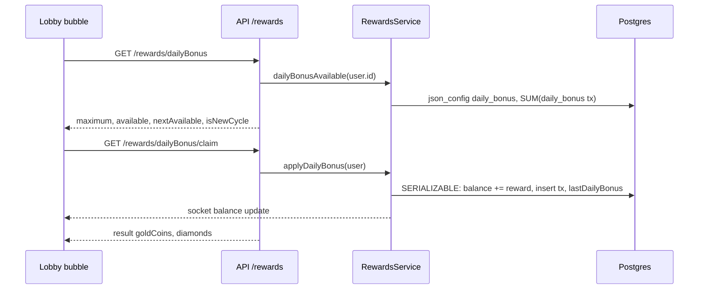

# Promotions and bonuses: how they surface today

Every promotion in SpinQuest today is either a row of data the Backend serves (shop package discounts, `json_config` reward tables, per-user AMOE codes, admin-issued grants) or a hardcoded block in the web client (landing page offer bar, giveaway hero, promotions page copy, VIP rank table). There is no promotion engine: the `promotion` Postgres schema was dropped by migration `DropPromotionDomain`. Coins reach a balance through a short list of transaction types (`daily_bonus`, `login_streak`, `wheel_spin`, `amoe`, `push_notification_bonus`, `affiliate`, `transfer`, `purchase`), and a user is told about a promotion either by a client component that reads one of a few endpoints or by a socket notification.

Backend references are to branch `PeterSons` (effectively Backend main). Mobile references are to `spinquest-mobile-app` `master` at `fce425f0` (2026-11-10); see "Native app" below.

## At a glance

| Piece | Path |
|---|---|
| Daily bonus routes | `Backend/src/api/controllers/main/RewardsController.ts:70-97` |
| Rewards logic (daily bonus, login streak, wheel, push bonus) | `Backend/src/services/RewardsService.ts:60`, `:144`, `:202`, `:297`, `:542` |
| Reward amounts (database config) | `json_config` rows `daily_bonus`, `login_streak`, `wheel_spin`, `push_notification_bonus` (`Backend/src/services/RewardsService.ts:152-153`, `:203-204`, `:411-412`; `:543-545`) |
| Casino lobby daily bonus UI | `spinquest-frontend/src/features/casino/components/lobby-view/casino-lobby-hero/use-daily-bonus-bubble.ts:21` |
| Daily bonus client | `spinquest-frontend/src/lib/api/rewards/index.ts:14-52` |
| Promotions page | `spinquest-frontend/src/features/promotions/components/page.tsx` |
| Shop package offers | `Backend/src/db/entity/ShopPackage.ts:34-39`, `Backend/src/api/controllers/main/ShopPackageController.ts:173`, `Backend/src/services/ShopPackageService.ts:95-111` |
| Landing offer bar and giveaway | `spinquest-frontend/src/features/landing/sections/promo-header-bar/index.tsx`, `spinquest-frontend/src/features/landing/landing-page.tsx:11` |
| AMOE | `Backend/src/api/controllers/main/AmoeController.ts`, `Backend/src/services/amoe/AmoeService.ts`, `Backend/src/services/admin/AmoeService.ts` |
| Vault | `Backend/src/api/controllers/main/VaultController.ts`, `Backend/src/services/VaultService.ts` |
| Affiliate | `Backend/src/api/controllers/main/AffiliateController.ts`, `Backend/src/services/affiliate/AffiliateService.ts` |
| Free spins | `Backend/src/api/controllers/admin/FreeSpinController.ts:95`, `Backend/src/services/Providers/wallet/FreeSpinService.ts` |
| CRM export | `Backend/src/services/optimove/OptimoveETLService.ts`, `Backend/src/api/cron/cronController.ts:98` |
| Admin coin grants | `Backend/src/api/controllers/admin/PlayersController.ts:193` (`PUT /credit/:id`) |
| Ledger types | `Backend/src/db/entity/Transaction.ts:21-38` |
| Vendors | Optimove (export only), game providers (free-spin payouts, `promo_win`) |
| Signup bonus | `Backend/src/services/AuthService.ts:283-289`, `:375-381` (`json_config` `signup_bonus`) |
| Mobile rewards client | `spinquest-mobile-app/src/lib/api/rewards/index.ts:14-53` (daily bonus GET/claim GET/claim POST, `checkPromo`) |
| Mobile daily bonus | `spinquest-mobile-app/src/features/casino/api/use-claim-daily-bonus-mutation.ts:34`, `use-claim-daily-bonus-tap-mutation.ts:54`, `src/features/promotions/components/daily-bonus-banner.tsx:113-144` |
| Mobile lobby widgets and giveaway | `spinquest-mobile-app/src/components/lobby/lobby-widgets/*`, `src/features/giveaway/constants/giveaway.constants.ts` |

## Inventory

"Who changes it" is the deciding column: Backend data can change without a frontend deploy; hardcoded cannot.

| Type | Defined in | User sees it in | Claimed by | Credits | Who changes it |
|---|---|---|---|---|---|
| Signup bonus | `json_config` `signup_bonus` | Starting balance | Automatic at signup | `goldCoins`, `diamonds` (no sweeps) | Database row |
| Daily bonus | `json_config` `daily_bonus` | Casino lobby hero bubble, promotions page banner (web and mobile) | `GET /rewards/dailyBonus/claim` | gold coins and sweeps coins (`diamonds`) | Database row (no endpoint calls `setDailyBonusRewards`, see Gaps) |
| Login streak | `json_config` `login_streak` | No web or mobile UI | `POST /rewards/loginStreak/claim` | per reward row | Database row |
| Wheel spin | `json_config` `wheel_spin` | No web or mobile UI | `POST /rewards/wheel/spin` | per wheel row | Database row |
| Push notification bonus | `json_config` `push_notification_bonus` | Popup notification (socket) | Automatic when `PUT /users` sets `pushNotifications: true` (no mobile caller found, see Gaps) | gold and sweeps coins | Database row |
| New player offer, first 15 minutes, one-time 50K GC | `shop_package.discount` | Shop, promotions page (one-time offer only) | Purchase flow (the 50K offer has price 0) | package coins | `shop_package` rows via `/admin/shopPackage` |
| Shop package bonus coins, regular price | `shop_package` columns | Shop banners and cards | Purchase | `goldCoins`, `diamonds` on the package | `shop_package` rows |
| AMOE mail-in | `amoe_transaction` row per user | `/amoe` page (code) | Support accepts the mailed entry | fixed amount in code | Hardcoded in `AdminAmoeService` |
| Vault | `vault` table | `/vault` | Deposit and withdraw | moves the user's own coins, no credit | n/a |
| Affiliate and referral | `affiliate_*` tables, `affiliate_settings` | `/affiliate-program` | `POST /affiliate/redeem` | commission to balance | DB settings, gated by env flag |
| Free spins | `free_spin_grant` | Socket-driven free spin modal | Played in the game | provider-side spins, wins as `promo_win` | Admin `POST /admin/free-spins/issue` |
| Admin manual grant | n/a | Balance change | Admin `PUT /credit/:id` | coins, optional `subtype` | Support staff |
| Landing offer bar ("30 coin package for just 10") | Frontend source | Landing page top bar | Opens register modal | nothing directly | Frontend deploy |
| Giveaway hero and prizes (500K, closes 2026-12-31) | Hardcoded in both clients (`spinquest-mobile-app/src/features/giveaway/constants/giveaway.constants.ts`) | Web landing page at `/`; mobile lobby widget and rules dialog (WebView) | Not verified | Not verified | Web and app deploys |
| VIP club | Frontend source (`rank-data.ts`) | `/vip-club` | none | none | Frontend deploy |
| CRM campaigns (Optimove) | Optimove (external) | Email, SMS outside the app | n/a | n/a | Optimove console |

## The flow

### 1. Daily bonus (the only fully wired claim in the web client)

1. `useDailyBonusStatus` runs `GET /rewards/dailyBonus` with `enabled: !!authToken`, `staleTime` 30 seconds, refetch on window focus (`spinquest-frontend/src/features/casino/api/use-daily-bonus-status.ts:11-17`, `spinquest-frontend/src/lib/api/rewards/index.ts:14-19`).
2. `RewardsController.dailyBonusStatus` returns `RewardsService.dailyBonusAvailable` (`Backend/src/api/controllers/main/RewardsController.ts:79-82`). It reads `json_config` `daily_bonus` as the maximum (`Backend/src/services/RewardsService.ts:152-155`), sets `isNewCycle` when `user.lastDailyBonus` is more than one day old (`:157`), otherwise subtracts the sum of this cycle's `daily_bonus` transactions from the maximum (`:160-180`). `nextAvailable` is `0` while anything is claimable, else cycle start plus one day (`:194-197`).
3. `useDailyBonusBubble` derives `canClaim` and a countdown from that response and refetches when the countdown ends (`use-daily-bonus-bubble.ts:29-59`). The promotions page banner shows the same status (`spinquest-frontend/src/features/promotions/components/daily-bonus-banner.tsx:47,78-82`).
4. Logged out, a tap opens the login modal (`spinquest-frontend/src/features/casino/components/lobby-view/casino-lobby-hero/index.tsx:273-279`; `daily-bonus-banner.tsx:98-108`).
5. Claim: `useClaimDailyBonusMutation` calls `GET /rewards/dailyBonus/claim` (the "claim all" legacy route), zeroes the cached `available` before the request lands, restores it on error, and toasts the gold and sweeps amounts on success (`use-claim-daily-bonus-mutation.ts:20-75`; `spinquest-frontend/src/lib/api/rewards/index.ts:44-52`).
6. `applyDailyBonus` runs in a `SERIALIZABLE` transaction (`RewardsService.ts:60-66`). With no `claim` argument it takes everything available (`:81-85`); with one it caps at available and requires multiples of `maximum / 10` (`:71-79`). If nothing is left it throws `DailyBonusAlreadyRedeemedError`, HTTP 400 (`:88`, `Backend/src/errors/RewardError.ts:44-47`).
7. It adds to `balance.diamonds`, `balance.goldCoins`, and `playThrough` of 3 times the sweeps amount (`:93-107`), inserts `daily_bonus` rows in `transaction` (`:109-113`), pushes the new balance over the socket (`:116`), and sets `user.lastDailyBonus = now()` only on the first claim of a cycle (`:128-132`).
8. The tap-by-tap route `POST /rewards/dailyBonus/claim` exists on the Backend (`RewardsController.ts:84-97`) and in the client library (`spinquest-frontend/src/lib/api/rewards/index.ts:28-39`). `lobby-hero.constants.ts:9-14` says per-tap size is derived from the status response. Not checked: whether a component calls the POST.

### 2. Login streak and wheel spin (Backend only as far as read)

1. `GET /rewards/loginStreak` returns the `login_streak` table plus `nextLoginStreak` and `nextLoginStreakDay` (`RewardsController.ts:99-112`). The streak resets to day 1 after more than two days idle or past the last configured day (`RewardsService.ts:281-295`).
2. `POST /rewards/loginStreak/claim` takes `{ day }` and throws `IneligibleLoginStreakError` if no row has that day (`RewardsController.ts:114-124`, `RewardsService.ts:202-213`).
3. `GET /rewards/wheel` returns an AES-encrypted `state` (`:410`); `POST /rewards/wheel/spin` decrypts it, rejects stale or tampered state (`InvalidWheelStateError`), picks a weighted winner, and for the free spin enforces one per day via `user.lastWheelSpin` (`RewardsService.ts:297-345`). `purchase: true` skips the daily check.
4. `GET /rewards` returns `nextFreeSpin`, `nextDailyBonus`, `nextLoginStreak` timers from user columns (`RewardsController.ts:28-41`).
5. The web client in `spinquest-frontend/src/lib/api/rewards/index.ts` exposes only the three daily bonus calls. The mobile client is the same plus `checkPromo` (`spinquest-mobile-app/src/lib/api/rewards/index.ts:14-53`); mobile has no `loginStreak` reference at all and mentions `wheel` only in type files (`src/types/user.ts`, `src/lib/types.ts`). So neither client calls the wheel or login streak routes.

### 3. Shop package offers (data-driven)

1. The shop calls `POST /balance/shop` (`spinquest-frontend/src/lib/api/shop/index.ts:22`, `use-shop.ts:21`; Backend `ShopPackageController.ts:173-175`, behind `GeoComplyMiddleware`).
2. The Backend loads all packages ordered by price (`ShopPackageService.ts:114-116`). In gold-coin-only states it zeroes `diamonds` and swaps the image (`:118-131`).
3. Per user, `checkShopPackage` hides `new_player_offer` once `user.newPlayerOffer` is set, `first_15_minutes` once `user.first15minutes` is set or the account is older than 15 minutes, `one_time_offer_50k_gc` once `user.oneTime50KGC` is set, and anything over $500.00 unless `user.liftedLimit` (`ShopPackageService.ts:95-111`). Logged out, every package is filtered out (`ShopPackageController.ts:181-186`).
4. The controller keeps the best package per price tier and drops the non-discounted twin when a discounted one has equal content (`ShopPackageController.ts:188-218`).
5. Paid path: on payment success `AsyncShopPackageService` credits the package coins and flips `newPlayerOffer` or `first15minutes` (`Backend/src/services/AsyncShopPackageService.ts:197-211`).
6. Free path: a package with `price === 0` (the 50K GC offer) skips payment, sets `oneTime50KGC` in a `SERIALIZABLE` transaction, and calls `addUserGC` (`ShopPackageService.ts:223-235`).
7. Frontend: the promotions page finds the package whose `discount` equals `OFFERS.ONE_TIME_OFFER_50K_GC` (`spinquest-frontend/src/features/promotions/components/page.tsx:128-132`); its claim opens login when logged out, else the shop package dialog for the billing address step (`first-time-offer-banner.tsx:57-65`). The shop list hides the 50K offer and pulls out `NEW_PLAYER_OFFER` for a banner (`spinquest-frontend/src/features/shop/components/shop-content/index.tsx:56,70`). Only `new_player_offer` and `one_time_offer_50k_gc` are in `OFFERS` (`spinquest-frontend/src/lib/constants/offers.ts:1-4`); `first_15_minutes` has no frontend constant.

### 4. AMOE mail-in entry

1. `/amoe` page calls `GET /users/amoe` via `useAmoeCodeQuery` (`spinquest-frontend/src/features/amoe/api/use-amoe-code-query.ts`, `spinquest-frontend/src/lib/api/amoe/index.ts:20`). Sweeps product only (`@ForProduct('sweeps')`, `AmoeController.ts:10`).
2. `AmoeService.getAmoe` returns the user's pending code or creates one; a code older than 45 days (`3888000000` ms) is replaced (`Backend/src/services/amoe/AmoeService.ts:10-25`). `GET /users/amoe/renew` forces a new code and deletes pending ones (`AmoeController.ts:21-25`, `AmoeService.ts:28-43`).
3. The user mails the code. Support reviews at `POST /admin/amoe/accept/:id` or `/decline/:id` (`Backend/src/api/controllers/admin/AmoeController.ts:49-70`).
4. On accept, `AdminAmoeService.decide` adds 5,000,000 gold coins and 500 sweeps units, `playThrough` of 3 times the sweeps amount, and writes two `amoe` transactions (`Backend/src/services/admin/AmoeService.ts:24-25,96-129`). States are `PENDING`, `ALLOWED`, `DECLINED` (`Backend/src/db/entity/AMOE/AmoeTransaction.ts:12`).

### 5. Vault, affiliate, push bonus, free spins, admin grants

1. Vault: `GET /vault/balance`, `POST /vault/deposit`, `POST /vault/request-withdraw`, `POST /vault/withdraw` (MFA-gated) (`VaultController.ts:27-46`). It moves the user's own coins into a locked store in `SERIALIZABLE` transactions (`VaultService.ts:143,214`). It is not a promotion that credits anything. UI at `spinquest-frontend/src/features/vault/`.
2. Affiliate: `GET/POST /affiliate/campaigns`, `GET /affiliate/referrals`, `GET /affiliate/revenues`, `POST /affiliate/redeem`, `POST /affiliate/campaign-hit` (`AffiliateController.ts:26-94`). `redeemCommission` throws `Error('not implemented')` unless `AFFILIATE_PAYOUT_ENABLED` is true (`AffiliateService.ts:39,499-502`). When on, it credits claimable gold and sweeps commission from a ClickHouse read and records an `affiliate` transaction (`:521-545`).
3. Push notification bonus: when `PUT /users` flips `pushNotifications` on and `pushNotificationsBonus` is false, `pushNotificationsBonus()` credits the `push_notification_bonus` config once (guarded by `UPDATE ... WHERE pushNotificationsBonus = false`), inserts a popup notification and the balance push (`Backend/src/services/UserService.ts:598-620`, `RewardsService.ts:542-600`). The trigger carries an FCM token, so this is a native-app path.
4. Free spins: support calls `POST /admin/free-spins/issue` (role `support`), default expiry 30 days (`FreeSpinController.ts:111-130`). `issueFreeSpins` creates a `FreeSpinGrant` and an `ActionLog` row (`Backend/src/services/admin/FreeSpinService.ts:38-71`). The web client opens a modal when a socket notification arrives with `command === 'freeSpins'` (`spinquest-frontend/src/features/notifications/components/notifications-socket-provider.tsx:93-94`).
5. Admin manual grant: `PUT /credit/:id` on the admin players controller calls `addUserCredit`, which adds `goldCoins` and `diamonds` and takes a `playthroughMulti` (default 1) and an optional `subtype` (`Backend/src/services/admin/UserService.ts:585-608`). Allowed subtypes include `bonus_vip`, `bonus_loyalty`, `good_will`, `promo` (`Transaction.ts:48-55`).

### 6. Landing page and static content

- Landing `/` serves the giveaway variant: `loadServedLandingPage = () => import('./variants/giveaway-500k')` (`spinquest-frontend/src/features/landing/landing-page.tsx:11`). It renders `PromoHeaderBar` and `GiveawayHero`, `GiveawayHowToEnter`, `GiveawayPrizes` (`spinquest-frontend/src/features/landing/variants/giveaway-500k/desktop.tsx:42-52`).
- The top bar text "All players get a 30 coin package for just 10!" is a literal in JSX; its button opens the register modal (`promo-header-bar/index.tsx:26-30`, `spinquest-frontend/src/features/landing/hooks/use-landing-cta.ts:10`). It is not linked to any `shop_package` row.
- `/promotions/:id` is a hardcoded Euro 2024 text page with placeholder "[Casino Name]" (`spinquest-frontend/src/features/promotions/components/detailed-promotion/index.tsx:13-24`).
- VIP club pages and rank tables are static; the level fetch is stubbed (see Gaps).

### 7. Native app (`spinquest-mobile-app`)

1. Daily bonus: same three routes as web. The "claim all" GET is used by `use-claim-daily-bonus-mutation.ts:34` (promotions `daily-bonus-banner.tsx:113-144`); the tap-by-tap `POST /rewards/dailyBonus/claim` is used by `use-claim-daily-bonus-tap-mutation.ts:54` (lobby hero taps).
2. Lobby widgets (`src/components/lobby/lobby-widgets/`): coin offer, daily bonus, giveaway, shop-now bubbles in widget slots. Web has no widget-slot system.
3. `POST /rewards/checkPromo` is pinged from the lobby when logged in and socket-connected, at most every 5 minutes on focus, `retry: false` (`src/app/(tabs)/index.tsx:66-91`, `src/features/casino/api/use-check-promo.ts`). Added in `87f69468` ("ping check promo, sale ribbon", 2026-10-27). The route does not exist on Backend `PeterSons` and never has (`git log --all -S checkPromo` in Backend is empty).
4. `useLimitedOffer` (`src/features/promotions/api/use-limited-offer.ts`) returns a hard-coded mock "Welcome Offer" after a 500 ms delay. No file imports it.
5. Giveaway: prizes, jackpot (`100,000 SC`), close date (`2026-12-31T23:59:59-08:00`) and rules path `/giveaway-500k-rules` are constants (`src/features/giveaway/constants/giveaway.constants.ts`); the rules open in a WebView dialog. Same campaign as the web landing variant, defined separately in each repo.
6. Shop offer constants: no `new_player_offer`, `first_15_minutes` or `one_time_offer` string in mobile `src` (grep). Inferred: mobile shows whatever `POST /balance/shop` returns without special-casing those discounts. Not traced.
7. Push notification bonus: mobile reads the device push token (`src/lib/firebase/notification-service.ts:13`) and wires Optimove push handlers (`src/app/_layout.tsx:47`), but no `pushNotifications` field is sent anywhere in mobile `src` (grep). The Backend credits the bonus only when `PUT /users` flips `pushNotifications` on (`Backend/src/services/UserService.ts:590-612`). See Gaps.

## States and data

- `Transaction.type` values relevant here: `purchase`, `transfer`, `reward`, `wheel_spin`, `daily_bonus`, `login_streak`, `amoe`, `vault`, `push_notification_bonus`, `promo_win`, `affiliate` (`Backend/src/db/entity/Transaction.ts:21-38`). `subtype`: `bonus_vip`, `bonus_loyalty`, `good_will`, `promo`, `game_adjustment`, `social_win` (`:48-55`). `reward` is commented as "low balance free GC".
- `User` columns that gate offers: `lastDailyBonus`, `lastLoginStreak`, `currentLoginStreak`, `lastWheelSpin`, `newPlayerOffer`, `first15minutes`, `oneTime50KGC`, `pushNotificationsBonus` (`Backend/src/db/entity/User.ts:343` for `oneTime50KGC`; others read in the services cited above).
- `ShopPackage.discount` in `new_player_offer | first_15_minutes | one_time_offer_50k_gc`, plus `regularPrice`, `popular`, `goldCoins`, `diamonds` (`Backend/src/db/entity/ShopPackage.ts:34-39,69-71,106-121`).
- `AmoeTransaction.state`: `PENDING`, `ALLOWED`, `DECLINED`.
- Daily bonus state is derived: the cycle sum of `daily_bonus` transactions against `json_config.daily_bonus`; there is no claim table.
- Removed: the `promotion` schema (groups, campaigns, claims) and `shop_package.promotionCampaignId`, dropped by `Backend/src/db/migration/1793304621000-drop-promotion-domain.ts:5-20`. It was created by `1778083200000-promotion-domain.ts`, with follow-ups `1778083126720-promotion-action-log-enum.ts`, `1781814482907-promotion-claim-sweeper-index.ts`, `1782575610169-promotion-claim-race-action.ts`. The `promotion.*` `action_log` enum values stay inert (`:5-8`). `down` recreates empty tables only (`:22-32`). No replacement exists in the code I read: offers are the three `shop_package.discount` values and the `json_config` reward tables.

## Configuration

- `json_config` keys `daily_bonus`, `login_streak`, `wheel_spin`, `push_notification_bonus` (`RewardsService.ts:152,203,411,543`).
- `MESSAGE_AES_KEY` signs wheel state (`RewardsService.ts:305-309`).
- `AFFILIATE_PAYOUT_ENABLED` (default false) gates affiliate redeem and revenue reads (`AffiliateService.ts:39,337,500`).
- `OPTIMOVE_API_KEY` (`Backend/src/services/optimove/OptimoveAPIService.ts:13`).
- `TIMEZONE` is read in `ShopPackageService.ts:78`.
- Constants: AMOE amounts (`Backend/src/services/admin/AmoeService.ts:24-25`), AMOE code lifetime 45 days (`AmoeService.ts:20`), free spin default expiry 30 days (`FreeSpinController.ts:130`), purchase limit above $500.00 needs `liftedLimit` (`ShopPackageService.ts:110`), first-15-minutes window (`:99-103`).
- Route registration for the web pages: `ROUTES.PROMOTIONS`, `VAULT`, `AMOE`, `AFFILIATE_PROGRAM`, `VIP_CLUB` (`spinquest-frontend/src/lib/constants/routes.ts:44,49,53,81,90`); modal behaviour for these is in `spinquest-frontend/src/features/smart-modal-navigation/constants/modal-routes.ts:30-43,73-86`.

## Edge cases and failure handling

- Daily bonus races: `SERIALIZABLE` transaction, and the client drains the cached `available` on send and restores it on error (`use-claim-daily-bonus-mutation.ts:25-37,78-83`). A 200 with `success: false` also restores it (`:41-48`).
- Geo and blocked-state gates on rewards are commented out: `// @UseBefore(GeoComplyMiddleware, BlockedStatesMiddleware)` (`RewardsController.ts:24`). Shop list and purchase routes do apply `GeoComplyMiddleware` (`ShopPackageController.ts:175,147,228`).
- Shop purchase also requires KYC on initiate (`options: { withKyc: true }`, `ShopPackageController.ts:145`).
- Free offer claim failure: if the `oneTime50KGC` update does not affect exactly one row it throws `InternalError` (`ShopPackageService.ts:229-230`).
- AMOE: product-gated to sweeps; support-only decisions; a second decision on a non-pending row is rejected by an update that must affect one row (`Backend/src/services/admin/AmoeService.ts:83-88`, as read in the excerpt).
- Affiliate redeem: off by default, returns a generic error (`AffiliateService.ts:500-502`).

### The 401 on `GET /rewards/dailyBonus` (2026-11-10, staging)

The route requires a user token: `@Authorized({ api: 'user' })` on the whole controller (`RewardsController.ts:22`), and the checker routes `api: 'user'` to `UserAuthService.authCheck` (`Backend/src/auth/authorizationChecker.ts:99-110`). That function can produce 401 three ways for this URL:

1. No bearer token: `NoTokenError`, 401 (`Backend/src/auth/UserAuthService.ts:45-48`, `Backend/src/errors/UserError.ts:34-38`).
2. Any invalid, expired, wrong-audience, force-logged-out, or deleted-account token: `checkAuthentication` catches everything and rethrows `InvalidTokenError`, 401 (`Backend/src/services/UserService.ts:410-444`, `UserError.ts:46-50`).
3. A valid token for a user whose phone or email is not confirmed, on any URL that starts with `/rewards/`: `UnverifiedEmailPhoneError`, 401, message "Please verify your phone number and email" (`UserAuthService.ts:56-62`, `UserError.ts:40-44`).

The Terms gate does not explain a 401: it throws `TermsNotAcceptedError`, a `ForbiddenError` (403) (`Backend/src/errors/TermsError.ts:12-16`, `UserAuthService.ts:64-77`).

Frontend side: the query runs whenever `authToken` is in the store, with no check of email or phone confirmation (`use-daily-bonus-status.ts:16`), and it calls plain `GET /rewards/dailyBonus` (`spinquest-frontend/src/lib/api/rewards/index.ts:17`). So a logged-in session whose account is unverified, or whose stored token is stale, fires the call and gets 401. Which of the three applied on that day cannot be told from the code. Inferred: cause 3 is the one specific to `/rewards/` and is worth checking first on the staging account. How the web client reacts to a 401 on this query was not read (`spinquest-frontend/src/lib/api/interceptors.test.ts` references invalid-token handling on 401).

## What the team has already said

- `central-tech/TODO.md:386-390`: the affiliate payout cron has been off since 2025-06-01; the remaining path is redeem behind `AFFILIATE_PAYOUT_ENABLED`, whose production value nobody has checked, and it reads a ClickHouse view not in git.
- `central-tech/TODO.md:179-181,282`: Optimove has no sandbox; sandbox uses production's account for SpinQuest only; the daily Optimove export is `OptimoveETLService` over SFTP at 10:00.
- `central-tech/drafts/legacy-parity-compliance.md:162,217-219`: the Optimove export carries `KYC_Status` and opt-in flags; a cron pulls Optimove email unsubscribers back into `marketingEmails`; SMS opt-outs are not synced back.
- `central-tech/drafts/back-office-to-control-plane.md:124`: `/admin/amoe/*` and `/admin/free-spins/*` are listed among back-office routes.
- `central-tech/drafts/spinquest-on-central.md:67`: `pushNotificationsBonus`, `lastWheelSpin`, `lastDailyBonus`, `lastLoginStreak`, `currentLoginStreak` are listed as user columns.
- Nothing found in the files I grepped on the `DropPromotionDomain` migration, VIP level, or daily bonus.

## Gaps, oddities, and risks

- Push notification bonus may be unreachable: no client found that sends `pushNotifications: true` to `PUT /users` (web has no push; mobile `src` has no `pushNotifications` reference). If so, `json_config` `push_notification_bonus` is configured but never paid. To confirm in the notifications review.
- Wheel and login streak have full Backend implementations and no client in either repo.
- Mobile `POST /rewards/checkPromo` has no Backend route (see Native app).
- The 500K giveaway is defined twice, as constants in the web landing variant and in mobile `giveaway.constants.ts`; a date or prize change needs two deploys and can drift.

- VIP level is a stub: `GET /users/:id/vip-level` ignores `:id` and calls `getUserVipLevel('1')` (`Backend/src/api/controllers/main/UserController.ts:50-56`), which always returns `vipLevel: 0` (`Backend/src/services/UserService.ts:657-662`). The client uses `MOCK_USER_EXP = 0` (`spinquest-frontend/src/features/vip-club/api/user-fetch-level.ts:11`). No VIP reward is credited by code; `bonus_vip` exists only as an admin transfer subtype.
- Setters for the reward tables (`setDailyBonusRewards`, `setLoginStreakRewards`, `setWheelRewards` at `RewardsService.ts:438-472`) have no callers in `Backend/src`; changing amounts means editing `json_config` rows directly. Inferred.
- `GET /rewards/dailyBonus/claim` (state-changing GET) is the claim path the web client uses (`use-claim-daily-bonus-mutation.ts:20`); the POST variant is the newer one.
- Promotion language is hardcoded and can drift from data: the landing bar "30 coin package for just 10" is JSX text, not a `shop_package` row (`promo-header-bar/index.tsx:26-30`).
- `first_15_minutes` is a backend discount value missing from the frontend `OFFERS` constants (`offers.ts:1-4`).
- `/promotions/:id` is a stale Euro 2024 draft with a "[Casino Name]" placeholder and a "100% Welcome Bonus" claim that no code backs (`detailed-promotion/index.tsx:13-24`).
- Rewards routes skip geo and blocked-state middleware (commented out, `RewardsController.ts:24`) while the shop applies them.
- `/rewards/` unverified-user 401 is keyed on URL prefix (`UserAuthService.ts:59`); the frontend does not pre-check verification.
- AMOE amounts are literals in a constructor, so changing them needs a Backend deploy (`Backend/src/services/admin/AmoeService.ts:24-25`).
- Signup bonus: correction to an earlier version of this note. Signup does credit coins: `getUserSignupBonus` reads `json_config` `signup_bonus` and seeds the new `Balance` with `goldCoins` and `diamonds` (`Backend/src/services/AuthService.ts:283-289`, `:375-381`). See `signup-and-onboarding.md`. The `SIGNUP_*_COINS_BONUS` env vars in `.env.example` are unused.

## Not verified

- Production and staging values for `AFFILIATE_PAYOUT_ENABLED`, the contents of `json_config` rows (reward amounts), and `shop_package` rows (which discounts are live).
- Whether any frontend component calls `POST /rewards/dailyBonus/claim`, the wheel, or login streak routes; only the first 60 lines of `spinquest-frontend/src/lib/api/rewards/index.ts` were read.
- Native app: read for rewards, daily bonus, giveaway, limited offer and push token. Not read: how mobile renders shop discount packages, the "sale ribbon" in `shop-card.tsx` that `checkPromo` was meant to feed, and any free-spin handling (no `freeSpins` reference in mobile `src`).
- Whether another service answers `/rewards/checkPromo` in production.
- The giveaway entry mechanics and prizes (components in `spinquest-frontend/src/features/landing/sections/giveaway-*` were not read past their imports).
- How the web client handles a 401 from `/rewards/dailyBonus` (interceptor not opened) and which of the three 401 causes hit staging.
- Optimove campaign configuration (external); the code only exports data and syncs unsubscribers (`OptimoveETLService.ts:45,189,271,356,390`).
- `PUBLIC` MDX content under `spinquest-frontend/public/mdx/` (only `responsible-gaming` listed; no promotion MDX seen).
- Whether a signup or welcome bonus exists outside the files searched.
