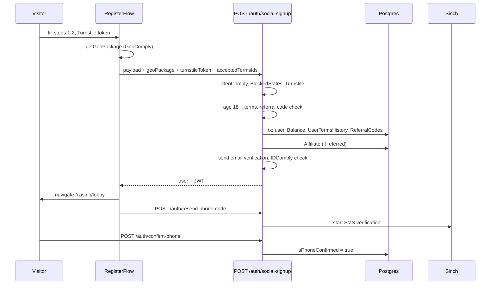

# Signup and onboarding: how it works today

A visitor registers on the web client with a two-step form (email/password only), which posts once to `POST /auth/social-signup`. The Backend validates age and terms, creates the user, balance, referral code and terms history in one transaction, runs an IDComply check, and returns a JWT. The account is then "usable" for gold-coin play only after the phone number is confirmed through Sinch; email confirmation, KYC and MFA gate later actions (redeem, rewards, merch), not entry to the lobby. The web client has no Google, Apple or Meta signup UI; those providers are supported by the Backend only (native app side not readable here).

## At a glance

| Piece | Path |
|---|---|
| Auth page route (`/auth/login`) and email-confirm route | `spinquest-frontend/src/features/auth/route.factory.ts:11`, `:22` |
| Register form (step 1 and 2, Turnstile, geo, terms) | `spinquest-frontend/src/features/auth/components/auth-page/register-flow.tsx:234` |
| Signup mutation | `spinquest-frontend/src/features/auth/api/use-social-register.ts` |
| Signup API client | `spinquest-frontend/src/lib/api/auth/index.ts:32` (`/auth/social-signup`) |
| Referral/landing-code capture | `spinquest-frontend/src/app/providers/referral-code-provider.tsx:38` |
| Phone verification dialog (hard gate) | `spinquest-frontend/src/features/auth/components/verify-number-otp/index.tsx:39` |
| Email confirm page | `spinquest-frontend/src/features/auth/components/confirm-email/index.tsx` |
| App-wide guards (terms, KYC) | `spinquest-frontend/src/components/common/app-guards/index.tsx:20` |
| Signup route and OAuth relay routes | `Backend/src/api/controllers/main/AuthController.ts:98`, `:306-346` |
| Signup logic | `Backend/src/services/AuthService.ts:292` (`socialCasinoSignupService`) |
| OAuth provider verification | `Backend/src/services/SocialOAuthService.ts:370` (`getAuthProviderData`) |
| Phone verification vendor | `Backend/src/services/sinch/SinchService.ts` (Sinch) |
| Terms | `Backend/src/services/TermsService.ts`, `Backend/src/services/terms/checkpoints.ts`, `Backend/src/api/controllers/main/TermsController.ts:47` |
| Geo gates | `Backend/src/api/middlewares/custom/GeoComplyMiddleware.ts`, `BlockedStatesMiddleware.ts`, `Backend/src/utils/geolocation.ts` |
| Captcha | `Backend/src/utils/turnstile.ts:71` (Cloudflare Turnstile) |
| KYC | `Backend/src/services/kyc/KycVerificationService.ts`, `Backend/src/api/controllers/main/KycController.ts:19`, webhooks `Backend/src/api/controllers/kyc/KycController.ts:24` (Veriff) |
| Affiliate | `Backend/src/services/affiliate/AffiliateService.ts:169,210,257` |
| Tables written at signup | `users`, `Balance`, `UserTermsHistory`, `ReferralCodes`, `AffiliateConfig`, `Affiliate` (entities; table names not checked) |

## The flow

### Main path: web email/password signup

1. `ReferralCodeProvider` reads `?u=` (referral) and `?lpc=` (landing-page code) from the URL and keeps them in cookies `referralCode` and `lpReferralCode` (`referral-code-provider.tsx:7-8`, `:39-40`). Comment in file: landing code overrides for 24h, referral code cookie lasts 30 days (`:47`, `:58`). `RegisterFlow` prefills `referralCode` from it (`register-flow.tsx:131-137`).
2. Visitor opens the auth modal/page (`/auth/login`, `route.factory.ts:11`). `RegisterFlow` step 1 collects email and username; step 2 the rest. A single Turnstile widget is mounted from step 1 with `action="signup"` (`register-flow.tsx:319`).
3. The form loads active signup terms with `useTerms(true)` (`register-flow.tsx:98`), served by anonymous `GET /terms` returning the `SIGNUP` checkpoint documents (`TermsController.ts:47-50`). Submit is disabled while terms are fetching (`register-flow.tsx:300`).
4. On submit, the client first obtains a GeoComply package with `useGeoLocation('SignUp')`. A geo failure aborts signup and shows the regional error modal (`register-flow.tsx:236-244`).
5. The client builds the payload: `source: web`, `country: 'USA'` hardcoded, `state` from the form, ISO `dob`, normalized phone, `phoneNumberVerificationMethod: 'sms'`, `isMarketingSMSEnabled`, `referralCode`, `geoPackage`, `turnstileToken`, `acceptedTermsIds` (all active ones), `language` (`register-flow.tsx:246-267`). It calls `POST /auth/social-signup` (`use-social-register.ts`, `lib/api/auth/index.ts:32`). It adds the PostHog device header only when `ENABLE_SERVER_FLAGS` is on.
6. Backend middleware order on the route: `CheckIPAuthMiddleware`, then `GeoComplyMiddleware`, `BlockedStatesMiddleware`, `PixelMiddleware` (`AuthController.ts:99-100`).
   - `GeoComplyMiddleware` accepts a valid signed `geoToken` cookie, else requires `geoPackage` in the body and calls `analyzeGeoPackage`; a missing package throws `ForbiddenError('IPChanged|<type>')` (`GeoComplyMiddleware.ts:81-100`). It sets `res.locals.state` to the resolved region.
   - `BlockedStatesMiddleware` throws `BlockedStateError` unless `isStateAllowed(state)` (`BlockedStatesMiddleware.ts:26-32`).
7. Controller verifies Turnstile (`verifyTurnstile(body.turnstileToken, 'signup', ip)`) unless `source` is `ios` or `android`; failure throws `CaptchaRejectedError` (`AuthController.ts:108-114`). A missing token returns false (`turnstile.ts:76`).
8. `socialCasinoSignupService` (`AuthService.ts:292`):
   1. Rejects dob under 18 with `BadRequestError('Must be atleast 18 years old to sign up')` (`:296-299`).
   2. Reads the active `SIGNUP` terms; keeps only submitted ids that are active; when `NEW_TERMS` is on and fewer than all active ids were accepted, throws `BadRequestError('Terms must be accepted')` (`:317-319`).
   3. Generates the user's own 7-char referral code (`:325`, `AffiliateService.ts:55`).
   4. Password branch: hashes the password (`:333-345`). Provider branch: see "Social signup" below.
   5. Sets `username`/`email` lowercased, `country`, `state`, `dob`, `phoneNumberNew` (not `phoneNumber`), `phoneNVM = 'sms'` (`:330-366`). Every signup starts with `marketingEmails = true` (`:370`); `marketingSMSs` follows the SMS checkbox (`:372`).
   6. Builds a `Balance` from the `signup_bonus` row in `json_config`: `goldCoins` and `diamonds` (`:375-381`).
   7. If `referralCode` is in the payload, `checkReferralCode` must return a code with a live owner, else `BadRequestError('Invalid referral code')` (`:393-403`).
   8. One DB transaction saves user, balance, `UserTermsHistory` rows (method `SIGNUP`, with IP and language) and `createUserCampaign` (the user's own `ReferralCodes` + `AffiliateConfig`) (`:407-421`). Unique violations go through `processUserErrors`.
   9. After commit: if a referral code was supplied, `createAffiliateWithCode` links referrer and referred (`:438-443`). If the email is not confirmed, `sendUserVerificationEmail` sends the confirmation mail (`:446-448`). Phone verification is not started here (call commented out, `:449-450`).
   10. IDComply: skipped for geo-bypass usernames, else `idComplyService.check(user)` (`:452-455`). On pass: `updateLastLoginTimestamp` and returns `{ user, token }` from `generateUserToken` (`:456-465`). On fail: soft-deletes the user with `deletedReason: 'idComply'` and throws `ForbiddenError('IDComply failed')` (`:468-476`).
9. Controller sets `res.locals.setGeoToken = 300` (`AuthController.ts:119`), fires Meta `CompleteRegistration` and Snapchat `SIGN_UP` pixels (`:121-148`), optionally embeds feature flags, and returns `{ success, user, token }`.
10. Client `onSuccess`: `onSuccessAuth(user, token)`, caches the user, emits the socket `auth` event if connected, and activates the casino FTUE only if `user.isPhoneConfirmed` (`use-social-register.ts:29-37`). It fires `trackEvent sign_up`, resets stored form data and navigates to `ROUTES.CASINO_LOBBY` (`register-flow.tsx:269-282`).

### Phone verification (required before play)

1. `PhoneVerificationDialog` computes `isVerificationRequired = user && !user.isPhoneConfirmed` (`verify-number-otp/index.tsx:39`). While true it forces navigation under `/casino`, is non-dismissable, and starts at step `verify-number` if a phone exists, else `enter-phone` (`:46-60`, `:84-91`). It waits behind the FTUE if that is active (`:56-59`).
2. The first code is sent with `POST /auth/resend-phone-code` (`useResendPhoneCodeMutation({ isInitialSend: true })`, `phone-verification-dialog.tsx:87-88`). A changed number uses `POST /auth/request-update-phone`; `POST /auth/request-phone-verification` also exists (`AuthController.ts:387-412`).
3. `AuthService.resendPhoneCode` checks `attackProtectionService.isUserPhoneVerificationAllowed`, then `sinchVerificationService.startVerification(user.phoneNumberNew, user.phoneNVM)` (`AuthService.ts:678-690`).
4. The user submits the code to `POST /auth/confirm-phone`. `confirmUserPhone` calls `verifyCode`, then sets `isPhoneConfirmed = true` and copies `phoneNumberNew` into `phoneNumber` (`AuthService.ts:697-716`). If a unique index `users_phoneNumber_ukey` fires, the user is soft-deleted with `deletedReason: 'phoneLock'` and the call returns `InternalError('Could not verify phone')` (`:723-741`).
5. When the user flips to confirmed, the dialog closes and `activateFtue()` runs (`verify-number-otp/index.tsx:64-70`).

Bypass: `DANGEROUS_PHONE_VERIFICATION_BYPASS_CODE` is read in `SinchService.ts:29-31`. In production the value is forced to `''` (`:29`) and an error is logged if it is still set (`:43-45`). Outside production, `verifyCode` returns true for that code on any number (`:76`), and `startVerification` reports "sent" when Sinch fails (`:60-63`).

### Email verification (not required to enter the lobby)

1. At signup, `sendUserVerificationEmail` sends a link (`AuthService.ts:447`, template env `EMAIL_VERIFICATION_TEMPLATE_NAME`). A logged-in user can resend with `GET /auth/request-email-verification` (`AuthController.ts:351`; throws `UserEmailAlreadyVerifiedError` if already confirmed, `AuthService.ts:484`).
2. The link opens `/auth/confirm-email?token=...`; the route loader redirects home when `token` is missing (`route.factory.ts:22-31`). The page calls `POST /auth/confirm-email`.
3. `confirmUserEmail` verifies the JWT with `JWT_EMAIL_VERIFICATION_SECRET_KEY`, maps expiry to `ExpiredEmailConfirmationTokenError`, and sets `isEmailConfirmed = true` (`AuthService.ts:517-541`).
4. `DANGEROUS_EMAIL_LOGIN_CODE_BYPASS_CODE` (`LoginCodeService.ts:29`) is the email-code analogue, used for login challenges, not signup. Production forces it empty (`:70`); outside production it verifies the code for any account (`:258-259`) and reports "sent" when email send fails (`:220`).

### Social signup (Google, Apple, Meta): Backend only

1. Provider redirects hit `POST /auth/apple/relay`, `GET /auth/google/relay`, `GET /auth/meta/relay` (`AuthController.ts:306-338`). Each stores the verified profile and redirects to `${APP_URL}/auth/callback?exchangeId=...&provider=...`.
2. `GET /auth/:provider/exchange/:exchangeId` returns email, first and last name (`AuthController.ts:340-345`).
3. The client then posts `POST /auth/social-signup` with `authSecretType` set to the provider and `authSecret` the token. `getAuthProviderData` validates it; the provider email must equal the body email or the call fails with `Email does not match your social login provider` (`AuthService.ts:340-351`).
4. The user gets the provider id on its provider column, `allowSocialLogin = true`, and `isEmailConfirmed` takes the provider's `emailVerified` (`:354-358`), so no verification mail is sent when the provider vouched for the email. Exchange tokens are cleaned up afterwards (`:424-436`).
5. Web client: no `/auth/callback` route, no `exchangeId` use and no provider buttons exist in `spinquest-frontend/src` (grep found none; `authSecretType` appears only as `PASSWORD` in `features/auth/hooks/use-login-form.ts:139`). Inferred: the native apps drive this path.

## States and data

What "onboarded" means in code. There is no single onboarded flag. These fields gate actions:

| Field (entity) | Set by | Gates |
|---|---|---|
| `User.isPhoneConfirmed` (`Backend/src/db/entity/User.ts:186`) | `confirmUserPhone` (`AuthService.ts:715`) | `User.isVerified()` is exactly this (`User.ts:407`). `POST /apps/load/:gameId` throws `Phone not Verified!` without it, for both currencies (`AppsController.ts:131-132`). Web: game tiles open the phone dialog instead of the game (`game-item.tsx:104`); the dialog is a hard gate (`verify-number-otp/index.tsx:39`). Also blocks `/rewards/` routes (`UserAuthService.ts:57-62`). |
| `User.isEmailConfirmed` (`User.ts:183`) | `confirmUserEmail` (`AuthService.ts:541`) or provider-verified at social signup (`:356`) | Not needed to play or enter the lobby. Needed with phone for `isVerifiedFully()` (`User.ts:411`): `POST /shop/redemption` (`ShopPackageController.ts:361-362`), `/rewards/` (`UserAuthService.ts:57-62`), merch (`MerchCatalogService.ts:42`). Web redeem flow checks both and opens dialogs (`use-redemption-verification.ts:55-63`). |
| `KycVerification.status` (`KycStatus`: `PENDING`, `VERIFIED`, `FAILED`, `REQUIRED`; `Backend/src/db/entity/Kyc/KycVerification.ts:26-31`) | Veriff webhooks and cron, admin `requireKyc` | `POST /shop/redemption` throws `KYC Verification Required` unless `status === 'VERIFIED'` (`ShopPackageController.ts:358-359`). Merch catalog also requires `VERIFIED` (`MerchCatalogService.ts:36`). |
| `KycVerification.ageStatus` | `KycVerificationService.ts:368-374` | Web opens the `KYC_AGE` guard on `FAILED` or `REQUIRED` (`app-guards/index.tsx:41-45`). |
| `User.termsCurrent` (computed, `User.ts:283`) | `TermsService.isUserTermsCurrent` | Web opens `AppGuardType.TERMS` when `false` (`app-guards/index.tsx:32`). Every authenticated request (except routes with `acceptTerms: true`) throws `TermsNotAcceptedError` when behind (`UserAuthService.ts:65-76`). |
| `User.mfaEnabled` (`User.ts:279`) | MFA enrollment | `MfaGateMiddleware` on redemption and `GET/POST` user routes (`ShopPackageController.ts:353`). Enrolling needs `isPhoneConfirmed` (`MfaService.ts:126`, `:152`). |
| `deletedAt` / `deletedReason` | `idComply`, `phoneLock` set during signup/phone confirm | Soft-deleted users cannot log in (not traced further). |

Gate summary by action (only what was read):

- Play gold coins (`currency` not `FC`): needs a token, terms current, `isPhoneConfirmed`. Geo and state middleware are skipped for non-`FC` loads (`GeoComplyMiddleware.ts:42`, `BlockedStatesMiddleware.ts:18-21`).
- Play sweeps coins (`currency=FC`): all of the above plus a resolved geo state that is allowed, and not in `goldCoinsOnly` states, else `UnauthorizedError('GeoLocation')` (`AppsController.ts:121-129`). Cards product refuses `GC` (`:114-116`).
- Purchase: `POST /shop/purchase*` routes sit behind `GeoComplyMiddleware` and `BlockedStatesMiddleware` (`ShopPackageController.ts:146-147`, `:227-228`). Phone/email checks for purchase were not found in the controller; the email check in `ShopPackageService` is commented out (`Backend/src/services/ShopPackageService.ts:270`).
- Redeem: `VERIFIED` KYC, phone and email confirmed, geo, MFA gate (`ShopPackageController.ts:352-362`).

Signup bonus: `getUserSignupBonus` reads the `signup_bonus` row of `json_config` (`AuthService.ts:283-289`, name listed in `Backend/src/db/entity/JsonConfig.ts:10`) and writes `goldCoins` and `diamonds` into the new `Balance` (`:379-380`). No sweeps balance is set here.

## Configuration

| Key / flag | Where read | Effect |
|---|---|---|
| `NEW_TERMS` | `AuthService.ts:317`, `TermsService.ts:218`, `:255` | Off: signup does not require terms acceptance, `isUserTermsCurrent` returns true and pending list is empty. On: enforced at signup and on every request. |
| `DANGEROUS_PHONE_VERIFICATION_BYPASS_CODE` | `SinchService.ts:29-31` | Non-production only. See Phone verification. |
| `DANGEROUS_EMAIL_LOGIN_CODE_BYPASS_CODE` | `LoginCodeService.ts:29`, `:70-72` | Non-production only. Login code, not signup. |
| `SIGNUP_GOLD_COINS_BONUS`, `SIGNUP_SWEEP_COINS_BONUS` | `Backend/.env.example:142-143` only | Not read anywhere in `Backend/src` (grep for `COINS_BONUS` finds only `.env.example`). The effective bonus is the `signup_bonus` json_config row. See Gaps. |
| `TURNSTILE_SECRET_KEY`, `TURNSTILE_HOSTNAMES`, `TURNSTILE_ALLOW_TEST_KEYS` | `turnstile.ts:10`, `:16`, `:25` | Secret, accepted hostnames (default `spinquest.com`), accept Cloudflare test keys. |
| `TURNSTILE_SITE_KEY` (frontend) | `spinquest-frontend/src/config/env.ts:96` | Widget site key. |
| `ALLOWED_STATES`, `BLOCKED_STATES` (default `NY,LA,NJ`) | `Backend/src/utils/geolocation.ts:11-16` | Allow-list wins when non-empty; cards product requires the allow-list (`:20-21`). |
| `GEO_WHITELIST`, `LOCAL_ENV` | `geolocation.ts:7-8`, `:23-31` | Usernames (or any username when `LOCAL_ENV`) that bypass geo and IDComply at signup (`AuthService.ts:453`). |
| `@spinquest.com` email suffix | `geolocation.ts:33-36` | `isGeoBypassEmail`; signup uses `body.email` for this on `/auth/social-signup` (`geolocation.ts:44-48`). |
| `JWT_EMAIL_VERIFICATION_SECRET_KEY`, `EMAIL_VERIFICATION_TEMPLATE_NAME` | `AuthService.ts:78-81` | Email confirm token and mail template. |
| `ENABLE_FLAGS_IN_AUTH_RESPONSE`, `ENABLE_SERVER_FLAGS` | `AuthController.ts:79-98`, `use-social-register.ts` | Embed feature flags in the signup response. |
| `APP_URL` | `AuthController.ts` (OAuth redirect) | Target of provider relay redirects. |
| `VERIFF_API_KEY` | `KycVerificationService.ts:100` | KYC session creation. |

## Edge cases and failure handling

- Terms changed mid-signup: Backend throws `Terms must be accepted`; the form shows `auth_terms_outdated` and refetches terms (`register-flow.tsx:184-192`).
- Invalid referral code: field error plus toast (`register-flow.tsx:194-205`). A code whose owner is soft-deleted is also invalid (`AuthService.ts:397-403`).
- Email or username already used: mapped to form fields via `EmailInUseError` / `UsernameInUseError`, and step 1 is re-opened (`register-flow.tsx:47-51`, `:225-229`).
- Turnstile: token mismatch, bad hostname, or Cloudflare non-OK all return false and the Backend answers `CaptchaRejectedError` (`turnstile.ts:90-100`). Apple/Android app signups skip it (`AuthController.ts:108-110`).
- Geo failure on web blocks signup before the request (`register-flow.tsx:238-243`); on the Backend a blocked state returns `BlockedStateError`.
- IDComply failure after the transaction commits: the user row already exists and is soft-deleted with reason `idComply`; the response is 403 (`AuthService.ts:468-476`). Same email/username are then stuck behind a deleted row (Inferred: depends on whether unique indexes ignore `deletedAt`; not checked).
- Verification email send happens after commit and outside the transaction (`AuthService.ts:446-448`); a failure there is not caught in this function.
- Phone code send failure is logged only; the response is `{ success: false }` and there is no thrown error (`AuthService.ts:629-648`, comment `// RAD no error handling`).
- Phone re-use: unique index collision on confirm soft-deletes the second account (`AuthService.ts:723-741`).
- Rate limiting on phone sends: `attackProtectionService.isUserPhoneVerificationAllowed` (`AuthService.ts:678`; internals not read).
- Terms gate for authenticated users: optional-auth endpoints load as logged out so the terms popup can show (`UserAuthService.ts:70-73`).
- Login after signup (not part of signup) uses the same Turnstile, with `login` action, and can return `mfaRequired` or `verificationRequired` challenges (`AuthController.ts:176-224`).
- KYC trigger: no code path in the Backend sets `REQUIRED` automatically at signup. `requireKyc` (admin action `PLAYER_FORCE_KYC`) sets existing rows to `REQUIRED` unless `PENDING` (`Backend/src/services/admin/UserService.ts:698-708`). A row is otherwise created by the user opening `GET /kyc/session` (`KycController.ts:19-25`, upsert at `KycVerificationService.ts:109`). Veriff results arrive on `POST /kyc/webhook/decision` and `/kyc/webhook/event` (`kyc/KycController.ts:24`, `:36`) and by cron `runKycVerificationCron` (`KycVerificationService.ts:458`). Web shows the KYC modal when status is `FAILED` or `REQUIRED` (`app-guards/index.tsx:38-40`) and at redeem when `sessionStatus !== 'approved'` (`use-redemption-verification.ts:26`).
- MFA: not part of signup. Phone confirmation is the prerequisite to enable it (`MfaService.ts:126`, `:152`).

First-time tutorial (casino FTUE) and welcome offers are covered by a separate document; this flow only calls `casinoFtue.activate()` once the phone is confirmed.

## What the team has already said

- `central-tech/TODO.md:104-108`: sign-up keeps `GeoComplyMiddleware` and `BlockedStatesMiddleware` only while Backend is in front of central; "the check before sign-up is no longer legally required (Stan, 2026-11-10)" and is on a cleanup list.
- `central-tech/TODO.md:90`, `:100`: on `feature/auth-central`, auth no longer writes SpinQuest's `users` at sign-up (the Backend here still does).
- `central-tech/TODO.md:453-454`: no link or unlink route after sign-up; only `POST /auth/social-signup` writes the provider id.
- `central-tech/TODO.md:723-729`: planned App Attest / Play Integrity fields on login and sign-up bodies; not started.
- `central-tech/drafts/legacy-parity-inventory.md:105`: signup balance from `signup_bonus` is marked "drop" (wallet and bonus out of scope for the port).
- `central-tech/drafts/legacy-parity-inventory.md:141` and `central-tech/drafts/backend-bugs.md:104`: the phone bypass code is a recorded bug, "Fixed" in central by a stub verifier chosen by mode.
- `central-tech/services/porting/auth.md:112`, `:135`: sign-up balance, terms, IDComply, pixels and social sign-up are CUT from the port; phone bypass replaced by test mode.
- `central-tech/drafts/legacy-rest-audit.md:143`: records that under-18 returns 500 with `Must be atleast 18 years old to sign up`; `:98` notes 503 `AccountNotReady` on social sign-up.
- `central-tech/parity/README.md:39`: staging bypass codes for central are named there (values not repeated here).
- `Backend/docs/`: nothing found specific to signup.

## Gaps, oddities, and risks

- `SIGNUP_GOLD_COINS_BONUS` and `SIGNUP_SWEEP_COINS_BONUS` are documented in `Backend/.env.example:142-143` but never read by code. The bonus comes from the `signup_bonus` json_config row, which only supports `goldCoins` and `diamonds` (`AuthService.ts:379-380`). No sweeps coins are credited at signup by this code.
- Dead client code: `useRegister` posts to `/auth/signup` (`use-register.ts:29`, `lib/api/auth/index.ts:86`). Only a `/auth/social-signup` route exists in the Backend and no component imports `useRegister`.
- Web client only ever signs up with password; provider signup has no web UI, yet `isGeoBypassRequest` and the Backend branch support it.
- `country` is hardcoded `'USA'` on the web client (`register-flow.tsx:250`).
- Phone verification is not started inside signup (commented out, `AuthService.ts:449-450`); the web client relies on the dialog to trigger the first send. A client that skips the dialog gets an account that cannot load games.
- Play gating is phone-only on the Backend (`User.isVerified()`); email confirmation is not enforced for play or purchase (purchase check commented out, `ShopPackageService.ts:270`).
- IDComply failure leaves a soft-deleted user, and the verification email was already sent before the check ran (`AuthService.ts:446-476`).
- `confirmUserPhone` has its "already confirmed" guard commented out (`AuthService.ts:698-700`), so a confirmed user can re-confirm a new `phoneNumberNew`.
- Web `redeem` KYC check uses `sessionStatus === 'approved'` while the Backend checks `status === 'VERIFIED'` (`use-redemption-verification.ts:26` vs `ShopPackageController.ts:358`): two different fields decide the same gate.
- Geo/state checks for gold play are skipped (`BlockedStatesMiddleware.ts:18-21`), so a visitor in a blocked state can sign up and play gold coins, but not sweeps; signup itself is blocked in those states (`AuthController.ts:100`).

## Not verified

- Values of any env key or the `signup_bonus` row in deployed environments.
- Table and column names in Postgres (only entities were read).
- Native app signup (Apple, Google, Meta buttons, `appDeviceId`, attestation); the web client has none.
- Internals of `IDComplyService.check`, `attackProtectionService`, `analyzeGeoPackage`, Sinch SMS delivery, and Veriff decision handling (`KycVerificationService.ts:187-460` only skimmed).
- Whether `/auth/signup` is reachable through any Backend route outside `AuthController`; grep for `'/signup'` under `Backend/src` found none.
- The login path after signup (`UserService.playerLogin`) and how soft-deleted users are treated by unique indexes.
- Purchase gating beyond the controller decorators, and whether `MfaGateMiddleware` applies to signup (it does not appear on `AuthController` signup).
- The `feature/auth-central` branch described in central-tech; this document describes the Backend working tree as checked out.
